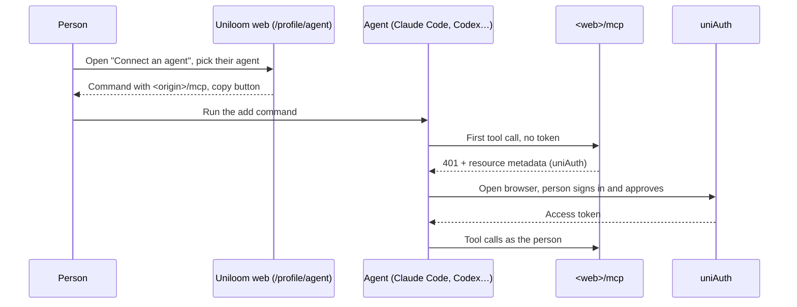

# 38: Connect an agent page

Status: Done

## Scope

A page at `/profile/agent` that shows a signed-in person how to connect their coding agent
to Uniloom's MCP server (plan 33, 34). Web only: no API change, no new rule, so no seed
cases. The layout follows the demo the user approved on 2026-10-13
(https://claude.ai/artifact/Gu6woaWdEoTd5i8tve1H1s), with tabs rounded like other boxes.

- The server address is the site's own origin plus `/mcp`: the web app already proxies
  `/mcp` to the API (`apps/web/next.config.ts`), so the page needs no config.
- Sign-in is uniAuth OAuth (ADR-0012): the page explains it and offers no tokens.
- Agents covered: Claude Code, Codex CLI, Gemini CLI, OpenCode, Cursor, VS Code (Copilot).

Left out:

- Showing whether the person's agent is connected, or a list of connected agents.
- Windsurf, Zed and other agents: easy to add later as one more entry in the list.

## Done when

- [x] `/profile/agent` renders inside the app shell for a signed-in person, and is linked
      from the profile screen and from the sidebar next to Profile.
- [x] The page shows `<window.location.origin>/mcp` with a copy button.
- [x] One tab per agent (the six above), each with an add-the-server step and a sign-in
      step, every command or config with a copy button; the commands match each tool's
      current docs, linked in a comment next to the list.
- [x] A "How sign-in works" section (first use opens uniAuth, sign in and approve, the
      agent then works as you) and a "What your agent can do" section that lists, as
      people-only, approving a design, accepting an ADR, and moving to Ready or Done
      (`MVP.md` §9).
- [x] The page reads well in light and dark themes and at phone width, using the
      existing `ui/` components (tabs, button) and theme tokens.

## Design

| Function                 | File                                                 | What                                                                                            | Why                                                                  |
| ------------------------ | ---------------------------------------------------- | ----------------------------------------------------------------------------------------------- | -------------------------------------------------------------------- |
| `ProfileAgentPage`       | `apps/web/src/app/profile/agent/page.tsx`            | `AppShell` around `ConnectAgent`, loaded with `dynamic(..., { ssr: false })`                    | Same pattern as `/profile`: the page reads `window.location.origin`  |
| `ConnectAgent`           | `apps/web/src/components/agent/connect-agent.tsx`    | Header, server address, setup tabs, sign-in steps, can/people-only lists, a first prompt to try | The page body                                                        |
| `AgentSetupTabs`         | `apps/web/src/components/agent/agent-setup-tabs.tsx` | `ui/tabs` with one tab per agent; each panel lists its steps as `CopyBlock`s                    | Keeps the tab markup out of the page body                            |
| `agentSetups(serverUrl)` | `apps/web/src/components/agent/agent-setups.ts`      | Returns the six agents: name, and steps (title, where it's run, text)                           | The commands are data; adding an agent is one entry                  |
| `CopyBlock`              | `apps/web/src/components/agent/copy-block.tsx`       | A `<pre>` with a Copy button (`navigator.clipboard.writeText`, toast on success or failure)     | Used for every command and the server address: well over three times |
| `Profile` (changed)      | `apps/web/src/components/user/profile.tsx`           | Adds a "Connect an agent" link to `/profile/agent`                                              | Where people look for account settings                               |
| `AppSidebar` (changed)   | `apps/web/src/components/shell/app-sidebar.tsx`      | Adds a "Connect an agent" link next to Profile                                                  | Found without opening the profile first                              |

## Changes

Commits: `8b8a700 feat(web): add connect-an-agent page`.

- `apps/web/src/app/profile/agent/page.tsx`: new route; `AppShell` around `ConnectAgent`,
  loaded with `dynamic(..., { ssr: false })` like `/profile`. `/profile/*` is already
  protected by `src/proxy.ts`.
- `apps/web/src/components/agent/connect-agent.tsx`: header with a breadcrumb back to
  Profile, the server address (`window.location.origin + "/mcp"`) in a `CopyBlock`, the
  setup tabs, "How sign-in works" (three steps), "What your agent can do" (Agent /
  People only, MVP.md §9) and a "Try it" prompt.
- `apps/web/src/components/agent/agent-setup-tabs.tsx`: `ui/tabs` restyled as wrapping,
  boxed tabs (`rounded-lg`, not pills); each panel numbers its steps and puts every
  command or config in a `CopyBlock`; Codex and Gemini also get an "Or edit the config
  file" `
`.
- `apps/web/src/components/agent/agent-setups.ts`: the six agents as data, with the doc
  links (checked 2026-10-13) in a comment above the list.
- `apps/web/src/components/agent/copy-block.tsx`: `<pre>` plus an outline `Button` that
  copies with `navigator.clipboard.writeText` and toasts success or failure.
- `apps/web/src/components/user/profile.tsx`: "Connect an agent" link above "Manage
  account".
- `apps/web/src/components/shell/app-sidebar.tsx`: "Connect an agent" (`Plug` icon) in
  the sidebar footer, right above the Profile link, active on `/profile/agent`.

Planned vs actual:

- As planned, plus two small additions from the approved demo: the config-file
  alternative for Codex and Gemini (`config` on a setup) and the "Try it" prompt.
- Steps have an optional `note` (shown, not copied) instead of the demo's `#` comments
  inside code; Cursor and VS Code sign-in are UI steps, so they show only a note.
- Commands that differ from the demo after checking the docs: Claude Code's sign-in note
  says "follow the steps in your browser" (the docs don't name an "Authenticate" item);
  Cursor's and VS Code's sign-in notes are worded generally, since their docs give no
  exact button labels ("Needs login", "Start → Allow" were not in the docs). VS Code's
  step points to "MCP: List Servers", which the docs do name.
- The "Try it" prompt no longer names the demo project `TG`.
- Open: none of the six setups sends a client ID, and `/mcp` only names uniAuth as the
  authorization server. Whether any agent can sign in depends on uniAuth letting agents
  register themselves (dynamic client registration or client metadata documents), which
  this repo doesn't record. VS Code's reference even documents an `oauth` object with a
  required `clientId`. Needs a try against real uniAuth before relying on the page.
- Open: the Gemini CLI docs say Gemini CLI was replaced by Antigravity CLI for unpaid and
  Google One users on 2026-06-18, so the Gemini tab may not apply to everyone.
- Dropped the demo's "Sign out of uniAuth to cut it off" (review finding): ADR-0012 says
  a revoked token works until it expires (15 minutes, TD-010), and nothing shows that
  uniAuth sign-out revokes an agent's tokens. Add a way to cut an agent off once uniAuth's
  behaviour is confirmed.
- Light, dark and phone width were checked by reading the classes and theme tokens, not
  by rendering the page (it sits behind sign-in and no database was used).
