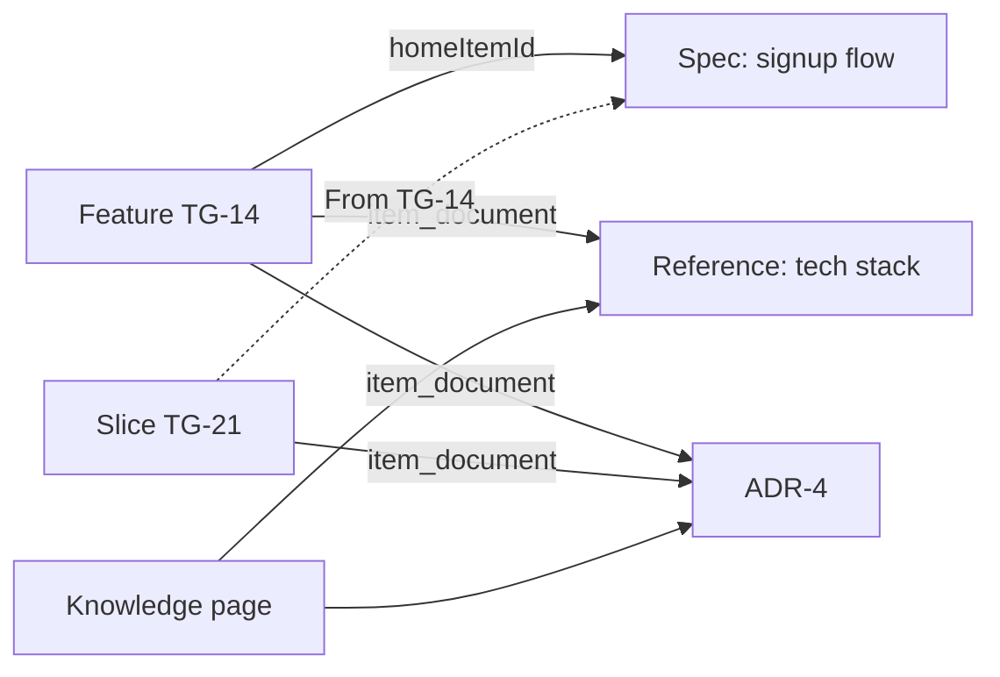
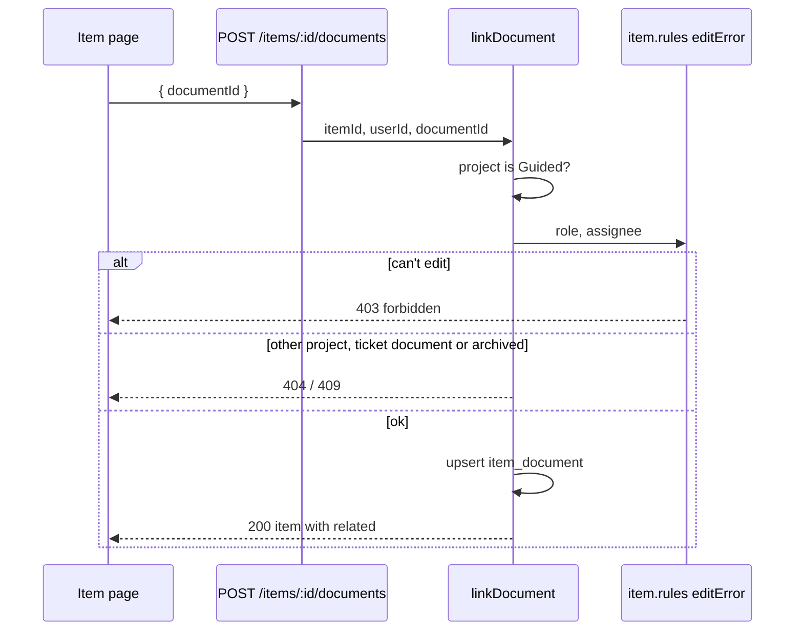

# 39: Ticket documents and links

Status: Done

## Scope

Every document stays one row in the one `document` table (ADR-0014). A document's home is
either the project (shown in Knowledge) or one ticket (`homeItemId`). A ticket shows its
own documents and the Knowledge documents linked to it in a **Related** section under the
description. First of three plans the user confirmed on 2026-10-13: 39 ticket documents
and links, 40 ADRs, 41 tech debt.

- **Guided projects only** (user decision): Guided is for coding work, Standard for other
  tasks. In a Standard project the item page has no Related section and these endpoints
  answer `409 guided_only`. Knowledge documents (plan 15) stay in both modes.
- **Ticket documents:** a feature's spec lives on the feature ticket ("New spec"), stored
  as a `document` row with `homeItemId` set and never in `item_document`. It goes with
  the ticket and is hidden from Knowledge unless "Show ticket documents" is on. Slices
  show their parent's documents as "From FEATURE-KEY", read only. Specs are optional: no
  gate requires one (user decision).
- **Knowledge documents** (tech stack, product-wide specs, references, and the ADRs and
  tech debt of plans 40 and 41) are linked to tickets, many to many, through
  `item_document`, which stores ids only.
- **Who** (user decision, 2026-10-13): writing a spec on a ticket, editing it, and linking
  or unlinking follow the ticket's edit rule (`editError`, plan 37): a Member on tickets
  assigned to them, Owners and Managers on any. Writing on the Knowledge page, and
  editing any Knowledge document, stays Owners and Managers by current role
  (plan 15, `dc3ec48`). Every member reads.
- **Created by:** documents keep `authorId` and `createdAt` as now; `createdFromItemId`
  records once the ticket a document was created from, so the page ends with "Created by
  NAME from TICKET-KEY" even if a link is later removed.
- Archived documents can't be newly linked; existing links stay and show as archived.

Left out:

- ADR and tech-debt kinds: plans 40 and 41.
- Change documents (§8): a later Record slice; they'll be ticket documents too.
- MCP document tools (`save_document`, `get_document`, `list_documents`): plan 42.
- Mapping plan 15's kinds onto §8's types: TD-012 stays open.

Note on order: MVP §14 puts ADRs (slice 7) before Record (slice 10). This plan comes first
because plans 40 and 41 need ticket documents and links. User to confirm.

## Done when

- [x] Migration: `document.homeItemId` (cascade), `document.createdFromItemId` (set null)
      and `item_document` (itemId, documentId, createdAt; cascade on both sides).
- [x] `POST /api/items/:id/documents/new` `{ kind, title, purpose, body }` creates a ticket
      document (kind `SPEC` or `REFERENCE`, `homeItemId` and `createdFromItemId` set):
      `403` with `editError`'s message when the person can't edit the ticket, `409
guided_only` in a Standard project; `PATCH /api/documents/:id` on a ticket document
      follows the same edit rule. `GET /api/projects/:id/documents` leaves ticket
      documents out unless `includeTicketDocuments=true`.
- [x] `POST /api/items/:id/documents` `{ documentId }` and
      `DELETE /api/items/:id/documents/:documentId` link and unlink a Knowledge document:
      `403` with `editError`'s message, `404` for another project's, a deleted or a
      ticket document, `409 document_archived`, `409 guided_only`; linking twice is a
      no-op.
- [x] `GET /api/items/:id` and MCP `get_item` return `related`: the ticket's own and
      linked documents and its parent's (with the parent's key), each with id, kind,
      number, title, status, archived and `home: "ticket" | "project"`, without bodies;
      `GET /api/documents/:id` returns its home ticket, `createdFrom` and the `items`
      linking to it.
- [x] Web: the item page's Related section (grouped by kind, "New spec", "Link a
      document" picker, remove buttons, each hidden when not allowed); the document page
      shows its home ticket or "Linked tickets" and ends with "Created by NAME from
      TICKET-KEY" and the date; Knowledge gets "Show ticket documents".
- [x] Seed: a Guided feature with its own spec and a linked tech-stack reference, a slice
      showing both as inherited, an archived linked doc, a Standard project without
      Related, and items titled with what to try ("Write a spec on your own ticket as a
      member: allowed", "…on someone else's ticket: refused").

## Design

| Function                                      | File                                                     | What                                                                                      | Why                                         |
| --------------------------------------------- | -------------------------------------------------------- | ----------------------------------------------------------------------------------------- | ------------------------------------------- |
| `createTicketDocument(itemId, userId, input)` | `apps/api/src/modules/items/item-document.service.ts`    | Guided check, `editError`, creates the document with `homeItemId` and `createdFromItemId` | A feature's spec lives on its ticket        |
| `linkDocument(itemId, userId, docId)`         | same                                                     | Guided check, `editError`, same project, Knowledge document, not archived, upserts link   | The one place the linking rules run         |
| `unlinkDocument(itemId, userId, docId)`       | same                                                     | Same checks, deletes the link                                                             | Same rule for removing                      |
| `findItemDocuments(itemId, parentId)`         | `apps/api/src/modules/items/item-document.repository.ts` | One `document.findMany`: `homeItemId` in [item, parent] or a link to either               | Feeds `GET /items/:id`, `get_item`, Related |
| `updateDocumentById` (changed)                | `apps/api/src/modules/documents/document.service.ts`     | A ticket document checks the ticket's `editError`; any other keeps the current-role check | One `if`, both rules in one place           |
| `listDocuments` (changed)                     | same                                                     | Adds `homeItemId: null` unless `includeTicketDocuments`                                   | Knowledge stays project scope               |
| `RelatedDocuments`                            | `apps/web/src/components/items/related-documents.tsx`    | Grouped list, remove buttons, inherited group                                             | The section on the item page                |
| `LinkDocumentPicker`                          | `apps/web/src/components/items/link-document-picker.tsx` | Search box over Knowledge documents, links on pick                                        | Adding without leaving the ticket           |
| `LinkedTickets`                               | `apps/web/src/components/documents/linked-tickets.tsx`   | Home ticket, or keys, titles and states of linking tickets                                | The other direction                         |
| `CreatedBy`                                   | `apps/web/src/components/documents/created-by.tsx`       | Avatar, name, "from TICKET-KEY", date                                                     | The page's last line                        |

Rules: reuse, don't rewrite. `editError` (`items/item.rules.ts`) for every ticket-side
check; `CREATORS` and `requireRole` (`members/member.service.ts`) and the existing check in
`updateDocumentById` for Knowledge documents. One new rule function,
`guidedOnlyError(project)` in `items/item.rules.ts`, returns the `guided_only` message or
null, the same shape as `editError`; plans 40 and 41 reuse it.

Schema (ADR-0014; plans 40 and 41 add the rest):

```prisma
model Document {
  // existing: id, projectId, kind, title, purpose, body (Markdown), authorId,
  //           archivedAt, createdAt, updatedAt
  /// Set: belongs to that ticket (e.g. a feature's spec), not listed in Knowledge.
  /// Null: a project document in Knowledge.
  homeItemId        String? @db.Uuid // cascade
  /// The ticket it was created from, set once: "from TG-21".
  createdFromItemId String? @db.Uuid // set null
  links             ItemDocument[]

  @@index([homeItemId])
}

/// Knowledge documents linked to tickets, many to many. Ids only, no content.
model ItemDocument {
  itemId     String   @db.Uuid // cascade
  documentId String   @db.Uuid // cascade
  createdAt  DateTime @default(now())

  @@id([itemId, documentId])
  @@index([documentId])
  @@map("item_document")
}
```





## Changes

Commits `6f7868e` (API), `704baf3` (web) and `e9d0e47` (docs), shared by plans 39 to 41. Branch `feat/ticket-documents`, migration `20261013112707_ticket_documents_and_links`.

**API**

- Schema and migration: `document.homeItemId` (cascade), `document.createdFromItemId`
  (set null), `item_document` (cascade both sides).
- `items/item-document.service.ts`: `createTicketDocument`, `linkDocument`,
  `unlinkDocument` (guided check, then `editError`, then the document checks), with
  `item-document.repository.ts` (`findItemDocuments`, link upsert and delete) and
  `item-document.utils.ts` (`toRelated`). `guidedOnlyError(project)` added to
  `items/item.rules.ts` with a unit test.
- `documents/`: `updateDocumentById` checks the home ticket's `editError` for a ticket
  document, the Knowledge role check for the rest; `getDocument` and `listDocuments` compute
  `canEdit` the same way; `listDocuments` hides ticket documents unless
  `includeTicketDocuments=true`; `GET /documents/:id` adds `homeItem`, `createdFrom`, `items`.
- `getItem` (REST and MCP `get_item`) returns `related`; empty in a Standard project.
- Seed: `seedTicketDocuments` in `apps/api/scripts/seed.ts`. Tests:
  `test/item-documents.e2e-spec.ts`, `related` in the MCP get_item test, operation ids in
  the OpenAPI test.

**Web:** `RelatedDocuments`, `LinkDocumentPicker`, `NewSpecDialog` on the item page
(Guided only); `LinkedTickets` and `CreatedBy` on the document page; "Show ticket
documents" and a "Ticket document" tag on Knowledge.

**Planned vs actual**

- `related` rows have no `number` or `status`: those columns arrive with plans 40 and 41.
  Each row has `from` (the parent's key, or null) instead of a separate flag.
- Added `NewSpecDialog` (not in the design table): the "New spec" button needs a form.
- Unlinking answers `200` with `data: null`, like removing a blocker; linking answers the
  item with `related`.
- Linking an already linked archived document is checked before the upsert, so it answers
  `409 document_archived` rather than a no-op.
- Review fixes: ticket documents of a deleted ticket answer `404 Document not found` and
  stay out of the Knowledge list; the e2e spec now covers `createdFromItemId` set null,
  unlink (403, 404, archived allowed) and clears `parentId` before cleanup; the MCP
  `get_item` test links a document and asserts `related`.
