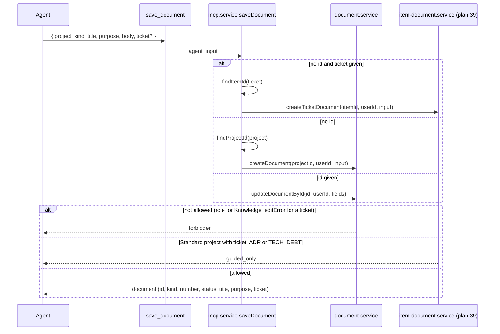

# 42: MCP document tools

Status: Done

## Scope

An agent can read and write knowledge documents over MCP, the same way a person does on
the New document page: pick a kind, give a title, a one-line purpose and a Markdown body.
These are the Record tools MVP §9 names: `list_documents`, `get_document` and
`save_document`. Each calls the service the website uses, as the person behind the agent,
so the rules stay the same (plans 39–41):

- **Reading:** every member.
- **Knowledge documents** (no `ticket`): only Owners and Managers create and edit them, by
  current role (plan 15, `dc3ec48`).
- **From a ticket** (`ticket` given): whoever may edit that ticket (`editError`, plan 37),
  so a Member on tickets assigned to them, Owners and Managers on any. A `SPEC` or
  `REFERENCE` becomes the ticket's own document (`homeItemId`); an `ADR` or `TECH_DEBT`
  is created in Knowledge and linked to the ticket (plans 40, 41). Editing a ticket's own
  document follows the same ticket rule; editing an ADR or tech debt afterwards is
  Owners and Managers only.
- **Guided only:** `ticket`, and the kinds `ADR` and `TECH_DEBT`, answer `guided_only` in
  a Standard project (ADR-0014).
- **No status tools:** accepting, rejecting or superseding an ADR and closing tech debt are
  for people on the website (MVP §7, §9).

Comes after plan 39 (user to confirm): `save_document` can then give a document a home
ticket, using plan 39's `createTicketDocument`, and `get_document` shows that ticket. Plans
40 and 41 add kinds to `DocumentKind`; the tools take the enum, so new kinds come through
without a change here, but their own rules (ADR statuses) belong to those plans.

- **Documents are named by id.** Items and projects have keys, documents don't. The tools
  take the document's id from `list_documents`, and the instructions say so.
- **Section outlines:** the website's starting text per kind lives in the web app
  (`document-templates.ts`). The `save_document` description lists each kind's sections
  in one line so an agent writes the same shape. That copies the text into the API; see
  TD-016.

Left out:

- Archiving and unarchiving over MCP: people do it on the website.
- Linking an existing Knowledge document to a ticket (plan 39's links): a later tool.
  Agents already see a ticket's documents through `get_item`'s `related` (plan 39).
- `list_items_missing_docs`, change documents and `link_commit` / `set_item_dev`: the rest
  of the Record slice (MVP §14 slice 10).
- An activity record for document writes: documents have no activity log yet (TD-011).

## Done when

- [x] `list_documents { project, kind?, query?, archived? }` returns slim rows (id, kind,
      title, purpose, number, status, home ticket key, archived, updatedAt) through
      `listDocuments`, Knowledge documents only (a ticket's own are in `get_item`'s
      `related`); any member; a project you're not in answers `not_found`.
- [x] `get_document { id }` returns the document with its Markdown body, number, status,
      home ticket key and the ticket it was created from, through `getDocument`; any member; a non-member or unknown id answers
      `not_found`.
- [x] `save_document` without `id` creates from `project`, `kind`, `title`, `purpose?`,
      `body?` and an optional `ticket` key (through `createTicketDocument`): without
      `ticket` a Member answers `forbidden`; with it, the ticket's `editError` decides and
      a Standard project answers `guided_only`; the document shows on the Knowledge page
      or the ticket's Related section, with the person as author.
- [x] `save_document` with `id` updates `title`, `purpose` and `body` through
      `updateDocumentById` (ticket documents by the ticket's rule, others by current
      role); `kind`, `ticket` or a status given with `id` answers `invalid_input`.
- [x] `INSTRUCTIONS` gets a Documents paragraph (ids, who writes where, Guided only,
      statuses and archiving are for people), and the `save_document` description names each kind's sections.
- [x] Tests for the three tools (member refused, manager creates and updates, non-member
      `not_found`, member writes a spec on their own ticket, member refused on someone
      else's) and seed items titled with what to try over MCP ("Create a brief over MCP
      as a member: refused", "Write a spec on your own ticket over MCP as a member:
      allowed").

## Design

| Function                                                         | File                                           | What                                                                                                                                                                                                          | Why                                         |
| ---------------------------------------------------------------- | ---------------------------------------------- | ------------------------------------------------------------------------------------------------------------------------------------------------------------------------------------------------------------- | ------------------------------------------- |
| `listDocuments(userId, input)`                                   | `apps/api/src/modules/mcp/mcp.service.ts`      | `findProjectId`, then `documentService.listDocuments`; maps to slim rows                                                                                                                                      | Agents find the id to read or update        |
| `getDocument(userId, id)`                                        | same                                           | `documentService.getDocument`; a malformed id answers `not_found` like a missing one                                                                                                                          | Same 404 for missing, foreign and malformed |
| `saveDocument(agent, input)`                                     | same                                           | No `id`: needs project, kind, title; with `ticket`, `findItemId` then `createTicketDocument` (its rules decide), else `createDocument`. With `id`: refuses kind, ticket and status, then `updateDocumentById` | One write tool, like `save_item`            |
| `listDocumentsSchema`, `getDocumentSchema`, `saveDocumentSchema` | `apps/api/src/modules/mcp/mcp.schema.ts`       | Zod inputs reusing `document.schema.ts`'s field limits                                                                                                                                                        | Same limits as the website                  |
| three `registerTool` calls                                       | `apps/api/src/modules/mcp/mcp.server.ts`       | Same try / `reply` / `toToolError` shape as the item tools                                                                                                                                                    | Follows the existing tools                  |
| `INSTRUCTIONS` (changed)                                         | `apps/api/src/modules/mcp/mcp.instructions.ts` | Documents paragraph                                                                                                                                                                                           | Agents learn the rules once, on connect     |

## Changes

Commits: `ebba3e5` (API, tests, seed, README). Branch `feat/mcp-document-tools`.

What changed:

- `mcp.service.ts`: `listDocuments`, `getDocument`, `saveDocument`. They call
  `documentService.listDocuments` / `getDocument` / `createDocument` / `updateDocumentById`
  and `createTicketDocument`; no rule is repeated. The MCP layer only checks input shape: a
  malformed id answers `not_found`, `kind`, `ticket` or `status` with an `id` answer
  `invalid_input`, a `status` on create answers `invalid_input`, and with `ticket` a kind
  other than SPEC, REFERENCE, ADR or TECH_DEBT answers `invalid_input` (the REST route
  rejects it by its zod enum, which `createTicketDocument` itself does not check).
- `mcp.schema.ts`: the three schemas, field limits taken from `document.schema.ts`.
- `mcp.server.ts`: three `registerTool` calls; `save_document`'s description lists each
  kind's sections (copied from `document-templates.ts`, TD-016).
- `mcp.instructions.ts`: Documents paragraph.
- `test/mcp-documents.e2e-spec.ts`: 7 tests (manager creates, lists, reads, updates; member
  refused; non-member, missing and malformed ids `not_found`; member spec on own ticket and
  refused on another's; ADR from a ticket; Standard `guided_only`, BRIEF with a ticket,
  `raise_from_ticket`; input checks with `id`).
- `scripts/seed.ts`: two items in the member project (TM) titled with what to try over MCP.

Planned vs actual:

- `list_documents` rows have no home ticket key: the tool lists Knowledge documents only, so
  it would always be null. They carry `createdFrom` (the ticket key it was raised on) instead.
- `get_document` and `save_document` answer with the service's document as is (author,
  home ticket, created-from ticket, linked tickets, body).
- A non-member's `get_document` says "Project not found" (the service's text), a missing id
  "Document not found"; both are `not_found`.
- No new tech debt.

Review fixes:

- With `ticket`, the ticket's key prefix must match `project` (`invalid_input`), so a wrong
  prefix never writes a document into a project the agent didn't name.
- `id`, `kind`, `ticket` and `status` are checked as given or not (`!== undefined`): an
  empty `id` is a malformed id (`not_found`), not a create.
- Tests added: `status` on create, a ticket outside the named project, an empty `id`.
- `README.md` lists `list_documents` and `get_document` with the read tools and says the
  server lists every tool.
