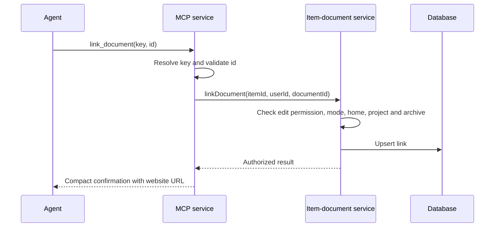
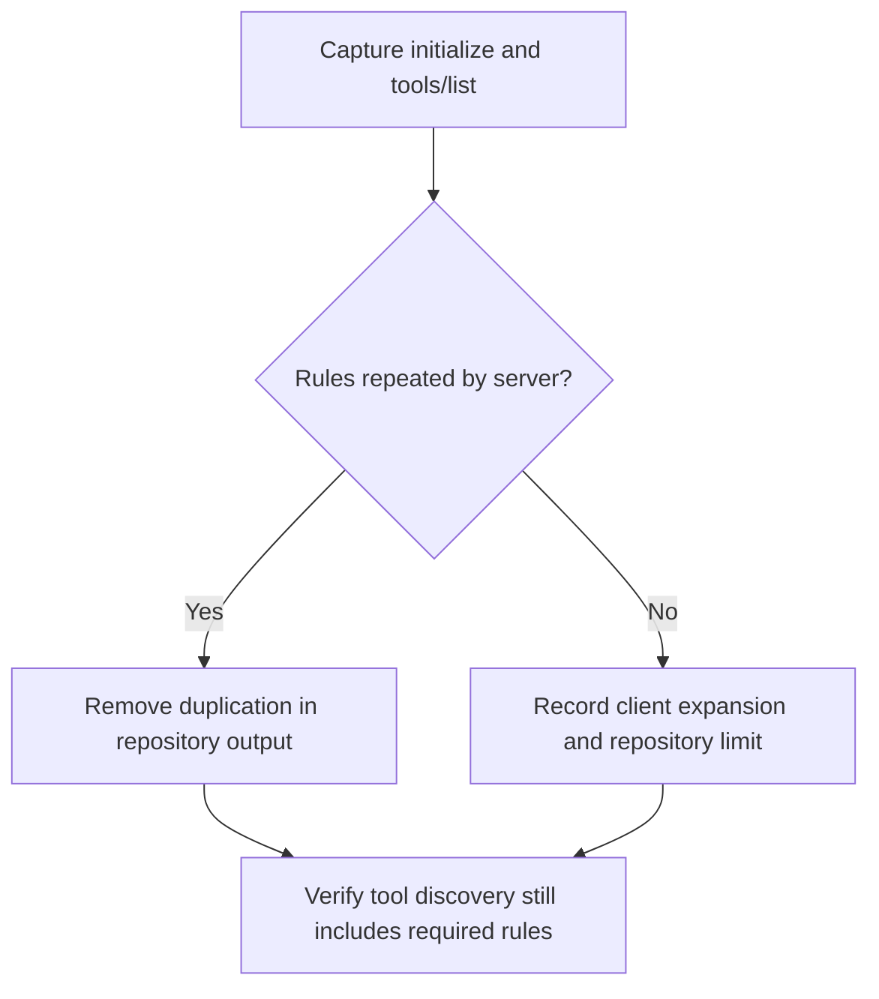

# 46: MCP usability

Status: Done

## Scope

The user confirmed all five MCP improvements after testing Unigym UG-2: link an
existing proposal to a ticket, name assignees, return website URLs, investigate
repeated instructions, and keep mutation responses short. Extend the existing
MVP §9 MCP server and item-document services; do not introduce new workflow rules.

Depends on plan 42's document tools and the existing ticket links. Implement before
plan 47. Scope confirmed on 2026-10-15; the user must set this plan to Ready before code.

Document-to-document provenance (a spec derived from a proposal) is a separate
scope question. This plan links Knowledge documents to tickets, not specs to proposals.

## Done when

- [x] `link_document` and `unlink_document` link an existing Knowledge document to a ticket by ticket key and document id, using the existing service permissions; repeated linking is harmless and archived, foreign-project, ticket-owned and Standard-mode cases retain their existing errors.
- [x] `list_items`, `get_item` and `save_item` include the assignee's name and email, or null when unassigned, so an agent can confirm assignment without interpreting a user id.
- [x] Project, item and document list/detail/save responses include absolute website URLs using the configured web origin and existing routes; ticket-owned documents link to their existing document page too.
- [x] `save_item`, `save_document` and document-link mutations return compact confirmations; full bodies, related records and checklists remain available through reads, and a failed move still reports any preceding successful write.
- [x] MCP initialize and tools/list output are captured to establish where repeated shared instructions originate; source descriptions stay focused, shared rules stay in server instructions, and any client-side expansion outside repository control is recorded with evidence rather than claimed fixed.
- [x] Focused MCP tests cover the new response contract, links, permissions, URLs and partial-write errors; seed cases explain what to try and expect, and README documents the tools and response change.

## Design

Response decisions are proposed in [ADR-0016](../adr/0016-mcp-readable-responses.md).
Reuse [ADR-0014](../adr/0014-ticket-records-are-linked-documents.md) for document homes
and links. Neither ADR is accepted by this plan.

| Function                                                       | File                                         | What                                                                                                               | Why                                                                                     |
| -------------------------------------------------------------- | -------------------------------------------- | ------------------------------------------------------------------------------------------------------------------ | --------------------------------------------------------------------------------------- |
| `buildServer`                                                  | `apps/api/src/modules/mcp/mcp.server.ts`     | Register `link_document` and `unlink_document`; describe tools individually.                                       | Expose the website's existing capability without overloading document editing.          |
| `linkDocument`, `unlinkDocument`                               | `apps/api/src/modules/mcp/mcp.service.ts`    | Resolve a ticket key, validate document id, call the item-document service, return link confirmation.              | Existing service owns membership, edit permission, Guided-only and document-home rules. |
| `findAssigneeProfiles`                                         | `apps/api/src/modules/mcp/mcp.repository.ts` | Read names and emails for the authorized items' unique assignee ids in one query.                                  | Avoid one lookup per item; keep Prisma access in a repository.                          |
| `listItems`, `getItem`, `saveItem`                             | `apps/api/src/modules/mcp/mcp.service.ts`    | Enrich authorized item results with readable assignees; shape save confirmation only after existing writes finish. | Keep the MCP contract separate from REST and preserve partial-save errors.              |
| `toWebsiteUrl`                                                 | `apps/api/src/modules/mcp/mcp.utils.ts`      | Resolve a known website path against `BETTER_AUTH_URL`, already documented as the web origin.                      | Return working links without trusting request headers or adding another origin setting. |
| `listProjects`, `listDocuments`, `getDocument`, `saveDocument` | `apps/api/src/modules/mcp/mcp.service.ts`    | Add website links; keep document reads complete and writes compact.                                                | Let agents link confirmations and read detail only when needed.                         |

Schemas for link tools take `{ key, id }`, with existing ticket-key and document-id
descriptions. Existing document kinds and create-from-ticket behavior stay intact:
create a proposal in Knowledge, then link it explicitly. No new REST endpoint or migration.

Proposed compact contracts:

- `save_item`: `{ key, title, state, priority, assignee, parent, url }`; state is a
  name, assignee is `{ name, email } | null`, parent is a ticket key or null.
- `save_document`: `{ id, kind, title, number, status, url }`.
- Link/unlink: `{ key, documentId, linked, url }`, where `url` opens the ticket.
- Delete and checklist confirmations are already small; preserve their shapes.

URLs use `/p/{projectId}`, `/p/{projectId}/items/{itemId}` and
`/p/{projectId}/docs/{documentId}`, based on real returned ids. Agents still address
items by key. Profiles and links are added only after normal service authorization.
Do not change REST item responses just to support MCP presentation.

Verification: API lint, typecheck, unit tests and relevant MCP e2e suites. E2e uses
the documented remote PostgreSQL setup, never a newly started local database.
Add seed examples for link success, forbidden edits, foreign documents, archived
documents and Standard-mode refusal. No new authorization rules are proposed.

Known existing debt: [TD-016](../tech-debt/016-document-outlines-in-two-places.md)
still applies to document section suggestions. This plan does not add a template API.
If inspection proves instruction expansion cannot be changed here, record that
specific limitation in tech debt with the captured protocol evidence.

## Changes

Commits: `ceace35` (planning, pushed to dev), `2331c50` (implementation on
`feat/mcp-markdown-reliability-documents`).

Added link/unlink tools through the existing item-document service, batched
assignee profiles, configured-origin website links and compact item/document save
confirmations. README describes the response compatibility change. Seed cases show
member linking, repeated linking, archive refusal, foreign-project isolation and
Standard-mode refusal. Partial-save errors retain the existing saved-write message.

Planned vs actual: raw initialize/tools-list discovery already separates shared
instructions from tool descriptions, so no duplicate repository block was removed.
The connected client's expansion is recorded in
[TD-021](../tech-debt/021-mcp-client-instruction-expansion.md). Document template
outline duplication remains [TD-016](../tech-debt/016-document-outlines-in-two-places.md).

Validation: all focused MCP read/write/document cases passed, including new link
and SLO/SLA cases added by plans 48–49. Root lint, typecheck, tests and API/web
production builds passed. Initial e2e failures came from missing baseline join
migrations; the documented development database was brought up to current migrations.
Hono CLI discovery was attempted but its bundler rejected a dynamic util require;
behavior was verified through the repository's Hono-backed e2e harness.

Implementation authorized by the user on 2026-10-15. Awaiting human code review;
ADRs remain Proposed. No production deployment.
