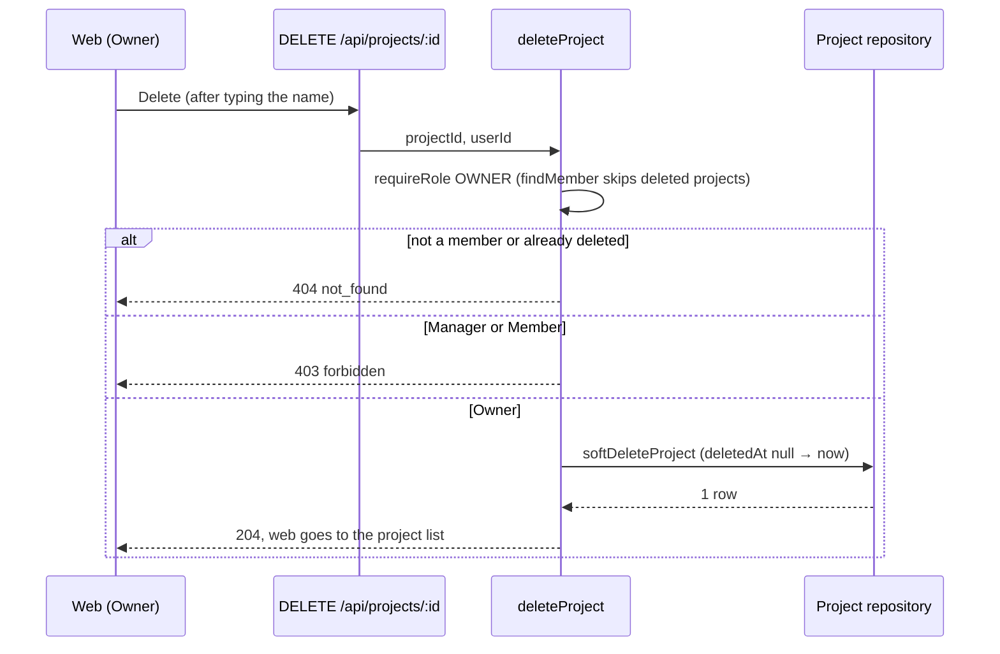
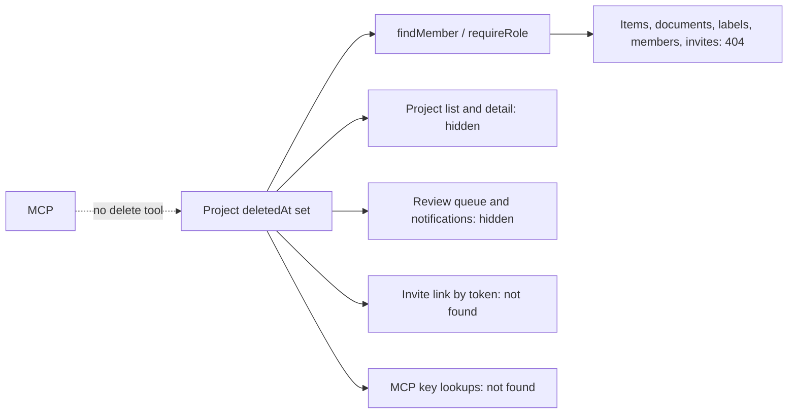

# 51: Delete a project (owner, soft delete, web only)

Status: Done

The user applied the migration on 2026-10-16; the seed and the full e2e suite then ran.

## Scope

MVP §4 lists "delete the project" as an Owner power, but there is no way to do it
today. On 2026-10-16 the user asked for it with three rules: only an Owner may delete,
the delete is soft (rows stay in the database), and it is not possible through MCP.

This slice delivers, end to end:

- a `deletedAt` column on Project and an owner-only `DELETE /api/projects/:projectId`
  that sets it;
- a deleted project disappears everywhere a member could reach it: project list,
  project pages, items, documents, labels, members, review queue, notifications,
  invite links and join requests, and every MCP tool;
- an owner-only "Delete project" section on the web settings page, confirmed by typing
  the project name.

The user authorized implementation with "start working on plan 51" on 2026-10-16,
setting this design Ready, with the defaults proposed: the key prefix stays reserved,
restore stays a database operation, and the confirm dialog asks for the project name.

Left out on purpose:

- **Restore.** No restore endpoint or page. Because the rows are kept, an operator can
  restore by clearing `deletedAt` in the database.
- **Hard delete or purge** of old deleted projects.
- **Freeing the key prefix.** A deleted project keeps its prefix (e.g. `UG`), so a new
  project cannot reuse it. See [TD-022](../tech-debt/022-deleted-project-keeps-prefix.md).
- **An MCP tool.** No `delete_project` tool is added; agents cannot delete a project.

## Done when

- [x] A migration adds a nullable `deletedAt` to Project. `DELETE /api/projects/:projectId` sets it for an Owner (any Owner, when there are several) and keeps every row; a Manager or Member gets 403 `forbidden`, a non-member or an already deleted project gets 404 `not_found`.
- [x] After a delete, every member, Owner included, gets 404 `not_found` on the project and on its items, documents, labels, members and invite settings; the project leaves `GET /api/projects`, the review queue and the notification list, and the notification worker sends nothing new for it.
- [x] An old invite link to a deleted project shows as not found and cannot be used to join, and a pending join request on it can no longer be approved.
- [x] MCP has no tool that deletes a project (a test asserts the registered tool names), and MCP reads and writes by project key or ticket key (e.g. `UG`, `UG-12`) on a deleted project answer not found.
- [x] On `/p/[projectId]/settings`, an Owner sees a "Delete project" section (driven by `canDeleteProject` from the API, not a role check in the web app); the confirm dialog enables Delete only once the exact project name is typed, then goes to the project list. Managers and Members do not see the section.
- [x] The seed adds a project with items titled with what to try and what should happen (Owner deletes → gone from the list; Manager or Member tries → refused; old invite link → not found), and focused API tests cover the delete rule and the hiding paths above.

## Design

See [ADR-0020](../adr/0020-projects-soft-deleted.md), Proposed: projects are soft-deleted,
and the membership lookup is the one gate that hides them.

The idea: almost every service already starts with `requireRole` or `requireMember`. If
those two lookups ignore deleted projects, every route behind them answers 404 with no
other change. The table lists that gate first, then the few queries that skip it.

| Function / component                                                                      | File                                                            | What                                                                                                                                                                                               | Why                                                                                                                               |
| ----------------------------------------------------------------------------------------- | --------------------------------------------------------------- | -------------------------------------------------------------------------------------------------------------------------------------------------------------------------------------------------- | --------------------------------------------------------------------------------------------------------------------------------- |
| `Project.deletedAt`                                                                       | `apps/api/prisma/schema.prisma` and a new migration             | Nullable `DateTime`, no index (lookups are by id or key).                                                                                                                                          | Soft delete: rows stay, as for items.                                                                                             |
| `findMember`                                                                              | `apps/api/src/modules/members/member.repository.ts`             | Change `findUnique` on the composite key to `findFirst` with `project: { deletedAt: null }`; keep the `db` transaction parameter.                                                                  | `requireRole` uses it, so items, documents, labels, members, invites and checklists all return 404 for a deleted project at once. |
| `findProjectsForUser`, `findProjectForMember`, `findProjectDetailForMember`, `isMember`   | `apps/api/src/modules/projects/project.repository.ts`           | Add `deletedAt: null` (or `project: { deletedAt: null }`) to each `where`.                                                                                                                         | They bypass `findMember`; the list and `requireMember` must hide the project too.                                                 |
| `softDeleteProject`                                                                       | `apps/api/src/modules/projects/project.repository.ts`           | `updateMany` where `id` and `deletedAt: null`, set `deletedAt: now()`; returns the count.                                                                                                          | `updateMany` with the null check makes two owners deleting at once safe: the second gets 404.                                     |
| `deleteProject`                                                                           | `apps/api/src/modules/projects/project.service.ts`              | `requireRole(projectId, userId, ['OWNER'])`, then `softDeleteProject`; 404 if it updated nothing.                                                                                                  | The Owner-only rule lives once, in the API service.                                                                               |
| `getProject`                                                                              | `apps/api/src/modules/projects/project.service.ts`              | Add `canDeleteProject: role === 'OWNER'`, next to `canEditSettings`.                                                                                                                               | The web reads this flag instead of checking roles itself.                                                                         |
| `deleteProjectById` and the route                                                         | `project.handlers.ts`, `project.routes.ts`                      | `projectRoutes.delete('/:projectId', describe({ operationId: 'deleteProject', status: 204 }), deleteProjectById)`.                                                                                 | Plain Hono route; `describe` adds it to OpenAPI so the web client hook is generated.                                              |
| `findReviewProjects`, `findReviewItems`                                                   | `apps/api/src/modules/reviews/review.repository.ts`             | Add `deletedAt: null` to the project filter.                                                                                                                                                       | The review queue spans projects without going through `requireRole`.                                                              |
| Notification list and worker queries                                                      | `apps/api/src/modules/notifications/notification.repository.ts` | Filter out notifications and pending review events whose project is deleted.                                                                                                                       | The inbox and the email worker read across projects directly.                                                                     |
| `findByToken`, `previewInvite`, `joinByInvite`, `decideJoinRequest`, `listMyJoinRequests` | `apps/api/src/modules/invites/`                                 | Treat an invite whose project is deleted as not found; `decideJoinRequest` already calls `requireRole`, so it is covered by `findMember`. `listMyJoinRequests` hides requests on deleted projects. | Invite links are read by token, not by membership, so they need their own filter.                                                 |
| `findProjectIdByKey`, `findItemIdByKey`                                                   | `apps/api/src/modules/mcp/mcp.repository.ts`                    | `findUnique` by key becomes `findFirst` with `deletedAt: null`; the item lookup adds `project: { deletedAt: null }`.                                                                               | Key lookups run before the membership check; filtering here gives a clean not found.                                              |
| (no tool)                                                                                 | `apps/api/src/modules/mcp/mcp.server.ts`                        | No `delete_project` tool. A test lists the registered tool names and asserts none deletes a project.                                                                                               | The user ruled that agents may not delete a project.                                                                              |
| `DeleteProjectSection`                                                                    | `apps/web/src/components/projects/delete-project-section.tsx`   | Danger section with a short warning and a Delete button that opens the dialog; rendered only when `canDeleteProject`.                                                                              | One component per file.                                                                                                           |
| `DeleteProjectDialog`                                                                     | `apps/web/src/components/projects/delete-project-dialog.tsx`    | Input for the project name; Delete is disabled until it matches. Calls the generated `useDeleteProject` hook, invalidates project queries and routes to `/`.                                       | Typing the name stops a misclick from removing a whole project.                                                                   |
| `SettingsPage`                                                                            | `apps/web/src/components/projects/settings-page.tsx`            | Render `DeleteProjectSection` at the bottom.                                                                                                                                                       | Delete sits with the other owner settings.                                                                                        |
| Seed                                                                                      | `apps/api/scripts/seed.ts`                                      | A "Delete me" project with Owner, Manager and Member, an invite link, and items titled with what to try and what should happen.                                                                    | New rule, so the seed gets its cases. Run with `SEED_OWNER_EMAIL=test@email.com,psst@gmail.com`.                                  |

Main error codes: `forbidden` (403, not an Owner) and `not_found` (404, not a member,
already deleted, or reached through a stale link or key). No new error code.

Notes:

- Items, documents and other child rows are not touched; they are hidden because their
  project is. Restoring the project (in the database) brings everything back as it was.
- `keyPrefix` stays unique across deleted projects, so MCP key lookups never match two
  rows. Freeing it would need a partial unique index; see TD-022.
- Use the remote development database over Tailscale, as `README.md` says. Do not start
  a local database.

## Changes

Commits: none yet.

What changed, as planned:

- API: `Project.deletedAt` (schema and hand-written migration `20261016120000_project_deleted_at`, not yet applied); `findMember`, the project list and detail lookups and `isMember` skip deleted projects; `softDeleteProject`, `deleteProject`, `deleteProjectById` and `DELETE /api/projects/:projectId`; `canDeleteProject` on the project detail; review queue, notification queries (including the raw grouping SQL) and the notification worker, invite `findByToken` and `findMineWaiting`, and MCP key lookups filter deleted projects. No MCP tool added.
- Web: `DeleteProjectSection`, `DeleteProjectDialog` (type the name, generated `useDeleteProject`), rendered by `SettingsPage` when `canDeleteProject`. `openapi.json` regenerated.
- Seed: projects TZ (you own it), TU (you manage it) and TK (already deleted, old invite link) in `seedDeleteProject`.
- Tests: `apps/api/test/delete-project.e2e-spec.ts` (delete rule, hiding paths, invite link, MCP).

Review fixes: migration renamed to `20261016130000_project_deleted_at` (the shared DB already has `20261016120000_comments`); `lockPermittedNotifications` now joins `project` and skips deleted ones; the e2e test now puts an item in review, runs the worker, checks the review queue, notifications and unread count before and after the delete, queues a second event and checks the worker adds no notification; MCP checks assert a not-found text; a second Owner can delete; `apps/api/AGENTS.md` notes soft-deleted projects; the dialog navigates to `/` before removing the project query. The demoted-owner race is left as is: [TD-023](../tech-debt/023-project-delete-role-race.md).

Planned vs actual: the route answers 200 with `data: null` and the message "Project deleted", not 204, because `apps/api/AGENTS.md` says deletes answer 200 and `describe` only allows 200 or 201. `canDeleteProject` was also added to `projectDetailSchema`. Not done: applying the migration, `db:seed`, and running the e2e tests, because the database was unreachable. Checks that ran: lint, typecheck, build, API unit tests (120 passed), web tests (4 passed).

Verification on 2026-10-16, after the user applied `20261016130000_project_deleted_at`:
seeded with `SEED_OWNER_EMAIL=test@email.com,psst@gmail.com`; the first full e2e run had
284 passed and 2 failed, both test mistakes (`get_item` called with `ticket` instead of
`key`, and `app.e2e-spec.ts`'s operation list missing `deleteProject`). After fixing them,
`app.e2e-spec.ts` and `delete-project.e2e-spec.ts` passed (42 tests); lint and typecheck
pass. The settings dialog has not been opened in a browser.
