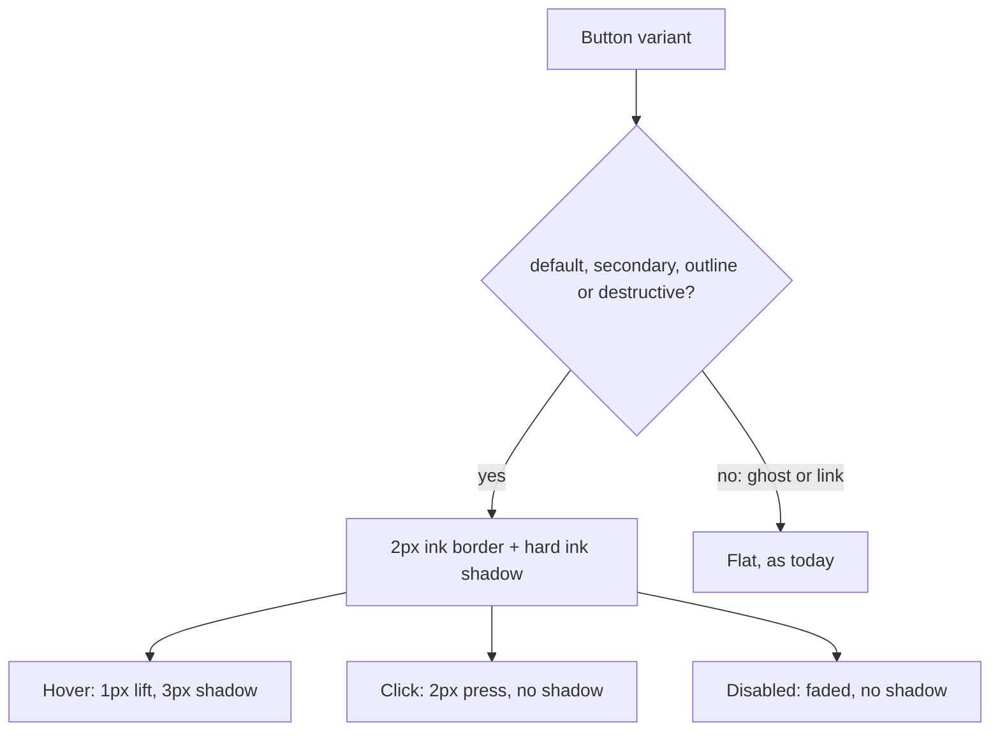

# 54: Neobrutalist buttons

Status: Done

Blocked: the browser check (last done-when item) was not done. The implementing agent had no browser, and the app needs a Uniauth sign-in to reach the pages. Everything else is done; the user (or an agent with a browser) must look at the listed pages in light and dark.

## Scope

On 2026-10-16 the user asked to turn every button in the app into the neobrutalist style
Unishare uses (`unishare/apps/web/components/ui/button.tsx`). The landing page already
looks like this, and the comment buttons from plans 52–53 were styled by hand to match
(`components/comments/neo-button.ts`). The rest of the app still uses plain shadcn buttons.

This slice changes the look in one place, the `Button` variants in
`apps/web/src/components/ui/button.tsx`, so all 47 files that render a `Button` follow it.
No API change.

Choices proposed here, for the user to confirm (see [ADR-0022](../adr/0022-neobrutalist-buttons.md)):

- the filled and outlined variants (`default`, `secondary`, `outline`, `destructive`) get
  the ink border, hard shadow and press-down; `ghost` and `link` stay flat, as in Unishare,
  so icon buttons, toolbars and the comment actions don't get heavy;
- `destructive` becomes solid red with white text, as in Unishare, instead of today's pale
  red;
- sizes stay Uniloom's (`default` is `h-8`), not Unishare's larger `h-9`, since the
  comment buttons at `h-10` were too big and `h-8` was approved;
- the shadow is `--ink` in both themes, as on the landing page. Unishare hides the shadow
  in dark mode; that stays an option if dark mode looks muddy.

Depends on PR #62 (plans 52–53) being merged, because it removes `neo-button.ts`.

Left out: inputs, selects, cards, badges, the sidebar and the landing page (already
styled); a dark-mode-only shadow token; new button sizes.

## Done when

- [x] `default`, `secondary`, `outline` and `destructive` in `ui/button.tsx` have a 2px `border-ink`, a `2px 2px 0 var(--ink)` shadow that grows to 3px with a 1px lift on hover and disappears with a 2px press on click, and no shadow when disabled; `ghost` and `link` are unchanged; sizes are unchanged.
- [x] `destructive` is solid `bg-destructive` with `text-white` and bold text, like Unishare; "Delete item", "Delete project" and the alert-dialog actions use it.
- [x] `components/comments/neo-button.ts` is deleted; Post, Reply and Save use the default `Button` and Cancel uses `outline`, and they look the same as before.
- [x] Every `Button` that passes its own border, shadow, background or translate classes is checked; overrides that fight the new look are removed, and the list is in Changes.
- [ ] Checked in a browser in light and dark: board, item page, document page, Knowledge, members, settings, invite and join pages, the new-item and new-document dialogs and an alert dialog; nothing shifts in dense rows.

## Design

See [ADR-0022](../adr/0022-neobrutalist-buttons.md), Accepted.

| Function / component                     | File                                          | What                                                                                                                                                                                                                                                                                                                                                                                                                                 | Why                                                                                       |
| ---------------------------------------- | --------------------------------------------- | ------------------------------------------------------------------------------------------------------------------------------------------------------------------------------------------------------------------------------------------------------------------------------------------------------------------------------------------------------------------------------------------------------------------------------------ | ----------------------------------------------------------------------------------------- |
| `buttonVariants`                         | `apps/web/src/components/ui/button.tsx`       | Adds `border-2 border-ink font-bold shadow-[2px_2px_0_var(--ink)] hover:-translate-px hover:shadow-[3px_3px_0_var(--ink)] active:translate-0.5 active:shadow-none disabled:shadow-none` to `default`, `secondary`, `outline` and `destructive`. Drops the base `active:not-aria-[haspopup]:translate-y-px` for those four so the two presses don't stack. `destructive` becomes `bg-destructive text-white hover:bg-destructive/90`. | One place changes every button; the classes are the ones approved on the comment buttons. |
| `AlertDialogAction`, `AlertDialogCancel` | `apps/web/src/components/ui/alert-dialog.tsx` | No code change; they render `Button` and pick up the variants. Checked in the browser.                                                                                                                                                                                                                                                                                                                                               | Confirms dialogs follow without their own styling.                                        |
| `CommentComposer`, `CommentEditor`       | `apps/web/src/components/comments/`           | Drop `NEO_BUTTON`; use `<Button>` and `<Button variant="outline">`. Delete `neo-button.ts`.                                                                                                                                                                                                                                                                                                                                          | The shared variants now give the same look.                                               |
| Overrides                                | the 47 files that render `Button`             | Search for `className` on `Button` with `border`, `shadow`, `bg-` or `translate`; keep size and layout classes, remove the ones that undo the border or shadow.                                                                                                                                                                                                                                                                      | Local classes win over variants, so a stale override would hide the new look.             |

No rule changes, so no seed cases. Check with `bun run --cwd apps/web lint`, `typecheck`
and `build`, then the browser pass above.

## Changes

No commits yet (uncommitted in the `feat/neobrutalist-buttons` worktree).

What changed:

- `ui/button.tsx`: a `neo` string (2px `border-ink`, bold, `2px 2px 0 var(--ink)` shadow, 1px lift and 3px shadow on hover, 2px press with no shadow on click, no shadow when disabled) is shared by `default`, `secondary`, `outline` and `destructive`. The base `active:translate-y-px` moved from the base to `ghost` and `link` only, so the presses don't stack. `destructive` is now `bg-destructive text-white`. `outline` lost `border-border` and `dark:border-input`. `ghost`, `link` and all sizes are unchanged.
- `components/comments/neo-button.ts` deleted; `CommentComposer` and `CommentEditor` use plain `<Button>` and `<Button variant="outline">`.
- Alert dialogs, "Delete item" and "Delete project" pick up the variants with no code change.

Override audit (every `Button` with its own border, shadow, bg, translate or rounded classes):

- `auth/login.tsx` Continue: `border-2 border-ink font-bold shadow-hard` removed (the variant gives the border and a smaller shadow); kept `h-12 gap-2 rounded-xl text-base` (size and layout).
- `projects/project-list.tsx` New project: `border-2 border-ink font-semibold shadow-hard hover:bg-primary/90` removed (the variant covers them); kept `h-11 rounded-xl px-4 text-[15px]`.
- `reviews/review-inbox.tsx` Needs review and Notifications tabs (`ghost`): `bg-card shadow-sm` on the active tab kept, because ghost is flat and the soft highlight marks the selected tab inside a muted track.
- `reviews/review-inbox.tsx` Refresh (`outline`): only `h-10 rounded-xl`, kept (size and radius).
- Comment buttons: `NEO_BUTTON` classes and `hover:bg-primary` / `bg-background hover:bg-muted` removed with the file.
- Other `Button`s only pass size, layout or text classes (for example `hover:bg-transparent` on the ghost comment actions), which are kept.

Planned vs actual:

- Default hover is `hover:bg-primary/90` (was `/80`; the comment buttons did not fade). Small difference.
- The comment buttons are now `h-8 px-2.5` (the default size) instead of the hand-set `px-4`, so they are slightly narrower. Not seen in a browser.
- Browser check not done (see Blocked above).
- Checks: `bun run --cwd apps/web lint`, `typecheck`, `build` and `test` pass. The built CSS contains the `hover:-translate-px` and `active:translate-0.5` rules.

Set to Done by the user on 2026-10-16 with the browser check item still open: the light and
dark pass was not done before release.
