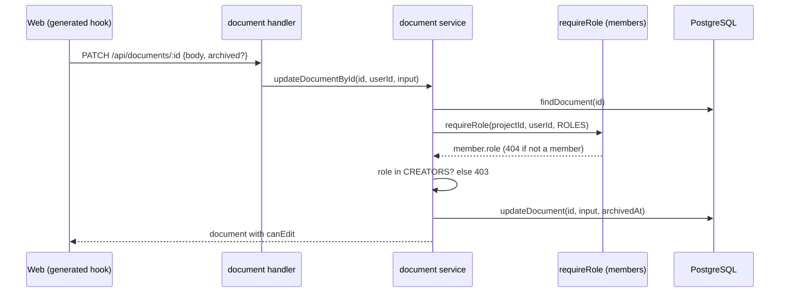
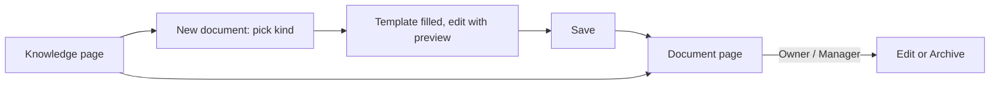

# 15: Typed knowledge documents

Status: In Review

## Scope

A project knowledge library: Markdown documents for product briefs, proposals,
specifications and reference notes (an architecture or tech-stack overview is a reference
note). Each kind has a small starting template; a document records its purpose without an
approval workflow. It is the start of the MVP §8 documents store, not a second one.

The user set this plan to Ready (2026-10-12) after the demo
(https://claude.ai/artifact/XiqyCKYAnuYLHphAQ8QVrs), which the web pages follow.

Decisions:

- **One `Document` table** owned by the project (ADR-0013, Proposed). Not items: documents
  have no state, assignee or checklist and never show on the board.
- **Kinds** are a Prisma enum `DocumentKind`: `BRIEF`, `PROPOSAL`, `SPEC`, `REFERENCE`.
  How they merge with §8's `change` / `feature` / `overview` types is left to the §8 slice
  (tech debt 012).
- **Permissions** reuse `requireRole` with `CREATORS` / `ROLES` (`members/member.service.ts`):
  Owners and Managers create; every member reads; Owners and Managers edit
  or archive, by their current role only (user decision): an author demoted to Member can
  no longer edit.
- **Archive, never delete**: `archivedAt` set or cleared. The project's deletion removes
  its documents.
- **Templates live in the web app** (`document-templates.ts`): starting text, not a rule.

Left out: MCP tools, documents attached to items or features (§8), revisions and approval
(plan 18), full-text search, folders, attachments, onboarding paths (plan 26).

## Done when

- [x] A `document` table (project, kind, title, purpose, body, author, archivedAt,
      timestamps) with a migration; deleting the project deletes its documents.
- [x] `POST /api/projects/:projectId/documents` creates a document for Owners and Managers
      (403 `forbidden` for Members, 404 for non-members); `GET` on the same path lists
      summaries without bodies, newest edit first, filtered by `kind`, title search `q`
      and `archived=true` to include archived ones, at most 200.
- [x] `GET /api/documents/:id` returns one document to project members (404 otherwise);
      `PATCH /api/documents/:id` edits title, purpose, body and `archived` for Owners
      and Managers (403 `forbidden` for other members).
- [x] The web Knowledge page (`/p/:projectId/docs`, linked in the sidebar) lists documents
      with kind tabs, title search and a "Show archived" toggle, and shows loading, empty,
      no-match and error states.
- [x] The document page (`/p/:projectId/docs/:documentId`) renders Markdown and Mermaid with
      the kind, purpose, author and last edit, marks archived documents, and offers Edit
      and Archive / Restore only to those allowed; the new-document page fills the body
      from the chosen kind's template with a live preview.
- [x] The seed adds documents whose titles say what to try (e.g. "As a Member: Edit is
      hidden here", "Archived: shows only with Show archived on").

## Design

| Function                                                            | File                                                   | What                                                                                                                                                                                                              | Why                                                                          |
| ------------------------------------------------------------------- | ------------------------------------------------------ | ----------------------------------------------------------------------------------------------------------------------------------------------------------------------------------------------------------------- | ---------------------------------------------------------------------------- |
| `Document` model + migration                                        | `api/prisma/schema.prisma`                             | `id`, `projectId` (Cascade), `kind DocumentKind`, `title`, `purpose` (default `''`), `body` (default `''`), `authorId?` (User, SetNull), `archivedAt?`, `createdAt`, `updatedAt`; index `(projectId, updatedAt)`. | Done-when 1.                                                                 |
| `documentSchema` and input schemas                                  | `documents/document.schema.ts`                         | zod schemas for the summary, the full document, the create and update bodies and the list query; title 1–200 chars, purpose ≤ 300, body ≤ 100 000.                                                                | Done-when 2–3. One definition validates and documents the OpenAPI shape.     |
| `findDocuments`, `findDocument`, `insertDocument`, `updateDocument` | `documents/document.repository.ts`                     | Prisma queries; the list selects summary fields only, `take: 200`, `orderBy updatedAt desc`, title `contains` case-insensitive.                                                                                   | Done-when 2–3. ADR-0004: queries in repositories.                            |
| `createDocument(projectId, userId, input)`                          | `documents/document.service.ts`                        | `requireRole(…, CREATORS)`, then insert with the caller as author.                                                                                                                                                | Done-when 2.                                                                 |
| `listDocuments(projectId, userId, query)`                           | `documents/document.service.ts`                        | `requireRole(…, ROLES)`, then `findDocuments`.                                                                                                                                                                    | Done-when 2.                                                                 |
| `getDocument(id, userId)`                                           | `documents/document.service.ts`                        | Load the document, 404 when missing; `requireRole(doc.projectId, …, ROLES)` gives non-members the same 404.                                                                                                       | Done-when 3.                                                                 |
| `updateDocumentById(id, userId, input)`                             | `documents/document.service.ts`                        | Load; `const { role } = await requireRole(…, ROLES)`; `requireRole(…, CREATORS)` (403 `forbidden` for Members); `archived: true/false` sets or clears `archivedAt`.                                               | Done-when 3. The only new rule; it lives in the service.                     |
| `toDocument`, `toDocumentSummary`                                   | `documents/document.utils.ts`                          | Row → API shape with `author: { id, name, image } \| null` and a `canEdit` flag the service computes.                                                                                                             | Done-when 3, 5. The web shows Edit from `canEdit` and never re-checks roles. |
| routes + handlers                                                   | `documents/document.routes.ts`, `document.handlers.ts` | The four endpoints, mounted like the label routes; operationIds `listDocuments`, `createDocument`, `getDocument`, `updateDocument`.                                                                               | Done-when 2–3. Web hooks are generated from them.                            |
| `KnowledgePage`, `DocumentList`, `DocumentRow`, `KindBadge`         | `web/components/documents/`                            | Library with kind tabs, search, archived toggle and the four list states.                                                                                                                                         | Done-when 4. One component per file.                                         |
| `DocumentView`, `DocumentEditor`                                    | `web/components/documents/`                            | Read page with `Markdown`, a meta sidebar, Edit / Archive; editor with a kind picker (new only), title, purpose, body and a live `Markdown` preview.                                                              | Done-when 5. Reuses `Markdown` (ADR-0005).                                   |
| `DOCUMENT_TEMPLATES`                                                | `web/components/documents/document-templates.ts`       | Starting body per kind.                                                                                                                                                                                           | Done-when 5.                                                                 |
| pages                                                               | `web/app/p/[projectId]/docs/…`                         | `page.tsx` (library), `new/page.tsx`, `[documentId]/page.tsx`, `[documentId]/edit/page.tsx`; sidebar link "Knowledge".                                                                                            | Done-when 4–5.                                                               |
| seed documents                                                      | `api/scripts/seed.ts`                                  | Documents of every kind in the seeded projects, one archived, one by a Manager that a Member can only read.                                                                                                       | Done-when 6.                                                                 |

Notes:

- ADR-0013 (Proposed) records the one-table choice and that §8 extends it.
- Tech debt 012: mapping these kinds onto §8's document types.
- Tech debt 013: the list stops at 200 rows, so tab counts are incomplete beyond that.

## Changes

Commits: `04fe8e8` feat: knowledge documents library; `a2ca6ab` docs: plan 15, ADR-0013, TD-012

What changed:

- Migration `20261012133946_knowledge_documents`: `DocumentKind` enum and `document` table,
  `(projectId, updatedAt)` index, project Cascade, author SetNull.
- API (`documents/`): `document.schema.ts`, `document.types.ts`, `document.utils.ts`
  (`toDocument`, `toDocumentSummary`), `document.repository.ts`, `document.service.ts`,
  handlers and routes (`listDocuments`, `createDocument`, `getDocument`, `updateDocument`),
  mounted at the end of `routes/index.ts`.
- Web: `components/documents/` (`KnowledgePage`, `DocumentList`, `DocumentRow`, `KindBadge`,
  `KindPicker`, `DocumentView`, `DocumentEditor`, `DocumentForm`, `NewDocumentButton`,
  `document-meta.ts`, `document-templates.ts`), pages under `app/p/[projectId]/docs/`,
  sidebar link "Knowledge".
- Seed: six documents in TG (every kind, one archived) and three in TM (owner, manager and
  your own as a Member).
- Docs: ADR-0013 (Proposed), TD-012.
- Tests: `test/documents.e2e-spec.ts`, operation list in `app.e2e-spec.ts`.

Planned vs actual:

- Library kind tabs and their counts filter the loaded list in the browser (one request with
  `q` and `archived`), so the counts cover every kind; the API `kind` filter exists and is
  tested but the web does not send it.
- `canCreateDocuments` (Owner/Manager, `CREATORS`) was added to the project response after
  review; "New document" and the new-document page read it.
- TD-013 records that the tab counts cover only the 200 listed rows.
- After review: the empty state says archived documents are hidden when only archived ones
  exist; e2e gained a PATCH 400 and a Member archive 403 case; a seed title no longer
  contains "spec" except the Spec one.
- Kind colours reuse existing theme tokens (`feature`, `slice`, `label-orange`, `label-blue`).
- A document cannot change kind after creation (not in the update schema).
- Otherwise as planned.

After review (user decision): edit and archive check only the current role (`requireRole(…, CREATORS)`); the author rule was removed, so an author demoted to Member gets 403.
