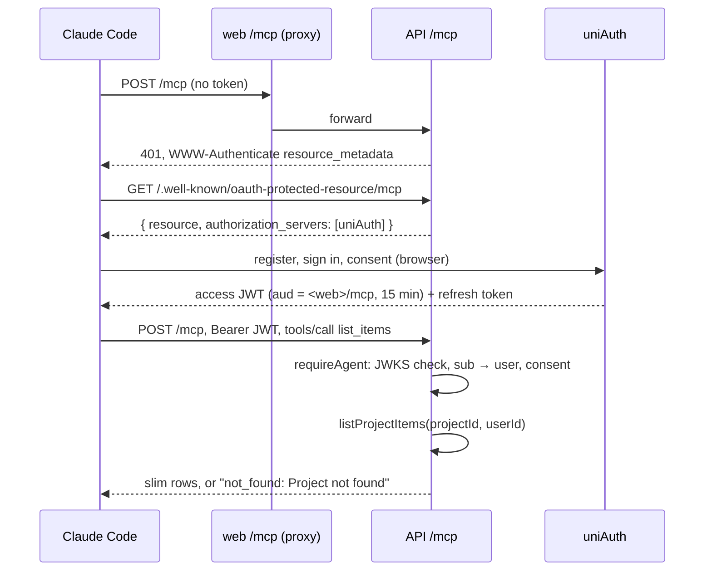

# 33: MCP connection and read tools

Status: In Progress

## Scope

The first half of `MVP.md` §14 slice 4: an agent such as Claude Code connects to
Uniloom's `/mcp`, signs in through uniAuth, and reads projects, items, states, labels and
checklists. Writes come in plan 34.

- **Auth through uniAuth OAuth, as Unishare does** (user decision, ADR-0012). Uniloom
  only serves resources: it publishes RFC 9728 metadata pointing at uniAuth and checks the
  access JWT locally. No tokens are stored in Uniloom, and there's no tokens page.
- **Access is the person's project role** (user decision): no scopes. Tools call the
  services the website uses, so they can only see what the person can.
- **`/mcp` sits on the web origin, as in Unishare.** The web app already proxies `/api/*`;
  it also proxies `/mcp` and `/.well-known/oauth-protected-resource/*` to the API, so the
  resource URL is `<web>/mcp` and needs no new public host.
- **Agents use keys**, not ids: projects by key prefix (`TG`), items by key (`TG-12`).
- Stateless Streamable HTTP: each request builds a server and transport and throws them
  away. No sessions to keep.

Depends on, outside Uniloom:

- **uniAuth must accept Uniloom's `/mcp` as an MCP resource.** Today its `mcp()` plugin
  takes one resource (`MCP_RESOURCE`, Unishare's) in `uniAuth/apps/server/src/auth/auth.ts`.
  It needs a second audience, and still to check is whether Better Auth's `mcp()` takes
  several (`validAudiences`) or uniAuth needs another way. No new scopes. Until this
  lands, done-when 6 can't be met, and the plan goes to Blocked at that point.

Left out:

- Write tools: plan 34. The activity log: plan 36.
- Design, ADR, comment and record tools: their own slices (7 and 10).
- Scopes and read-only agents (ADR-0012, option 3).
- Rate limiting `/mcp`.

## Done when

- [x] `GET /.well-known/oauth-protected-resource` and `…/mcp` return the resource
      metadata (`resource`, `authorization_servers: [uniAuth]`), and `/mcp` without a valid
      token answers 401 with `WWW-Authenticate: Bearer resource_metadata="…"`.
- [x] `/mcp` accepts only a JWT signed by uniAuth (JWKS) with issuer `UNIAUTH_ISSUER`,
      audience `MCP_RESOURCE` and not expired; its `sub` maps to a Uniloom user through the
      `account` row; a user who hasn't accepted Uniloom's terms is refused.
- [x] The server sends `instructions`: the states, each mode's rules, the checklist limits,
      that agents can't approve or move to Ready or Done, and the item key format.
- [x] `list_projects`, `list_items` (slim rows; optional state, assignee and parent
      filters), `get_item`, `list_states`, `list_labels` and `get_criteria` answer as the
      person, through the existing services; a non-member gets the same `not_found` as on
      the website.
- [x] Service errors come back as MCP tool errors carrying the API's `code` and message,
      e.g. `not_found: Item not found`.
- [ ] From Claude Code, `claude mcp add --transport http uniloom <web>/mcp` signs in
      through dev uniAuth and lists the seed project TG's items; the README shows how.

## Design

| Function                                | File                                      | What                                                                                                                                                                                     | Why                                                                                   |
| --------------------------------------- | ----------------------------------------- | ---------------------------------------------------------------------------------------------------------------------------------------------------------------------------------------- | ------------------------------------------------------------------------------------- |
| `env.mcpResource`                       | `api/src/auth/auth.ts`                    | `MCP_RESOURCE` (required), e.g. `http://127.0.0.1:3013/mcp`, next to the uniAuth settings.                                                                                               | Done-when 1–2. The audience tokens must carry.                                        |
| `verifyAgentToken(token)`               | `api/src/modules/mcp/mcp.auth.ts`         | `jwtVerify` with a cached `createRemoteJWKSet(<issuer>/jwks)`, issuer and audience; returns `{ sub, clientId }` or null. `clientId` comes from the token's client claim.                 | Done-when 2. Copied from Unishare's `verifyMcpAccessToken`; plan 34 logs `clientId`.  |
| `requireAgent` middleware               | `api/src/modules/mcp/mcp.auth.ts`         | Reads `Authorization: Bearer`, calls `verifyAgentToken`, maps `sub` with `findUserIdBySub`, loads the user, checks `consentGivenAt`; puts `{ userId, clientId }` on the context or 401s. | Done-when 1–2. One place for every `/mcp` check.                                      |
| `protectedResource` handler             | `api/src/modules/mcp/mcp.routes.ts`       | `{ resource, authorization_servers: [UNIAUTH_ISSUER], bearer_methods_supported: ['header'] }`.                                                                                           | Done-when 1. How clients find uniAuth.                                                |
| `mcpRoutes`                             | `api/src/modules/mcp/mcp.routes.ts`       | `app.all('/mcp', requireAgent, handler)`: builds the server, a stateless `StreamableHTTPServerTransport`, and handles the raw request.                                                   | Done-when 1, 3, 4. Mounted in `app.ts` before `/api`, outside the session middleware. |
| `buildServer(agent)`                    | `api/src/modules/mcp/mcp.server.ts`       | `new McpServer({ name, version }, { instructions })` and `registerTool` for each read tool; each tool calls one service with `agent.userId`.                                             | Done-when 3–4. Tools are thin, so rules stay in the services.                         |
| `INSTRUCTIONS`                          | `api/src/modules/mcp/mcp.instructions.ts` | The instruction text.                                                                                                                                                                    | Done-when 3.                                                                          |
| `toToolError(error)`                    | `api/src/modules/mcp/mcp.server.ts`       | Turns an `apiError` (`HTTPException` with the JSON body) into `{ isError: true, content: [{ type: 'text', text: 'code: message' }] }`; rethrows anything else.                           | Done-when 5. Rule errors stay explicit.                                               |
| `findProjectIdByKey`, `findItemIdByKey` | `api/src/modules/mcp/mcp.repository.ts`   | Key prefix → project id; `TG-12` → item id (project by prefix, then `number`).                                                                                                           | Done-when 4. Agents work with keys; membership is still checked by the service after. |
| `/mcp` and `/.well-known/…` rewrites    | `web/next.config.ts`                      | Two more entries next to `/api/:path*`.                                                                                                                                                  | Done-when 1, 6. The resource lives on the web origin.                                 |

Tools and the services they call:

| Tool            | Input                                       | Service                                  |
| --------------- | ------------------------------------------- | ---------------------------------------- |
| `list_projects` | none                                        | `listProjects`                           |
| `list_items`    | `project`, `state?`, `assignee?`, `parent?` | `listProjectItems`, filtered in the tool |
| `get_item`      | `key`                                       | `getItem`                                |
| `list_states`   | `project`                                   | `getProject` → `states`                  |
| `list_labels`   | `project`                                   | `listLabels`                             |
| `get_criteria`  | `key`                                       | `getItem` → checklist, numbered from 1   |

Notes:

- Tools take the place of the HTTP handlers: same services (which already run
  `requireRole` / `requireMember`, so role checks need nothing new), and input checked with
  the existing zod schemas (`item.schema.ts` and friends) wherever a tool takes the same
  fields. The token comes from the `Authorization` header (a small `readBearer`), not a
  form field like `readEvent`.

- Decision record: ADR-0012. Revoked tokens stay valid until they expire: TD-010.
- The e2e tests sign tokens with a local key and serve its JWKS, as they already mock
  uniAuth for sign-in.
- `@modelcontextprotocol/sdk` pinned to the version Unishare uses (1.29.0).

## Changes

Commits:

- `68eb120` docs: plans 33-34 for the MCP server, ADR-0012 and TD-010
- `789fc3c` feat(api): add MCP server with uniAuth sign-in and read tools

Built as designed. Added `@modelcontextprotocol/sdk` 1.29.0 and `apps/api/src/modules/mcp/`
(`mcp.auth.ts`, `mcp.repository.ts`, `mcp.instructions.ts`, `mcp.server.ts`,
`mcp.routes.ts`, `mcp.types.ts`). `MCP_RESOURCE` is a required setting in `auth.ts`, in
`.env.example`, the unit-test and OpenAPI-script placeholders and the e2e `test-app.ts`
(CI needs nothing: the e2e setup sets it). `app.ts` mounts `mcpRoutes` outside `/api`;
`next.config.ts` rewrites `/mcp` and `/.well-known/oauth-protected-resource[/...]` to the
API, keeping the user's `allowedDevOrigins` line. README has "Connect an agent (MCP)".
Tests: `mcp.auth.spec.ts` (token check) and `test/mcp.e2e-spec.ts`; the mock uniAuth got
`signAgentToken`.

Planned vs actual:

- **Transport:** the SDK 1.29.0 has `WebStandardStreamableHTTPServerTransport`, so Hono
  hands it the raw `Request` and returns its `Response`; no Node req/res shim. Stateless,
  with `enableJsonResponse: true` (plain JSON answers, no SSE stream per call).
- **`verifyAgentToken`** is `createAgentVerifier(issuer, audience, keys?)` applied to the
  env values, the same shape as `createEventVerifier`, so tests pass a local key.
- **User lookup:** `requireAgent` uses `mcpRepo.findUserBySub` (account row, then the
  user's `consentGivenAt` in one query) instead of `findUserIdBySub` from the uniauth
  module, because a module must not import another module's repository (API guide) and
  the consent check needs the user row anyway. Mapping is still by `sub`, never email.
- **401s:** an unknown sub answers 401 (with the challenge); a missing consent answers
  403 `consent_required`, as `/api`.
- **Same 404 for missing and not-a-member items** (user change): `loadItem` in
  `item.service.ts` answers `not_found: Item not found` both when the item doesn't exist and
  when the caller isn't in its project, so a guessable key (`TG-12`) can't reveal that it
  exists. This affects the website's item endpoints too. It reads the membership with
  `memberRepo.findMember` directly: a user-approved exception to the API guide's "never
  another module's repository" rule, chosen over a one-line wrapper in the members module.
- **Module layout** (user refactor): `mcp.service.ts` (key lookups and the service calls),
  `mcp.schema.ts` (tool inputs), `mcp.utils.ts` (+ spec) next to the planned files.
- No seed change: the plan adds no workflow rule.
- No tech-debt file added beyond TD-010; no shortcuts taken.

Checks: lint, typecheck, unit tests (84) and build pass. E2E: the new `mcp.e2e-spec.ts`
passes; `reviews.e2e-spec.ts` "rolls partial fan-out back, retries with backoff..." fails
(0 notifications, expected 2) in the full run and alone. It is notification worker code
this plan doesn't touch; not investigated further.

Open: done-when 6 stays unticked. It needs uniAuth to accept `<web>/mcp` as a second MCP
audience and a manual `claude mcp add` sign-in from Claude Code; neither was possible
here. Until then the plan stays In Progress.
