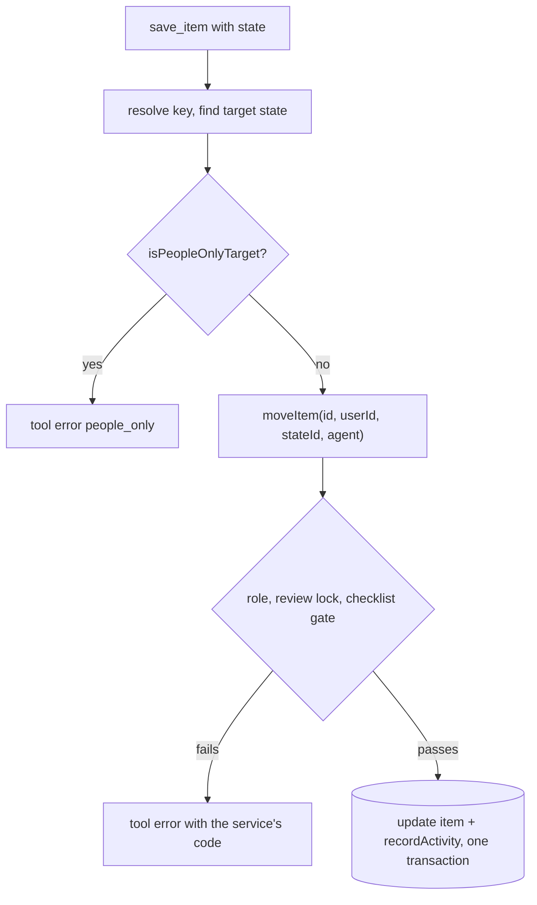

# 34: MCP write tools and activity log

Status: Aligning

## Scope

The second half of `MVP.md` §14 slice 4: through `/mcp` (plan 33), an agent creates,
edits, moves and deletes items and keeps their done-when checklists, and every change it
makes is recorded.

- **Same services, same rules** as the website: role, claim, review lock, checklist
  gates and limits. An agent can do exactly what its person can (ADR-0012).
- **One MCP-only rule** (§9): agents can't move an item to Ready or Done, even an owner's
  agent. People do that on the website.
- **Activity log**: who, which agent (OAuth client id), what, when. Stored only; a page to
  read it comes later.

Left out:

- Design, ADR, comment and record tools: slices 7 and 10.
- Blocked-by links, labels on items and restore through MCP: wait until an agent needs them.
- Logging changes people make on the website: the table allows it (no client id), but
  this plan only writes from MCP.

## Done when

- [ ] `save_item` without a key creates an item (kind, title, description, parent,
      priority, assignee) and with a key updates it, through `createProjectItem` /
      `updateProjectItem`; rule errors come back with their code.
- [ ] `save_item` with a `state` moves the item through `moveItem`; a target with key
      `ready` or category `DONE` is refused for every agent with `people_only`, before
      the service runs.
- [ ] `delete_item` deletes through `removeItem`.
- [ ] `set_criteria` replaces an item's checklist (the project's maximum still applies,
      `checklist_max_exceeded`), and `check_criterion` ticks one entry by 1-based index or
      exact text, with optional evidence.
- [ ] Each successful write tool call adds an `activity` row (user, client id, tool,
      project, item, when) in the same transaction as the change.
- [ ] The seed has items whose titles say what to try from an agent and what should
      happen: move to Done → `people_only`; tick the checklist, then move to In Review →
      works; add a 7th criterion → `checklist_max_exceeded`.

## Design

| Function                                          | File                                              | What                                                                                                                                                                                            | Why                                                                                        |
| ------------------------------------------------- | ------------------------------------------------- | ----------------------------------------------------------------------------------------------------------------------------------------------------------------------------------------------- | ------------------------------------------------------------------------------------------ |
| `Activity` model + migration                      | `api/prisma/schema.prisma`                        | `id`, `userId`, `clientId?`, `action` (e.g. `item.create`), `projectId`, `itemId?`, `createdAt`; index on `(projectId, createdAt)`.                                                             | Done-when 5. `clientId` null leaves room for website changes later.                        |
| `recordActivity(tx, row)`                         | `api/src/modules/activity/activity.repository.ts` | Inserts one row inside the caller's transaction.                                                                                                                                                | Done-when 5. ADR-0008: queries in repositories, transactions in services.                  |
| `agent?: { clientId }` parameter                  | `api/src/modules/items/item.service.ts`           | `createProjectItem`, `updateProjectItem`, `moveItem`, `removeItem` and the checklist functions take an optional last `agent`; when set they call `recordActivity` in their transaction.         | Done-when 5. Atomic with the change; the website passes nothing, so nothing changes there. |
| `replaceChecklist(itemId, userId, texts, agent?)` | `api/src/modules/items/item.service.ts`           | Deletes the entries and adds `texts` in order in one transaction, with the max check.                                                                                                           | Done-when 4. One call instead of N removes and adds, so a failure leaves the old list.     |
| `isPeopleOnlyTarget(state)`                       | `api/src/modules/mcp/mcp.rules.ts`                | True for key `ready` or category `DONE`.                                                                                                                                                        | Done-when 2. The one MCP-only rule, in one place.                                          |
| write tools                                       | `api/src/modules/mcp/mcp.server.ts`               | `save_item`, `delete_item`, `set_criteria`, `check_criterion` registered next to the read tools; each resolves keys, checks `isPeopleOnlyTarget` for moves, and calls the service with `agent`. | Done-when 1–4.                                                                             |
| seed cases                                        | `api/scripts/seed.ts`                             | Items in TG with agent instructions in their titles.                                                                                                                                            | Done-when 6.                                                                               |

Notes:

- `check_criterion` finds the entry by index or text, then calls `updateChecklistEntry`
  with `done: true` and the evidence.
- Open: whether the website's own changes should also be logged (pass `agent` as null with
  the user). Not in this plan.

## Changes

Filled in at the end.
