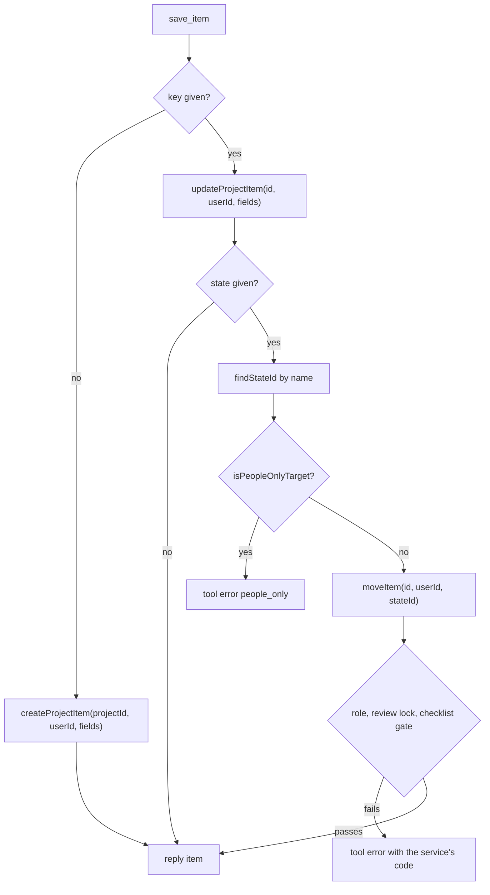

# 34: MCP write tools

Status: Aligning

## Scope

The second half of `MVP.md` §14 slice 4: through `/mcp` (plan 33), an agent creates,
edits, moves and deletes items and keeps their done-when checklists.

- **Same services, same rules** as the website: role, claim, review lock, checklist
  gates and limits. An agent can do exactly what its person can (ADR-0012).
- **One MCP-only rule** (§9): agents can't move an item to Ready or Done, even an owner's
  agent. People do that on the website.
- **People are named, not ids** (user decision): `assignee` is `me`, `none` or a project
  member's email, in `save_item` and in `list_items`' filter (which takes a user id in
  plan 33).
- **`list_projects` slims down** (user decision) to key, name, mode and the caller's role.
- **Builds on plan 35:** checklist functions live in `items/checklist.service.ts` by then.

Left out:

- **Activity log**: moved to plan 36 (user decision), together with an Activity section on
  the item page, so the records arrive when people can see them.
- Design, ADR, comment and record tools: slices 7 and 10.
- Blocked-by links, labels on items and restore through MCP: wait until an agent needs them.

## Done when

- [ ] `save_item` without `key` creates an item (`project`, `kind`, `title`,
      `description?`, `parent?` key, `priority?`, `assignee?`) through `createProjectItem`,
      and with `key` updates it through `updateProjectItem`; text fields follow the limits
      in `items/item.schema.ts`, and rule errors come back with their code.
- [ ] `save_item` with `state` (a state name) moves the item through `moveItem`; a target
      with key `ready` or category `DONE` is refused for every agent with `people_only`,
      before the service runs.
- [ ] `delete_item` deletes through `removeItem`.
- [ ] `set_criteria` replaces an item's checklist in one transaction (the project's maximum
      still applies, `checklist_max_exceeded`), and `check_criterion` ticks one entry by
      its number from `get_criteria` or its exact text, with optional evidence.
- [ ] `assignee` takes `me`, `none` or a member's email in `save_item` and the
      `list_items` filter (an unknown email answers `invalid_assignee`), and
      `list_projects` returns key, name, mode and role.
- [ ] The seed has TG items whose titles say what to try from an agent and what should
      happen: move to Done → `people_only`; tick every criterion, then move to In Review →
      works; set 7 criteria → `checklist_max_exceeded`.

## Design

| Function                                        | File                         | What                                                                                                                                                             | Why                                                                        |
| ----------------------------------------------- | ---------------------------- | ---------------------------------------------------------------------------------------------------------------------------------------------------------------- | -------------------------------------------------------------------------- |
| `saveItem(userId, input)`                       | `mcp/mcp.service.ts`         | No key: resolve project, parent and assignee, call `createProjectItem`. Key: call `updateProjectItem` with the fields sent, then `moveItem` when `state` is set. | Done-when 1–2. §9's single `save_item`; the item services keep every rule. |
| `deleteItem(userId, key)`                       | `mcp/mcp.service.ts`         | `findItemId`, then `removeItem`.                                                                                                                                 | Done-when 3.                                                               |
| `setCriteria(userId, key, texts)`               | `mcp/mcp.service.ts`         | `findItemId`, then `replaceChecklist`; answers the new list via `toCriteria`.                                                                                    | Done-when 4.                                                               |
| `checkCriterion(userId, key, which, evidence?)` | `mcp/mcp.service.ts`         | Reads the checklist with `getItem`, picks the entry by number or exact text (else `not_found`), calls `updateChecklistEntry` with `done: true`.                  | Done-when 4. Numbers match `get_criteria`.                                 |
| `findAssigneeId(projectId, value, userId)`      | `mcp/mcp.service.ts`         | `me` → `userId`, `none` → `null`, else the member with that email from `memberService.listMembers`, or 400 `invalid_assignee`.                                   | Done-when 1, 5. Membership is checked by the service listing members.      |
| `findStateId(projectId, name, userId)`          | `mcp/mcp.service.ts`         | The state by name (case-insensitive) from `projectService.getProject`, or 400 `invalid_state`; returns key and category too.                                     | Done-when 2. Agents name states as people do.                              |
| `isPeopleOnlyTarget(state)`                     | `mcp/mcp.rules.ts`           | True for key `ready` or category `DONE`.                                                                                                                         | Done-when 2. The one MCP-only rule, pure, in one place.                    |
| `replaceChecklist(itemId, userId, texts)`       | `items/checklist.service.ts` | `loadItem`, then in one transaction: lock the item, check the max, delete the entries, insert `texts` in order.                                                  | Done-when 4. One call, and a failure leaves the old list.                  |
| tool input schemas                              | `mcp/mcp.schema.ts`          | `saveItemSchema`, `deleteItemSchema`, `setCriteriaSchema`, `checkCriterionSchema`; text fields reuse the rules in `items/item.schema.ts`.                        | Done-when 1, 4. Same limits as the website.                                |
| tool registrations                              | `mcp/mcp.server.ts`          | The four write tools next to the read tools, with `reply` / `toToolError`; `list_projects` maps rows to key, name, mode, role.                                   | Done-when 1–5.                                                             |
| `INSTRUCTIONS`                                  | `mcp/mcp.instructions.ts`    | Adds the write tools, `people_only`, and the assignee format.                                                                                                    | Done-when 2, 5.                                                            |
| seed cases                                      | `api/scripts/seed.ts`        | TG items with agent instructions in their titles.                                                                                                                | Done-when 6.                                                               |

Notes:

- A create with `state` creates in the project's first state, then moves, so the
  `people_only` check and the checklist gate apply the same way.
- `list_items`' `assignee` filter uses `findAssigneeId` too, so `me` and an email work there.

## Changes

Filled in at the end.
