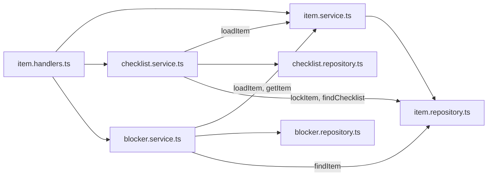

# 35: Split the item service

Status: In Review

## Scope

`apps/api/src/modules/items/item.service.ts` has grown to about 450 lines holding three
things: items (CRUD, move, restore), blocked-by links, and checklists. Plan 34 adds more
(`replaceChecklist`, the `agent` parameter). This refactor splits it by what each part
does, before plan 34, so the MCP write tools land in small files. No behaviour changes.

- **Split inside the `items/` module, not into new modules** (changed from the first
  idea of `checklists/` and `blockers/` modules). The checklist is part of the item:
  `itemSchema` embeds it, `toItem` maps its entries, and `moveItem` reads it for the
  gate. Separate modules would need cross-module imports of item utils, schemas and
  repository queries, which the API guide doesn't allow for repositories. Files in one
  module can share freely.
- New files follow the module's naming: `checklist.service.ts`, `checklist.repository.ts`,
  `blocker.service.ts`, `blocker.repository.ts` next to `item.*.ts`.
- Routes, handlers, schemas, OpenAPI operation ids, response shapes and error codes stay
  as they are, so the web app and MCP don't change.
- `item.service.spec.ts` tests only `item.rules.ts`; it's renamed to `item.rules.spec.ts`
  so the name says what it covers.

Left out:

- Splitting `item.handlers.ts` (127 lines) and `item.routes.ts` (201 lines): fine at
  their size.
- Any change in behaviour, including plan 34's work.

## Done when

- [x] `addChecklistEntry`, `updateChecklistEntry`, `removeChecklistEntry`,
      `reorderChecklist` and `writePositions` live in `items/checklist.service.ts`, and the
      entry queries (`findEntry`, `insertEntry`, `updateEntry`, `deleteEntry`,
      `setEntryPosition`) in `items/checklist.repository.ts`.
- [x] `addBlocker` and `removeBlocker` live in `items/blocker.service.ts`, and the link
      queries (`findLinks`, `insertLink`, `deleteLink`, `lockProject`) in
      `items/blocker.repository.ts`.
- [x] `moveItem`'s "finish the feature when its last slice finishes" step is a private
      `finishFeature(tx, item)` in `item.service.ts`, so `moveItem` reads as: who may move,
      Done check, checklist gate, update, review event, finish feature.
- [x] `item.service.spec.ts` is renamed to `item.rules.spec.ts`.
- [x] Nothing changes from outside: `bun run api:spec` leaves `apps/web/openapi.json`
      unchanged, and lint, typecheck, unit tests, e2e tests and build pass as on the
      base branch.

## Design

| Function                      | File                            | What                                                                                                                            | Why                                                                                                 |
| ----------------------------- | ------------------------------- | ------------------------------------------------------------------------------------------------------------------------------- | --------------------------------------------------------------------------------------------------- |
| `loadItem` (exported)         | `items/item.service.ts`         | Unchanged, but exported so the checklist and blocker services use the same membership check and 404.                            | Done-when 1–2. One place decides "can this person see this item".                                   |
| `finishFeature(tx, item)`     | `items/item.service.ts`         | The parent-feature step from `moveItem`: lock the parent, check its slices and checklist, move to Done.                         | Done-when 3. `moveItem` drops from about 70 lines to about 40.                                      |
| checklist functions           | `items/checklist.service.ts`    | Moved as they are, calling `loadItem`, `item.repository`'s `lockItem` / `findChecklist`, and their own repository.              | Done-when 1. `lockItem` and `findChecklist` stay in `item.repository.ts`: `moveItem` uses them too. |
| entry queries                 | `items/checklist.repository.ts` | Moved as they are.                                                                                                              | Done-when 1.                                                                                        |
| `addBlocker`, `removeBlocker` | `items/blocker.service.ts`      | Moved as they are; `addBlocker` still checks the blocker with `item.repository`'s `findItem` and returns `getItem(id, userId)`. | Done-when 2.                                                                                        |
| link queries                  | `items/blocker.repository.ts`   | Moved as they are. `lockProject` is only used by `addBlocker`.                                                                  | Done-when 2.                                                                                        |
| `item.handlers.ts`            | `items/item.handlers.ts`        | Import the moved functions from their new files.                                                                                | Done-when 5. Handlers and routes otherwise unchanged.                                               |

Notes:

- Plan 34's `replaceChecklist` and the `agent` parameter then go into
  `checklist.service.ts` and `item.service.ts`.
- `apps/api/AGENTS.md`'s file table lists `<feature>.service.ts`; a line is added saying a
  module may split its service and repository by sub-feature
  (`checklist.service.ts`), all files staying in the module folder.
- Builds on plan 33's branch (`loadItem` there answers the same 404 for missing and
  not-a-member items).

## Changes

Commits: none yet, not committed.

What moved where:

- `checklist.service.ts` (111 lines): `addChecklistEntry`, `updateChecklistEntry`,
  `removeChecklistEntry`, `reorderChecklist`, `writePositions`, moved as they were.
  `checklist.repository.ts`: `findEntry`, `insertEntry`, `updateEntry`, `deleteEntry`,
  `setEntryPosition`.
- `blocker.service.ts` (52 lines): `addBlocker`, `removeBlocker`. `blocker.repository.ts`:
  `lockProject`, `findLinks`, `insertLink`, `deleteLink`.
- `item.service.ts` went from 454 to 315 lines; `loadItem` is exported; `moveItem`'s
  parent-feature step is the private `finishFeature(tx, item)`.
- `item.handlers.ts` and `scripts/seed.ts` import the moved functions from the new files.
- `item.service.spec.ts` renamed to `item.rules.spec.ts`; `apps/api/AGENTS.md` notes that a
  module may split by sub-feature.

Planned vs actual: as planned. `finishFeature` receives the updated row (it carries the
new state), so it reads the finished state from `item.state.category` instead of taking the
target as a second parameter. Same logic and comments.

Checks: lint, typecheck, unit tests (86) and build pass; `bun run api:spec` leaves
`apps/web/openapi.json` unchanged; e2e passed 142/143 on the first run (one
`reviews.e2e-spec.ts` test failed in teardown with a DB deadlock); rerunning that file
alone passed 12/12. The code-reviewer's full e2e run passed 143/143, so the deadlock was a one-off on the shared dev database, not a known problem; no tech-debt file.

Review (code-reviewer, against `feat/mcp-read-tools`): ready, no critical findings. Two minor doc findings, both fixed: the flow diagram now shows `blocker.service.ts` calling `findItem` in `item.repository.ts`, and this paragraph records that the e2e deadlock was a one-off.
