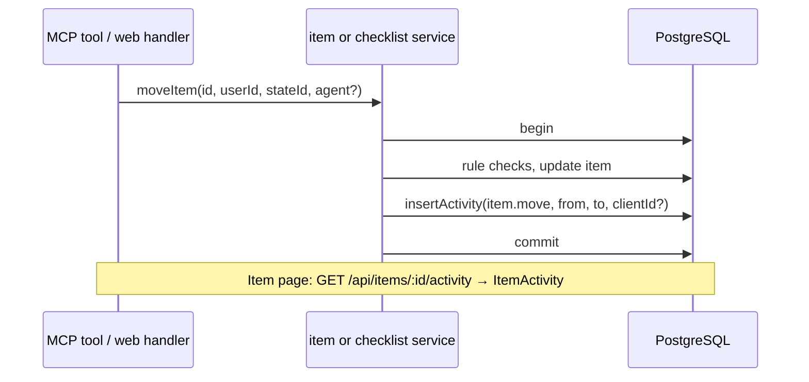

# 36: Item activity

Status: Aligning

## Scope

`MVP.md` §9: "Every change is recorded in an activity log (who, which agent, what, when)",
and §4: "The site shows 'Mya's agent created UG-12'". An agent acts with its person's full
role (ADR-0012), so people need to see whether a change was made by the person or by the
person's agent. Split out of plan 34 (user decision) so the records arrive together with a
place to see them.

- **Item-level** (user decision): agents only touch items and their checklists, so every
  agent change belongs to an item. The item page gets an **Activity** section.
- **People and agents alike**: website changes are recorded too (no client id), so an
  item's history is complete, not only its agent part.
- **Written in the same transaction as the change**, as `moveItem` already does for
  `review_event`: a change never exists without its record.
- **Who is the agent**: the OAuth client id from the token (`Agent.clientId`, plan 33).

Left out:

- A project-wide activity feed, and recording project changes (settings, members, labels):
  people-only today; a later plan can reuse the same table (`itemId` is optional).
- The agent's display name (e.g. "Claude Code"): needs the client's name from uniAuth;
  until then the page says "Slade's agent".
- Retention and paging: the section shows the latest 50.

## Done when

- [ ] An `activity` table (user, client id, action, project, item, detail, time) with a
      migration; rows go when their item or project goes.
- [ ] Creating, editing, moving, deleting and restoring an item each add one row in the
      same transaction: `item.create`, `item.update` (which fields), `item.move` (from and to
      state), `item.delete`, `item.restore`.
- [ ] Adding, editing, ticking, unticking, removing and replacing checklist entries each
      add one row (`checklist.*`, with the entry's text).
- [ ] The MCP write tools (plan 34) pass the agent, so their rows carry its client id;
      website changes carry none.
- [ ] `GET /api/items/:id/activity` returns the item's latest 50 rows, newest first, with
      the person's name and whether an agent did it; a non-member gets the same 404 as
      for the item.
- [ ] The item page shows an Activity section: "Slade moved TG-12 to In Review · 2h ago",
      "Slade's agent ticked 'It works' · 5m ago"; the seed gives TG items some history.

## Design

| Function                                      | File                                                  | What                                                                                                                                                    | Why                                                                         |
| --------------------------------------------- | ----------------------------------------------------- | ------------------------------------------------------------------------------------------------------------------------------------------------------- | --------------------------------------------------------------------------- |
| `Activity` model + migration                  | `api/prisma/schema.prisma`                            | `id`, `userId?` (SetNull), `clientId?`, `action`, `projectId` (Cascade), `itemId?` (Cascade), `detail Json?`, `createdAt`; index `(itemId, createdAt)`. | Done-when 1. `itemId` optional for a project feed later.                    |
| `insertActivity(tx, row)`                     | `items/activity.repository.ts`                        | One insert inside the caller's transaction.                                                                                                             | Done-when 2–3. ADR-0008: queries in repositories, transactions in services. |
| `findActivity(itemId)`                        | `items/activity.repository.ts`                        | Latest 50 rows with the user's name and image.                                                                                                          | Done-when 5.                                                                |
| `agent?: { clientId: string }` last parameter | `items/item.service.ts`, `items/checklist.service.ts` | Every write function takes it and calls `insertActivity` in its transaction; `createProjectItem` and `removeItem` gain one.                             | Done-when 2–4. The website passes nothing, so its rows have no client id.   |
| `listItemActivity(id, userId)`                | `items/activity.service.ts`                           | `loadItem` (same 404), then `findActivity`, mapped with `toActivity`.                                                                                   | Done-when 5.                                                                |
| `toActivity(row)`                             | `items/item.utils.ts`                                 | Row → `{ action, detail, by: { name, image }, viaAgent, at }`.                                                                                          | Done-when 5. Pure mapper.                                                   |
| route + handler                               | `items/item.routes.ts`, `item.handlers.ts`            | `GET /items/:id/activity`, `operationId: 'listItemActivity'`.                                                                                           | Done-when 5. The web hook becomes `useListItemActivity`.                    |
| MCP write tools                               | `mcp/mcp.service.ts`                                  | Pass `{ clientId: agent.clientId }` to the services.                                                                                                    | Done-when 4.                                                                |
| `ItemActivity`                                | `web/components/items/item-activity.tsx`              | Collapsible section under the checklist: one line per row with avatar, sentence and `timeAgo`.                                                          | Done-when 6. One component per file.                                        |

Notes:

- Builds on plan 35 (checklist service split) and plan 34 (write tools).
- ADR-0012 already says the activity record carries the OAuth client id.

## Changes

Filled in at the end.
