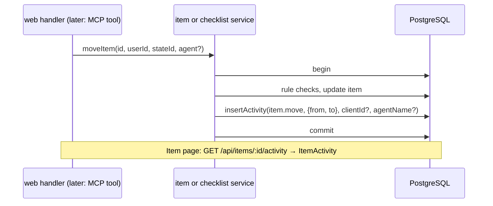

# 36: Item activity

Status: In Review

## Scope

`MVP.md` §9: "Every change is recorded in an activity log (who, which agent, what, when)",
and §4: "The site shows 'Mya's agent created UG-12'". An agent acts with its person's full
role (ADR-0012), so people need to see whether a change was made by the person or by the
person's agent. Split out of plan 34 and built before it (user decisions), so the records
and a place to see them exist before agents can write.

- **Item-level** (user decision): agents only touch items and their checklists, so every
  agent change belongs to an item. The item page gets an **Activity** section, as in the
  mockup the user approved (Uniloom Item Activity artifact).
- **People and agents alike**: website changes are recorded too (no client id), so an
  item's history is complete, not only its agent part.
- **Written in the same transaction as the change**, as `moveItem` already does for
  `review_event`: a change never exists without its record.
- **Who is the agent** (user decision): the OAuth client id and its registered name from
  the token. uniAuth adds a `client_name` claim (uniAuth#3); `requireAgent` reads it into
  `Agent.clientName`. The page says "Slade · Claude Code"; "Slade's agent" is only the
  fallback when a row has no name. The name is self-declared: shown, never used for access.
- **`detail` is typed** (user decision): one zod discriminated union on `action` in
  `items/item.schema.ts`, used for the TS type of every write and the endpoint's OpenAPI
  response. Values are what a person reads: state names, member names, entry text; enum
  codes (`HIGH`) stay codes because the web already formats them. Updates list their
  changes: `{ changes: [{ field, from?, to? }] }`, with `from`/`to` left out for long text
  (description).

Left out:

- Passing the agent from MCP write tools: plan 34 (its tools don't exist yet). This plan
  gives the services the `agent` parameter and `Agent` its name.
- A project-wide activity feed, and recording project changes (settings, members, labels);
  a later plan can reuse the table (`itemId` is optional).
- Blocked-by link changes and label changes on items: added when someone needs them.
- Comments: when they exist they join this timeline (All / Comments / History tabs).
- Retention and paging: the section shows the latest 50.

## Done when

- [x] An `activity` table (user, client id, agent name, action, project, item, detail,
      time) with a migration; rows go when their item or project goes.
- [x] Creating, editing, moving, deleting and restoring an item each add one row in the
      same transaction: `item.create` (`parent`), `item.update` (`changes`), `item.move`
      (`from`, `to` state names), `item.delete`, `item.restore`.
- [x] Adding, editing, ticking, unticking and removing checklist entries each add one row
      (`checklist.add` / `edit` / `tick` / `untick` / `remove`, with the entry's text, and
      the evidence on a tick).
- [x] `requireAgent` reads the optional `client_name` claim into `Agent.clientName`; every
      item and checklist write function takes an optional last `agent: { clientId,
    clientName }`, stored as `clientId` / `agentName`; without it (the website) both are
      null.
- [x] `GET /api/items/:id/activity` returns the item's latest 50 rows, newest first, with
      the person's name and image and, for an agent row, the agent's name (or null); a
      non-member gets the same 404 as for the item.
- [x] The item page shows the Activity section under the checklist: "Slade moved it
      IN PROGRESS → IN REVIEW · 2h ago", "Slade · Claude Code ticked 'It works' · 5m ago"
      ("Slade's agent" when the name is missing); the seed gives TG items some history.

## Design

| Function                       | File                                                  | What                                                                                                                                                                                                                   | Why                                                                             |
| ------------------------------ | ----------------------------------------------------- | ---------------------------------------------------------------------------------------------------------------------------------------------------------------------------------------------------------------------- | ------------------------------------------------------------------------------- |
| `Activity` model + migration   | `api/prisma/schema.prisma`                            | `id`, `userId?` (SetNull), `clientId?`, `agentName?`, `action`, `projectId` (Cascade), `itemId?` (Cascade), `detail Json`, `createdAt`; index `(itemId, createdAt)`.                                                   | Done-when 1. `itemId` optional for a project feed later.                        |
| `activitySchema`               | `items/item.schema.ts`                                | `z.discriminatedUnion('action', [...])`, one entry per action with its `detail` shape; `ActivityDetail` type via `z.infer` in `item.types.ts`.                                                                         | Done-when 2–3, 5. One definition types every write and documents the response.  |
| `insertActivity(tx, row)`      | `items/activity.repository.ts`                        | One insert inside the caller's transaction.                                                                                                                                                                            | Done-when 2–3. ADR-0008: queries in repositories, transactions in services.     |
| `findActivity(itemId)`         | `items/activity.repository.ts`                        | Latest 50 rows with the user's name and image.                                                                                                                                                                         | Done-when 5.                                                                    |
| `agent?` last parameter        | `items/item.service.ts`, `items/checklist.service.ts` | `createProjectItem`, `updateProjectItem`, `moveItem`, `removeItem`, `restoreProjectItem` and the checklist writes take it and call `insertActivity` in their transaction; writes that have no transaction yet get one. | Done-when 2–4. The website passes nothing.                                      |
| `Agent.clientName`             | `mcp/mcp.types.ts`, `mcp/mcp.auth.ts`                 | The verifier returns `clientName` from `client_name` when it is a string, else null; `requireAgent` puts it on `Agent`.                                                                                                | Done-when 4. A token without the claim still works.                             |
| `listItemActivity(id, userId)` | `items/activity.service.ts`                           | `loadItem` (same 404), then `findActivity`, mapped with `toActivity`.                                                                                                                                                  | Done-when 5.                                                                    |
| `toActivity(row)`              | `items/item.utils.ts`                                 | Row → `{ id, action, detail, by: { name, image }, agent, at }`; `agent` is `{ name }` (name or null) for an agent row, null for a person.                                                                              | Done-when 5. Pure mapper.                                                       |
| route + handler                | `items/item.routes.ts`, `item.handlers.ts`            | `GET /items/:id/activity`, `operationId: 'listItemActivity'`, described with `activitySchema`.                                                                                                                         | Done-when 5. The web hook becomes `useListItemActivity`.                        |
| `ItemActivity`                 | `web/components/items/item-activity.tsx`              | Collapsible section under the checklist (same style as Blocked by): avatar (robot badge for agents), sentence by `switch (row.action)`, `timeAgo` with the full date on hover.                                         | Done-when 6. One component per file; refreshes with the item after each change. |
| seed history                   | `api/scripts/seed.ts`                                 | TG items created, moved and ticked through the services, one of them with an `agent`, so the section has rows to show.                                                                                                 | Done-when 6.                                                                    |

Notes:

- Builds on plan 35 (`checklist.service.ts`). Plan 34 then passes the agent from its write
  tools and records `checklist.replace` for `set_criteria`.
- ADR-0012 already says the activity record carries the OAuth client id.

## Changes

Commits: none yet, not committed.

What changed:

- Migration `20261011165533_item_activity`: `activity` table, `(itemId, createdAt)` index,
  user SetNull, project and item Cascade.
- API (`items/`): `activitySchema` (zod discriminated union, 10 actions), `activity.repository.ts`
  (`insertActivity`, `findActivity`), `activity.service.ts` (`listItemActivity`), `toActivity`,
  `GET /api/items/:id/activity`. Item and checklist writes take an optional last `agent` and
  write their row in the same transaction. `createItem`, `deleteItem` and `restoreItem`
  repository functions now take `tx`; the services run the transactions.
- `mcp.auth.ts` reads `client_name` into `Agent.clientName`.
- Web: `ItemActivity`, `ActivityRow`, `ActivitySentence` under the checklist; the item page's
  `refresh` also reloads the activity.
- Seed: a TG feature with history by you, Mya and an agent (`seed-client`, Claude Code).
- Tests: `item.utils.spec.ts`, `mcp.auth.spec.ts` (client_name), `test/activity.e2e-spec.ts`,
  operation list in `app.e2e-spec.ts`.

Planned vs actual: as planned. Checklist edit records `{ from, to }`. Gaps are in
`docs/tech-debt/011-activity-gaps.md` (automatic feature move, evidence-only edit, reorder,
labels, blockers, `from` read before the transaction).

Checks: lint, typecheck, test (91), build, e2e (148 after adding the new operation to the
app spec list) all pass.

Review (code-reviewer): no critical findings; four minor.

- Plan bookkeeping: fixed (this section, ticks, status).
- Update `from` values computed outside the transaction: not fixed, recorded in TD-011.
- `toActivity` casts stored `detail` to the union: not fixed, the plan accepts it (only the
  services write rows).
- TD-011 coverage: noted here.
