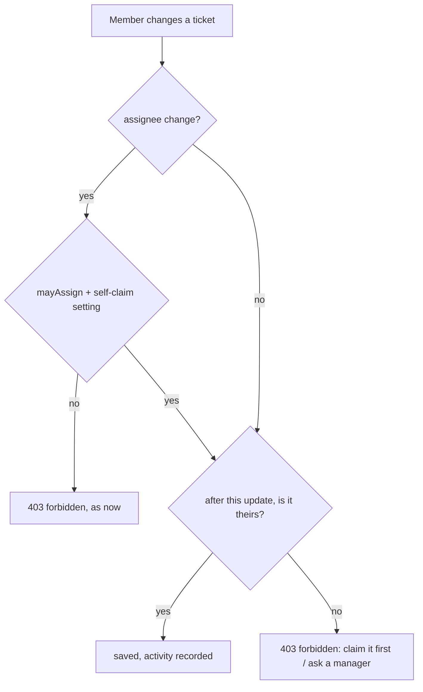

# 37: Members edit only their own tickets

Status: In Review

## Scope

`MVP.md` §4 says a Member may "edit tickets", which every plan so far read as any ticket in
the project (plan 09 left "editing only your own tickets" out; plan 11 opened checklists to
any member). With MCP write tools (plan 34) a Member's agent can therefore rewrite anyone's
ticket. The user decided: **a Member changes only tickets assigned to them.** Owners and
Managers are unchanged.

- **One rule, in the services**, so the website and MCP follow it alike: title, description,
  priority, parent, labels, the done-when checklist (add, edit, tick, untick, remove,
  reorder, replace) and blocked-by links.
- **Claiming follows the project setting** (user decision): with "Members can claim
  tickets" on, a Member claims a free ticket and then edits it; with it off, only an Owner
  or Manager can assign it, so the Member waits. Unclaiming their own ticket stays allowed
  in both (as now), after which they can no longer edit it.
- **A claim and an edit in one request** (e.g. MCP `save_item` with `assignee: "me"` and a
  title) is allowed when the claim itself is allowed: the rule looks at who the ticket
  belongs to after the update.
- **In Review stays editable** for its assignee (user decision); only moving it out stays
  locked (plan 12).
- **Reading is unchanged:** every member still sees every ticket.

Left out:

- Comments (no comments yet; when they come, any member comments on any ticket, per §4).
- Moving rules: unchanged (Members already move only their own tickets).
- Owners/Managers editing: unchanged.

## Done when

- [x] `mayEdit(role, userId, assigneeId)` in `items/item.rules.ts`: true for Owners and
      Managers, and for a Member only when the ticket is assigned to them; `mayMove` is
      rewritten on top of it (its behaviour and tests unchanged); unit tests.
- [x] `updateProjectItem` refuses a Member changing any field of a ticket that isn't theirs
      with `403 forbidden` ("Members can only edit tickets assigned to them: claim it
      first", or "…: ask an owner or manager to assign it" when self-claim is off); a claim
      or unclaim alone works as now, and a claim with edits in one request works when the
      claim is allowed.
- [x] The checklist calls (add, update, remove, reorder, replace) and blocker calls (add,
      remove) refuse the same way.
- [x] Item responses return `canEdit`; the item page disables title, description, priority,
      parent, labels, checklist and blocked-by controls when it is false and says why
      ("Claim it to edit" or "Only its assignee, owners and managers can edit it").
- [x] Through MCP the same calls answer `forbidden` (no MCP code change; e2e covers
      `save_item`, `set_criteria`, `check_criterion` for a Member's agent), and the
      instructions say Members edit only their own tickets.
- [x] Seed: TM (you are a Member, self-claim on) and TC (self-claim off) get tickets whose
      titles say what to try and what should happen; `MVP.md` §4 says "edit tickets assigned
      to them".

## Design

| Function                                       | File                                                     | What                                                                                                                                                                     | Why                                                                                                                                                           |
| ---------------------------------------------- | -------------------------------------------------------- | ------------------------------------------------------------------------------------------------------------------------------------------------------------------------ | ------------------------------------------------------------------------------------------------------------------------------------------------------------- |
| `mayEdit(role, userId, assigneeId)`            | `items/item.rules.ts`                                    | True for Owners and Managers (`CREATORS`), or when `assigneeId === userId`: "whose ticket is it", defined once.                                                          | Done-when 1. Shared by edits, checklists and blockers.                                                                                                        |
| `mayMove` (changed)                            | `items/item.rules.ts`                                    | `CREATORS.includes(role) or (sourceStateKey !== "in_review" and mayEdit(role, userId, assigneeId))`: moving is editing plus the In Review lock.                          | Done-when 1. Reuses `mayEdit` instead of a second copy; calling `mayMove(…, null)` for edits was rejected (misleading name, ties edits to future move rules). |
| `editError(project, role, userId, assigneeId)` | `items/item.rules.ts`                                    | The 403 message when `mayEdit` is false, naming claim or assignment by `project.selfClaimAllowed`; null when allowed.                                                    | Done-when 2–3. One message everywhere.                                                                                                                        |
| `updateProjectItem` (changed)                  | `items/item.service.ts`                                  | After the existing `mayAssign` check, if any non-assignee field is sent: check `mayEdit` against the assignee after this update (`input.assigneeId ?? item.assigneeId`). | Done-when 2. Lets claim-and-edit through, nothing else.                                                                                                       |
| checklist and blocker services (changed)       | `items/checklist.service.ts`, `items/blocker.service.ts` | `loadItem` already gives the role; add the `mayEdit` check before the transaction.                                                                                       | Done-when 3.                                                                                                                                                  |
| `canEdit` (changed)                            | `items/item.utils.ts` `toItem`, `item.schema.ts`         | `mayEdit(role, userId, row.assigneeId)`, next to `canMove`.                                                                                                              | Done-when 4. The web asks the API instead of repeating the rule.                                                                                              |
| item page (changed)                            | `web/components/items/item-detail.tsx` and its parts     | `disabled={!item.canEdit}` on the edit controls (as `canMove` disables State), plus a one-line hint under the title.                                                     | Done-when 4.                                                                                                                                                  |
| `INSTRUCTIONS` (changed)                       | `mcp/mcp.instructions.ts`                                | One sentence on the rule.                                                                                                                                                | Done-when 5.                                                                                                                                                  |
| seed cases                                     | `api/scripts/seed.ts`                                    | TM: a free ticket ("Edit → 403; claim it, then edit → works"), one of Mya's ("Edit → 403"). TC: a free ticket ("Edit → 403; no claim here: a manager assigns it").       | Done-when 6.                                                                                                                                                  |

Notes:

- Owners and Managers pass `mayEdit` always, so nothing changes for them.
- Website and MCP share the services; no rule is repeated in the web app (it reads
  `canEdit`).
- Existing e2e tests where a Member edits a ticket that isn't theirs will change to expect
  403, or assign the ticket first.

## Changes

No commits (left uncommitted for review).

What changed:

- `items/item.rules.ts`: added `mayEdit` and `editError`; `mayMove` now reads `CREATORS.includes(role) || (sourceStateKey !== 'in_review' && mayEdit(...))`, same behaviour. Unit tests for `mayEdit` and `editError`.
- `items/item.service.ts` `updateProjectItem`: after the `mayAssign` check, if title, description, parent, priority or labels are sent, refuses with `403 forbidden` unless the member owns the ticket after this update (`input.assigneeId` if sent, else the current assignee). A claim or unclaim alone is unchanged.
- `items/checklist.service.ts` (add, update, remove, reorder, replace) and `items/blocker.service.ts` (add, remove): same `403 forbidden` through `editError`, before the transaction.
- `canEdit` on the item response (`toItem`, `item.schema.ts`), next to `canMove`; not on list rows. `apps/web/openapi.json` regenerated.
- Web (`items/`): `item-detail.tsx` disables title, priority, parent, labels, blocked-by add/remove when `!item.canEdit` and shows a hint under the title; `Description`, `Checklist`, `ChecklistRow` and `LabelPicker` got a `canEdit`/`disabled` prop. The web only reads `canEdit`.
- `mcp/mcp.instructions.ts`: one sentence on the rule. No MCP code change.
- Seed: TM gets two slices (free: "403; claim it, then edit works"; Mya's: "403"), TC gets one free slice. `MVP.md` §4 now says "edit and move tickets assigned to them".
- Tests: updated three existing e2e tests that had a Member editing a ticket that was not theirs (roles/assign, checklist add, labels), and added e2e for the 403 paths, claim-and-edit, self-claim off wording, own-ticket checklist/blockers, and MCP `save_item`, `set_criteria`, `check_criterion`.

Planned vs actual: as planned. Choices the plan left open: the web hint says "Claim it to edit" only when the ticket is free and the project allows claiming, otherwise "Only its assignee, owners and managers can edit it"; description and checklist controls are hidden (not just disabled) when `canEdit` is false; tech debt: TD-015 (an edit racing a reassignment, found in review).
