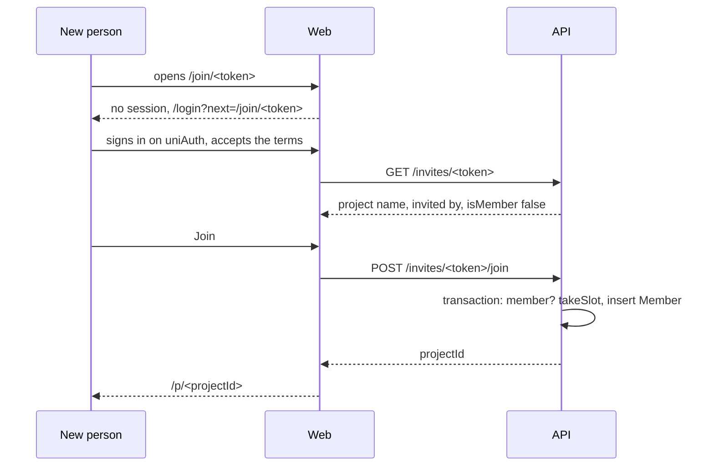
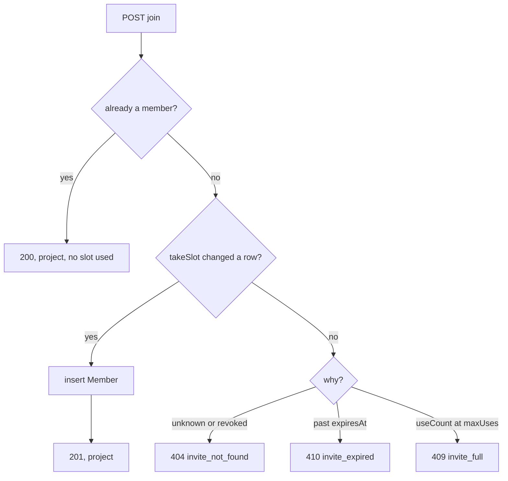

# 39: Invite links

Status: In Progress

## Scope

A project gets one invite link. An Owner or Manager picks an expiry and a limit, creates
the link and shares it. Anyone who opens it signs in (if needed), sees which project it is
and presses Join to become a Member. This is the first of three plans; the decisions are
in [ADR-0014](../adr/0014-project-invite-links.md).

- **API:** create (replacing the live link), read and delete the project's link; preview a
  link by its token; join through it.
- **Web:** the join page at `/join/<token>`, and an "Invite link" card on the Members page
  with the options, the link, two copy buttons and a status line.
- **Removing a member** now asks for confirmation. When an open link is live, the dialog
  offers to turn it off too, so the removed person can't walk back in.
- Add by email stays as it is.

Left out:

- Require approval and join requests: plan 40. Every link in this plan is open.
- The requester's view of their own request: plan 41.
- Email, MCP tools, several links per project, editing a live link, a ban list (ADR-0014).
- Rate limiting: the API has none, and a 256-bit token can't be guessed.

## Done when

- [x] An `invite` table (project, token, `maxUses`, `useCount`, `expiresAt`, creator,
      `revokedAt`) with at most one row per project where `revokedAt` is null, enforced by
      the database.
- [x] `POST`, `GET` and `DELETE /projects/:projectId/invite` work for Owners and Managers
      (`403 forbidden` for a Member, `404` for a non-member). Creating takes an expiry of
      1 hour, 24 hours, 7 days or 30 days and a limit of 1 to 100 or none, and the previous
      link stops working in the same transaction.
- [x] `GET /invites/:token` returns the project name, who made the link and whether the
      caller is already a member. `POST /invites/:token/join` adds the caller as a Member
      and uses one slot. An unknown or deleted link answers `404 invite_not_found`, an
      expired one `410 invite_expired`, a full one `409 invite_full`, and none of them name
      the project. A member who joins again gets the project back and uses no slot. When
      two people race for the last slot, exactly one gets in.
- [ ] `/join/<token>`: a signed-out visitor goes through login and consent and comes back
      to the same page; the page shows the project and a Join button, then opens the board;
      each error code has its own message and a way onward.
- [ ] The Members page shows an "Invite link" card to Owners and Managers: options and
      "Create link" when there is none; otherwise the link, "Copy link", "Copy invite
      message", "3 of 10 used, expires in 5 hours", "Delete link" and "Create new link",
      the last two behind a dialog that says the current link stops working. Removing a
      member asks first, with a ticked "Also turn off the invite link" when one is live.
- [ ] Seed projects with a live link, a full link and an expired link (the seed prints
      their URLs and what each should do); `MVP.md` §4 and §11 describe invite links.

## Design

New module `apps/api/src/modules/invites/`, mounted at `/` after `requireConsent`.

| Function                                               | File                                                                | What                                                                                                                                                                                                               | Why                                                                                                                                                    |
| ------------------------------------------------------ | ------------------------------------------------------------------- | ------------------------------------------------------------------------------------------------------------------------------------------------------------------------------------------------------------------ | ------------------------------------------------------------------------------------------------------------------------------------------------------ |
| `Invite` model, migration                              | `prisma/schema.prisma`                                              | Columns above. `token` unique. The migration adds a partial unique index on `projectId` where `revokedAt IS NULL`, and a CHECK that `maxUses` is null or at least 1.                                               | Done-when 1. The database, not the code, guarantees one live link.                                                                                     |
| `newToken()`                                           | `invites/invite.utils.ts`                                           | `randomBytes(32).toString('base64url')`.                                                                                                                                                                           | 256 bits, safe in a URL path.                                                                                                                          |
| `EXPIRY_SECONDS`                                       | `invites/invite.schema.ts`                                          | Map of `1h`, `24h`, `7d`, `30d` to seconds; the body is `{ expiresIn, maxUses }`.                                                                                                                                  | Done-when 2. The server computes `expiresAt`, so a client can't send a far date.                                                                       |
| `linkState(invite, now)`                               | `invites/invite.rules.ts`                                           | `'live'`, `'expired'` or `'full'` for a link that isn't revoked. Pure, unit tested.                                                                                                                                | One definition, used by read, preview and join.                                                                                                        |
| `createInvite(projectId, userId, input)`               | `invites/invite.service.ts`                                         | `requireRole(CREATORS)`. In a transaction: lock the project, set `revokedAt` on the live link, insert the new one.                                                                                                 | Done-when 2. The lock makes two managers creating at once end with one live link.                                                                      |
| `getInvite(projectId, userId)`                         | `invites/invite.service.ts`                                         | `requireRole(CREATORS)`. The current link with its token and state, or null. An expired or full link is still returned until replaced.                                                                             | Done-when 5: the card shows "Expired" instead of going blank.                                                                                          |
| `deleteInvite(projectId, userId)`                      | `invites/invite.service.ts`                                         | `requireRole(CREATORS)`. Sets `revokedAt`. Deleting when there is none is a 200.                                                                                                                                   | Done-when 2 and 5.                                                                                                                                     |
| `previewInvite(token, userId)`                         | `invites/invite.service.ts`                                         | Finds the link by token; throws the code for unknown, revoked, expired or full; otherwise `{ projectId, projectName, invitedBy, isMember }`. A member gets `isMember: true` even when the link is expired or full. | Done-when 3. A member following an old link should reach the project.                                                                                  |
| `joinAsMember(tx, projectId, userId)`                  | `members/member.service.ts`                                         | Inserts the Member row inside the caller's transaction; false if they already belong.                                                                                                                              | The invites module adds members through the members service, never its repository (API guide).                                                         |
| `joinByInvite(token, userId)`                          | `invites/invite.service.ts`                                         | In a transaction: if already a member, return the project. Else `takeSlot`, insert the Member row.                                                                                                                 | Done-when 3.                                                                                                                                           |
| `takeSlot(tx, inviteId, now)`                          | `invites/invite.repository.ts`                                      | One `UPDATE invite SET "useCount" = "useCount" + 1 WHERE id = … AND "revokedAt" IS NULL AND "expiresAt" > now AND ("maxUses" IS NULL OR "useCount" < "maxUses")`. Returns whether a row changed.                   | The check and the count are one statement, so the last slot can't be taken twice. On false the service re-reads the link to pick the right error code. |
| `canInvite`                                            | `projects/project.service.ts` `getProject`                          | `CREATORS.includes(role)`.                                                                                                                                                                                         | `canManageMembers` is Owner only, and Managers invite too. The web asks the API.                                                                       |
| `JoinPage`                                             | `web/components/invites/join-page.tsx`, `app/join/[token]/page.tsx` | Preview query, Join mutation, then `router.replace('/p/<id>')`. A member is sent straight there.                                                                                                                   | Done-when 4.                                                                                                                                           |
| `PROTECTED` (changed)                                  | `web/src/proxy.ts`                                                  | Adds `/join`.                                                                                                                                                                                                      | Login and consent already return to `next`, so a new person lands back on the link.                                                                    |
| `InviteLinkCard`, `InviteOptions`, `ReplaceLinkDialog` | `web/components/members/`                                           | The card and its parts. The link is built from `window.location.origin` and the token.                                                                                                                             | Done-when 5.                                                                                                                                           |
| `inviteMessage(...)`                                   | `web/components/members/invite-message.ts`                          | The text for "Copy invite message".                                                                                                                                                                                | Done-when 5.                                                                                                                                           |
| `RemoveMemberDialog`                                   | `web/components/members/remove-member-dialog.tsx`                   | AlertDialog before removing. With a live link, a ticked checkbox; when ticked, the page calls `deleteInvite` after the removal succeeds.                                                                           | Done-when 5. Two existing calls, no new rule in the API.                                                                                               |
| seed                                                   | `api/scripts/seed.ts`                                               | `TV` (you own it, live link, 3 of 10 used), and three owned by Ko that you are not in: `TO` open link, `TF` full, `TE` expired.                                                                                    | Done-when 6.                                                                                                                                           |





Text:

- Card options: a "Expires after" select (1 hour, 24 hours, 7 days, 30 days) and a "Limit"
  select (No limit, 1, 5, 10, 25, 50, 100 people). Defaults: 24 hours, no limit.
- Invite message, with the time left worked out when the button is pressed:

  ```text
  Mya invited you to join Unigym on Uniloom.
  https://uniloom.example/join/AbC…
  This link expires in 24 hours.
  ```

- Join page: heading "Join Unigym", "Mya invited you to this project. You'll join as a
  Member.", button "Join project".
- Errors: "This invite link has expired. Ask for a new one.", "This invite link is full.
  Ask for a new one.", "This invite link doesn't work. It may have been replaced.", each
  with a "Go to your projects" link.
- Replace dialog: "Create a new link? The current link stops working right away. People who
  already joined stay in the project."

Accessibility (WCAG 2.2 AA):

- Every control has a visible label; the link is in a read-only input with a label, so it
  can be selected by keyboard when the clipboard is blocked.
- Copy results are announced through the existing toasts; the status line is text, never
  colour alone ("Expired", "Full").
- Dialogs use the existing `AlertDialog` (focus trap, Escape, focus returns to the button).
  The destructive action is never the default focus.
- The join page has one `h1`, errors use `role="alert"`, and the button shows a busy state
  with `aria-busy` while joining.
- Targets are at least 24 by 24 CSS pixels; the layout wraps at 320 px wide.

Notes:

- The token sits in the URL path, so it reaches the access logs of the web host and the
  `next` parameter during login. Both are ours. Avatars load from other hosts, but browsers
  send only the origin as referrer by default.
- `describe()` only marks the names in `pathParams` as uuids. `token` is left out of that
  list, as `userId` is on the members routes, so the spec lists it as a plain string.
- Tests first: the unit tests for `linkState` and the e2e file `test/invites.e2e-spec.ts`
  are written and seen failing before the service.

## Changes
