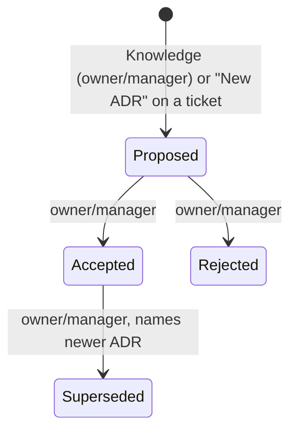

# 40: ADRs

Status: In Review

## Scope

MVP §7 ADRs inside Uniloom projects, as a document kind in the one `document` table
(ADR-0014). ADRs are Knowledge documents: they live in Knowledge → ADRs because they
outlive the ticket that raised them. Needs plan 39 for linking them to tickets.

- **Guided projects only** (user decision, 2026-10-13; MVP §7 changed to match).
- Kind `ADR`, numbered per project from 1 (shown `ADR-7`), with a status: Proposed →
  Accepted or Rejected; an accepted ADR can later be Superseded by a newer one.
- **Creating:** on the Knowledge page, Owners and Managers. From a ticket ("New ADR"),
  whoever may edit that ticket (`editError`, plan 37): a Member on their own ticket,
  Owners and Managers on any. It's saved in Knowledge, linked to the ticket, with
  `createdFromItemId` set, in one transaction.
- **Editing after creation:** Owners and Managers only, by current role, like every
  Knowledge document (plan 15, `dc3ec48`). The author who is a Member can't edit it.
- **Accepting, rejecting and superseding:** Owners and Managers, on the website only
  (§7, §9). No MCP path offers them.
- Never deleted, only superseded: archive is refused for ADRs.
- New ADRs open from a template: Context, Options, Decision, Consequences.

Left out:

- MCP `save_adr`, `get_adr`, `list_adrs` (MVP §9; with plan 42's document tools).
- Approver ≠ author for ADRs (§4 switch): later, with design approval.

## Done when

- [x] Migration: `DocumentKind.ADR`, `DocumentStatus`, `document.number` (unique per
      project and kind), `document.status`, `document.supersededById`; a new ADR takes
      the next number with the project row locked, like item numbers.
- [x] `POST /api/items/:id/documents/new` with kind `ADR` creates a Proposed project ADR,
      links it to the ticket and sets `createdFromItemId`, in one transaction (`403` with
      `editError`'s message, `409 guided_only`); `POST /api/projects/:id/documents` with
      kind `ADR` stays Owners and Managers.
- [x] `POST /api/documents/:id/status` `{ status, supersededById? }`: Owners and Managers
      only (`403`); allowed moves Proposed→Accepted, Proposed→Rejected,
      Accepted→Superseded (needs a newer Accepted ADR, else `409 invalid_status`).
- [x] Archiving an ADR answers `409 adr_not_archivable`; editing an Accepted ADR's body is
      allowed (Owners and Managers) and keeps its status.
- [x] Web: Knowledge gets an ADRs tab (`ADR-n`, title, status badge); the item page gets
      "New ADR" beside "New spec"; the ADR page shows Accept / Reject for Owners and
      Managers on a Proposed ADR and "Superseded by ADR-n" with a link.
- [x] Seed: a Proposed ADR created by a Member from their ticket (to accept), a Rejected
      one, and an Accepted one superseded by a newer one, each titled with what to try.

## Design

| Function                                  | File                                                       | What                                                                | Why                                            |
| ----------------------------------------- | ---------------------------------------------------------- | ------------------------------------------------------------------- | ---------------------------------------------- |
| `nextStatusError(kind, from, to)`         | `apps/api/src/modules/documents/document.rules.ts`         | Null when the move is allowed for that kind, else the reason        | Statuses are rules, not constraints (ADR-0014) |
| `setDocumentStatus(id, userId, input)`    | `apps/api/src/modules/documents/document.service.ts`       | Current-role check, `nextStatusError`, supersede check, update      | The one path that changes status               |
| `nextDocumentNumber(tx, projectId, kind)` | `apps/api/src/modules/documents/document.repository.ts`    | Locks the project row, returns max(number) + 1 for that kind        | Numbers never repeat, even at the same moment  |
| `createTicketDocument` (changed)          | `apps/api/src/modules/items/item-document.service.ts`      | For kind ADR: project home, number, Proposed, link, one transaction | Raised on the ticket, kept in Knowledge        |
| `AdrStatusActions`                        | `apps/web/src/components/documents/adr-status-actions.tsx` | Accept, Reject, Supersede buttons for people                        | People-only approval on the website            |
| `StatusBadge`                             | `apps/web/src/components/documents/status-badge.tsx`       | Colour per status, shared by ADR and tech debt                      | Used in lists, pages and the Related section   |

Schema added to `document` (ADR-0014):

```prisma
enum DocumentStatus { PROPOSED ACCEPTED REJECTED SUPERSEDED OPEN FIXED WONT_FIX }

model Document {
  /// ADR-7 / TD-3: per project and kind.
  number         Int?
  status         DocumentStatus?
  supersededById String? @db.Uuid // ADR only, set null

  @@unique([projectId, kind, number])
}
```



## Changes

Commits `6f7868e` (API), `704baf3` (web) and `e9d0e47` (docs), shared by plans 39 to 41. Branch `feat/ticket-documents`, migration `20261013185703_adrs` (adds to
plan 39's; applied to the shared dev DB).

**API**

- Schema: `DocumentKind.ADR`, `DocumentStatus` (all seven values), `document.number`,
  `status`, `supersededById` (set null), `@@unique([projectId, kind, number])`.
- `documents/document.rules.ts`: `nextStatusError` (ADR moves only), with a unit spec.
- `documents/`: `nextDocumentNumber` (locks the project row `FOR UPDATE`, then max + 1),
  `addAdr` (next number, Proposed, inside the caller's transaction), `setDocumentStatus`,
  `createDocument` for kind `ADR` (Guided only), `updateDocumentById` refuses archiving an
  ADR. `number`, `status` and `supersededBy` added to the responses.
- `items/item-document.service.ts`: `createTicketDocument` accepts kind `ADR`: creates the
  Knowledge ADR (`createdFromItemId` set) and links it in one transaction. `related` rows
  gain `number` and `status` (the omission noted in plan 39).
- Seed: `seedAdrs`. Tests: `test/adrs.e2e-spec.ts`, `document.rules.spec.ts`, operation
  list in `app.e2e-spec.ts`.

**Web:** `StatusBadge`, `AdrStatusActions` (Accept, Reject, Supersede with a picker of
newer Accepted ADRs), ADRs tab and `ADR-n` + status in the Knowledge list, ADR page header
with "Superseded by ADR-n", no Archive button on ADRs, "New ADR" beside "New spec" (both
now `NewTicketDocumentDialog`, replacing `NewSpecDialog`), ADR in the new-document picker
for Guided projects only, ADR in Related with number and status.

**Planned vs actual**

- `NewSpecDialog` became `NewTicketDocumentDialog` with a `kind` prop instead of a second
  near-identical dialog.
- Superseding is refused (`409 invalid_status`) without a newer Accepted ADR of the same
  project, and `supersededById` on any other status is refused too.
- `POST /api/projects/:id/documents` with kind `ADR` answers `409 guided_only` in a
  Standard project (the plan said only "stays Owners and Managers").
- `nextStatusError` handles ADRs only; other kinds answer "Only ADRs have a status" until
  plan 41.
- The Prisma migration was written with `prisma migrate diff` because `migrate dev` needs
  a terminal.
- Review fixes (done with plan 41): `setDocumentStatus` writes only while the status is
  still the one it read (`moveDocumentStatus`, `409 invalid_status` for the move that
  lost a race; e2e test with two moves at once), and the web no longer rebuilds the
  Guided-only rule: the project response has `documentKinds`, the item response
  `ticketDocumentKinds` (from `guidedOnlyError`), and the kind picker, Knowledge tabs
  and the item's Related section read them (`kindsFor` removed).
