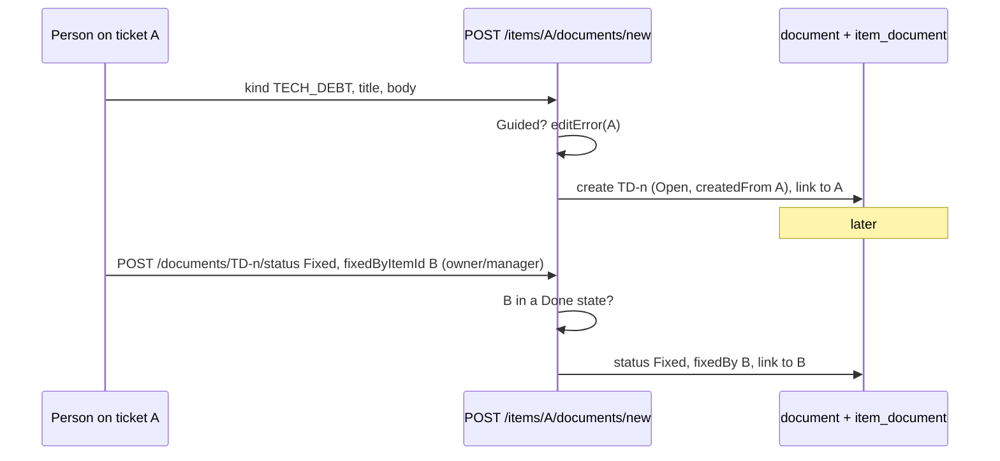

# 41: Tech debt records

Status: In Review

## Scope

Tech debt as a record inside Uniloom projects, raised from the ticket where it was found
and closed by the ticket that fixes it. A document kind in the one `document` table
(ADR-0014); needs plans 39 and 40 (links, numbering and statuses). The user asked
for it on 2026-10-13; MVP.md §4 and §8 describe it.

- **Guided projects only** (user decision, 2026-10-13).
- Kind `TECH_DEBT`, numbered per project (`TD-3`), status Open → Fixed or Won't fix. Tech
  debt is a Knowledge document (Knowledge → Tech debt): it's often fixed by another ticket.
- **Raising:** "Raise tech debt" on a ticket creates the record, links it to the ticket
  and sets `createdFromItemId` ("Raised on"), in one step. Allowed to whoever may edit
  the ticket (`editError`): a Member on their own ticket, Owners and Managers on any.
- **Editing after creation:** Owners and Managers only, by current role, like every
  Knowledge document (plan 15, `dc3ec48`).
- **Closing:** Owners and Managers set Won't fix, or Fixed naming the fixing ticket
  (`fixedByItemId`), which must be in a Done state in the same project; it's linked too.
- Uniloom's own `docs/tech-debt/` files stay as they are; this is for projects managed in
  Uniloom.

Left out:

- MCP tools for raising tech debt (with plan 42's document tools).
- Turning a debt record into a ticket automatically.

## Done when

- [x] Migration: `DocumentKind.TECH_DEBT` and `document.fixedByItemId` (set null);
      numbering and status reuse plan 40's columns.
- [x] `POST /api/items/:id/documents/new` with kind `TECH_DEBT` `{ title, body }` creates an
      Open `TD-n`, links it to the ticket and sets `createdFromItemId`, in one
      transaction; `403` with `editError`'s message, `409 guided_only`.
- [x] `POST /api/documents/:id/status`: Owners and Managers only; Open→Won't fix, and
      Open→Fixed only with `fixedByItemId`, a ticket in the same project in a Done state
      (`409 fix_not_done` otherwise), which is stored and linked.
- [x] Item page: a "Raise tech debt" button beside "New ADR" opening a title and Markdown
      form; Related shows the ticket's debts with their status badge.
- [x] Knowledge page: a Tech debt tab with `TD-n`, title, status, Raised on
      (`createdFromItemId`) and Fixed by (`fixedByItemId`).
- [x] Seed: a ticket with an open debt raised by a Member, a debt fixed by a Done ticket,
      and one titled "Mark this Fixed with a ticket that isn't Done: refused".

## Design

| Function                         | File                                                       | What                                                                  | Why                                   |
| -------------------------------- | ---------------------------------------------------------- | --------------------------------------------------------------------- | ------------------------------------- |
| `createTicketDocument` (changed) | `apps/api/src/modules/items/item-document.service.ts`      | For kind TECH_DEBT: project home, number, Open, link, one transaction | Raising and linking can't half-happen |
| `nextStatusError` (changed)      | `apps/api/src/modules/documents/document.rules.ts`         | Adds TECH_DEBT moves                                                  | Same rule function as ADRs            |
| `setDocumentStatus` (changed)    | `apps/api/src/modules/documents/document.service.ts`       | For Fixed: checks the fixing ticket is Done, stores and links it      | "Fixed" means a real fix exists       |
| `RaiseTechDebtDialog`            | `apps/web/src/components/items/raise-tech-debt-dialog.tsx` | Title and Markdown body, then creates                                 | Raised where it's found               |

Schema added to `document` (ADR-0014):

```prisma
model Document {
  /// Tech debt only: the Done ticket that fixed it.
  fixedByItemId String? @db.Uuid // set null
}
```



## Changes

Not committed. Branch `feat/ticket-documents`, migration `20261013210000_tech_debt`
(adds to plans 39 and 40's; applied to the shared dev DB).

**API**

- Schema: `DocumentKind.TECH_DEBT`, `document.fixedByItemId` (set null) with the
  `fixedByItem` relation. `Document` responses gain `fixedBy` (`{ id, key }`).
- `documents/document.rules.ts`: `nextStatusError` adds TECH_DEBT (Open to Fixed or
  Won't fix, then closed), unit specs added.
- `documents/document.service.ts`: `addAdr` became `addNumberedDocument(tx, projectId,
userId, kind, input, createdFromItemId)` (ADR starts Proposed, tech debt Open).
  `setDocumentStatus` takes `fixedByItemId`: Fixed needs a Done ticket of the same
  project (`409 fix_not_done`), stores it and links it, in one transaction.
- `items/item-document.service.ts`: `createTicketDocument` accepts kind `TECH_DEBT` (same
  path as ADR: numbered `TD-n`, Open, linked, `createdFromItemId` set, one transaction).
- Seed: `seedTechDebt`. Tests: `test/tech-debt.e2e-spec.ts`, `document.rules.spec.ts`.

**Web:** `TECH_DEBT` kind (icon, template, `TD-n` via `documentKey`), a Tech debt tab on
Knowledge, `TD-n` + status in the list, the debt page ("Fixed by KEY" line),
`TechDebtStatusActions` (Mark fixed with a Done ticket picker, Won't fix; owners and
managers), "Raise tech debt" beside "New ADR" on the item page, tech debt in Related with
its status badge.

**Planned vs actual**

- No `RaiseTechDebtDialog`: `NewTicketDocumentDialog` (plan 40) got a third kind instead
  of a third near-identical dialog.
- `POST /api/projects/:id/documents` with kind `TECH_DEBT` answers `409
raise_from_ticket`: debt is raised from a ticket only. The Knowledge new-document
  picker leaves it out.
- Naming a fixing ticket that doesn't exist or the person isn't a member of answers 404
  (the ticket lookup); a ticket of this project that isn't Done, or of another project
  the person can see, answers `409 fix_not_done`. `fixedByItemId` on any other status
  answers `409 invalid_status`.
- Review fixes of plan 40, applied to tech debt too: the status write is conditional on
  the status that was read (a lost race answers `409 invalid_status`), and the web no
  longer derives kinds from `project.mode`: the project response lists `documentKinds`
  and the item response `ticketDocumentKinds`.
- The Done-ticket picker on the web lists tickets in states whose category is Done; the
  API is the one that decides (`fix_not_done`).
- `linkItem` in `document.repository.ts` repeats the six lines of `upsertLink` in the
  items module, because a module may not call another module's repository.

**Review fixes**

- The Tech debt tab shows Raised on and Fixed by: document summaries gain `createdFrom` and
  `fixedBy` (`{ id, key }`), shown as a line under the title in `document-row.tsx`.
- Both are null when the ticket is soft-deleted, in the summary and the document view, so
  the page shows no dead link.
- The project response lists `creatableDocumentKinds` (`creatableDocumentKindsFor` in
  `items/item.rules.ts`, tech debt left out); the new-document form reads it and the web
  filter is gone.
- Assistant decision: tech debt can't be archived, like ADRs (Won't fix closes it).
  `PATCH` with `archived: true` answers `409 tech_debt_not_archivable`. The document view
  has `canArchive` (`isArchivable` in `documents/document.rules.ts`) and the web shows
  Archive from it, replacing the web-side `kind !== "ADR"` check.
- Tests added: Done ticket of another project the caller belongs to (`fix_not_done`),
  a Manager sets Won't fix, archiving refused, deleted tickets read as null.
