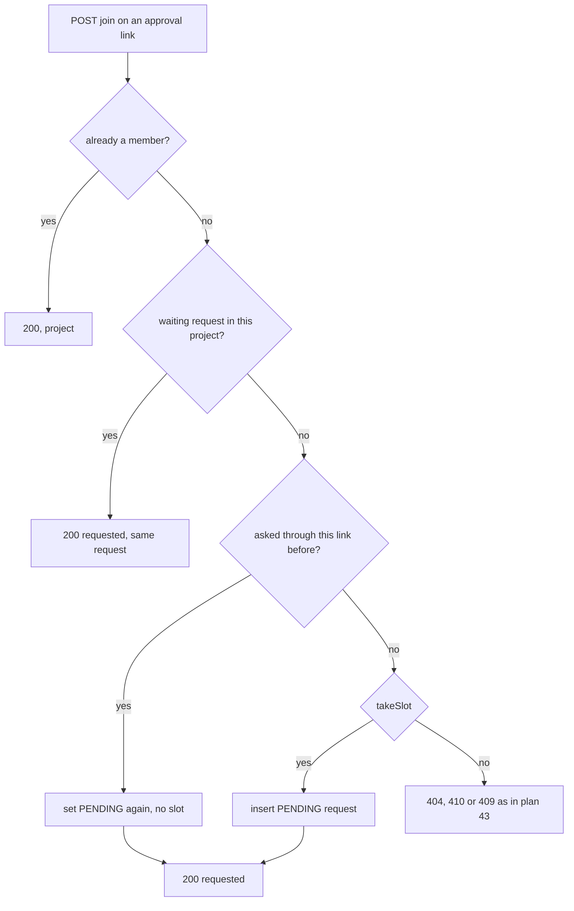
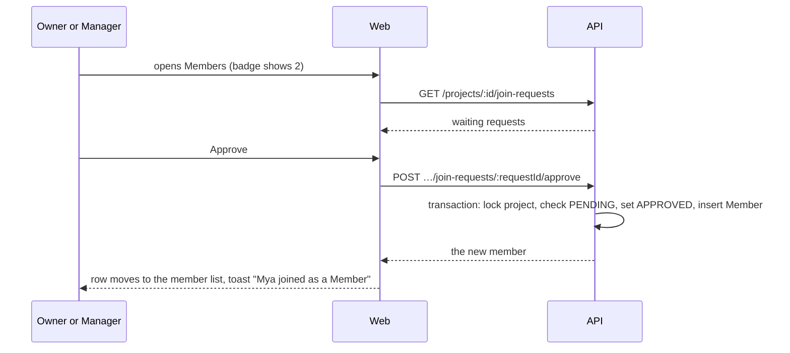

# 44: Require approval and join requests

Status: In Review

## Scope

An invite link can require approval. A person who opens such a link asks to join instead
of joining, and an Owner or Manager approves or declines the request on the Members page.
Builds on [plan 43](43-invite-links.md); decisions are in
[ADR-0015](../adr/0015-project-invite-links.md).

- **API:** `joinApproval` on the link; asking through a link creates a request; list,
  approve and decline requests.
- **Web:** a "Require approval" switch in the invite options, a "Join requests" card above
  the member list, a count on the sidebar's Members link, and a "request sent" state on the
  join page.

Rules (user decisions, 2026-10-13):

- A person uses one slot of a link the first time they ask through it. Declining never
  gives the slot back, and asking again through the same link never takes another.
- Nobody is blocked: a declined person may ask again.
- Requests outlive their link. Deleting or replacing a link leaves its waiting requests in
  the list, and they can still be approved.
- Requests never expire.
- A person has at most one waiting request per project.
- A waiting request is cleared when the person gets in another way (added by email, or
  through an open link).

Left out:

- The requester's own view (home page row, cancel, declined and ask-again states): plan 45.
  Until then the join page only says the request was sent.
- Email or in-app notifications to approvers, blocking people, bulk approve.

## Done when

- [x] `invite.joinApproval` and a `join_request` table (project, user, invite, status
      `PENDING`, `APPROVED` or `DECLINED`, who decided, timestamps), unique per invite and
      user, with at most one `PENDING` row per project and user enforced by the database.
- [x] `POST /invites/:token/join` on an approval link creates a waiting request and answers
      `200` with `result: "requested"`. The first ask by a person uses a slot; asking again
      after a decline reopens the same request and uses none; a person already waiting in
      this project gets their waiting request back; a full link answers `409 invite_full`
      to a new person.
- [x] `GET /projects/:projectId/join-requests` lists the waiting requests, oldest first,
      for Owners and Managers. `POST …/join-requests/:requestId/approve` adds the person as
      a Member in the same transaction, also after the link was replaced or expired.
      `POST …/decline` marks it declined. A second decision on the same request answers
      `409 already_decided`.
- [x] Adding someone by email, or their joining through an open link, removes their waiting
      request for that project.
- [x] The invite options have a "Require approval" switch; the Members page shows a "Join
      requests" card above the member list while there are requests, with Approve and
      Decline on each row; the sidebar's Members link shows the count; the join page says
      "Ask to join" and then "Request sent".
- [x] Seed project `TA`: an approval link with two waiting requests from the seed users,
      and a second project you are not in whose approval link the seed prints.

## Design

| Function                                                   | File                                                | What                                                                                                                                                                                                                     | Why                                                                                                                       |
| ---------------------------------------------------------- | --------------------------------------------------- | ------------------------------------------------------------------------------------------------------------------------------------------------------------------------------------------------------------------------ | ------------------------------------------------------------------------------------------------------------------------- |
| `joinApproval`, `JoinRequest`, migration                   | `prisma/schema.prisma`                              | `@@unique([inviteId, userId])`. The migration adds a partial unique index on `(projectId, userId)` where `status = 'PENDING'`.                                                                                           | Done-when 1. The first index is the "one slot per person per link" rule; the second is "one waiting request per project". |
| `createInvite` (changed)                                   | `invites/invite.service.ts`, `invite.schema.ts`     | The body gains `joinApproval`; the limit defaults stay in the web.                                                                                                                                                       | Done-when 5.                                                                                                              |
| `joinByInvite` (changed)                                   | `invites/invite.service.ts`                         | For an approval link, calls `askToJoin` instead of inserting a Member.                                                                                                                                                   | Done-when 2.                                                                                                              |
| `askToJoin(tx, invite, userId)`                            | `invites/request.service.ts`                        | In the join transaction: a member returns the project. A `PENDING` request in this project is returned as is. A request for this invite and user is set back to `PENDING`, no slot. Otherwise `takeSlot`, then insert.   | Done-when 2. The order matters: reuse before counting.                                                                    |
| `listJoinRequests(projectId, userId)`                      | `invites/request.service.ts`                        | `requireRole(CREATORS)`; waiting requests with name, email, image and when they asked.                                                                                                                                   | Done-when 3.                                                                                                              |
| `decideJoinRequest(projectId, userId, requestId, approve)` | `invites/request.service.ts`                        | `requireRole(CREATORS)`. In a transaction: lock the project, re-read the request, `409 already_decided` unless `PENDING`, set the status and `decidedById`; on approve insert the Member row (already a member is fine). | Done-when 3. The lock stops two managers deciding the same request differently.                                           |
| `joinAsMember` (changed)                                   | `members/member.service.ts`, `member.repository.ts` | Also deletes the person's `PENDING` request for the project, in the same transaction. `addMember` and both join paths go through it.                                                                                     | Done-when 4. `members` never imports `invites`, so there is no import cycle.                                              |
| `joinRequestCount`                                         | `projects/project.service.ts` `getProject`          | The number of waiting requests, 0 for a Member.                                                                                                                                                                          | Done-when 5: the sidebar badge, without a second request per page.                                                        |
| `previewInvite` (changed)                                  | `invites/invite.service.ts`                         | Adds `joinApproval` and `request: 'PENDING' or null`.                                                                                                                                                                    | The join page picks "Join project" or "Ask to join", and shows "Request sent" on a revisit.                               |
| `JoinRequestsCard`, `JoinRequestRow`                       | `web/components/members/`                           | The card and one row: avatar, name, email, "asked 2 hours ago", Approve, Decline.                                                                                                                                        | Done-when 5.                                                                                                              |
| sidebar (changed)                                          | `web/components/shell/app-sidebar.tsx`              | A count next to Members, with a screen-reader label ("3 join requests").                                                                                                                                                 | Done-when 5.                                                                                                              |
| seed                                                       | `api/scripts/seed.ts`                               | `TA` and `TQ`.                                                                                                                                                                                                           | Done-when 6.                                                                                                              |

Text:

- Switch: "Require approval", with the hint "People ask to join, and an owner or manager
  lets them in." With approval on, the limit defaults to 10.
- Status line on an approval link: "3 of 10 requests used, expires in 5 hours".
- Card: heading "Join requests", then "People who asked to join through the invite link.
  Approving adds them as a Member."
- Join page: "Mya invited you to this project. An owner or manager approves each request."
  Button "Ask to join". Afterwards: "Request sent. You'll get in once an owner or manager
  approves it."
- Invite message gains a line: "An owner or manager approves each request."
- Replace and delete dialogs add, when requests are waiting: "The 2 join requests stay in
  the list."

Accessibility (WCAG 2.2 AA):

- Each row's buttons name the person ("Approve Mya", "Decline Mya") through `aria-label`,
  so a screen-reader user hears who each button is for.
- The card is a labelled region (`aria-labelledby` its heading) with a list inside.
- After a decision, focus moves to the next row's Approve button, or to the member list
  when the card empties, so keyboard focus is never lost.
- The badge count is text with a visually hidden label, never a bare dot.
- Decline needs no confirmation: it is reversible (the person can ask again).

Notes:

- `APPROVED` rows are kept. If that person later leaves and opens the same link, the row is
  reused, so they don't take a second slot.
- The Members page refetches requests when the window regains focus (the query client's
  default). There is no live push.
- Tests first: the e2e cases in `test/join-requests.e2e-spec.ts` are written and seen
  failing before the service.

## Changes

Commits: `e9f6c08` (API), `20ff4e6` (web), `1341159` and `2650df9` (wording).

What changed and how:

- `invite.joinApproval`, the `join_request` table with `@@unique([inviteId, userId])` and a
  partial unique index on `(projectId, userId)` where the status is `PENDING`.
- `joinByInvite` files a request on an approval link (`askToJoin`); `request.service.ts`
  has `listJoinRequests` and `decideJoinRequest`.
- `joinRequestCount` on the project, read by the sidebar.
- Web: the "Require approval" switch, `JoinRequestsCard`, `JoinRequestRow`, the count on
  the Members link, and the ask and waiting states of the join page.

Planned vs actual:

- A waiting request of someone who gets in another way is set to `APPROVED`, not deleted
  (the plan said deleted). The row is what remembers that they used a slot of that link.
  `settleJoinRequest` lives in the members repository, and `joinAsMember` and `addMember`
  call it, so `members` never imports `invites`.
- `askToJoin` stayed in `invite.service.ts` (the plan put it in `request.service.ts`): it
  needs the dead-link errors that live there, and the other way round would be an import
  cycle.
- Join answers `200` with `result: "requested"`, not `202`.
- The preview already answers a person with a waiting request when the link is dead, and a
  person who holds a slot when the link is full (planned for plan 45).
- Approve and decline answer `data: null` with a message, not the member.

Tests written first and seen failing: `test/join-requests.e2e-spec.ts` (19 for this plan)
and one case in `test/schema.e2e-spec.ts`. Expectations changed, both because this plan
adds fields: the preview test in `test/invites.e2e-spec.ts` gained `joinApproval` and
`request`, and `test/app.e2e-spec.ts` gained three operations.

Checked in the browser: the card with two requests and the count of 2; Approve moved Mya
to the members and focus to Ko's Approve; Decline emptied the card and focus went to the
member list; "Ask to join" then the waiting state.
