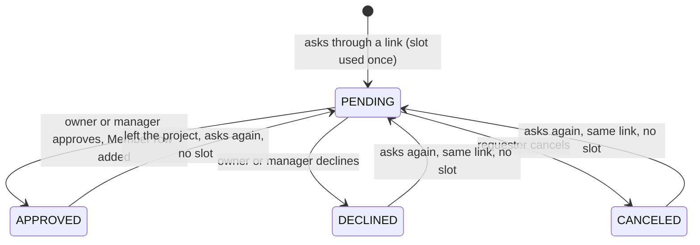

# 45: The requester's view of a join request

Status: In Review

## Scope

After asking to join a project ([plan 44](44-join-approval.md)), a person can see that
they are waiting, cancel, and find out when they were declined. No email is sent
([ADR-0015](../adr/0015-project-invite-links.md)), so the app has to show it.

- **API:** list my waiting requests; cancel one of mine.
- **Web:** a "Waiting for approval" section on the home page, and the full set of states
  on the join page.

Rules (user decisions, 2026-10-13):

- Cancelling does not give the slot back, and asking again through the same link takes no
  new slot.
- A declined request disappears from the home page without a message. The join page says
  it was declined and offers "Ask again" while the link is live.

Left out:

- Notifications, a history of past requests, a reason for a decline.

## Done when

- [x] `GET /join-requests` returns the caller's waiting requests with the project's name
      and key prefix and when they asked. It never returns anything else about a project
      the caller isn't in.
- [x] `DELETE /join-requests/:requestId` cancels the caller's own waiting request (status
      `CANCELED`, slot kept); someone else's request or an unknown id answers `404`; a
      request that is no longer waiting answers `409 already_decided`.
- [x] `GET /invites/:token` returns the caller's request state for that project (`PENDING`,
      `DECLINED`, `CANCELED` or none), also when the link is expired, full or deleted and
      the caller has a waiting request from it.
- [x] The home page shows "Waiting for approval" under the projects, one row per request
      with a Cancel button, and nothing when there are none.
- [x] The join page shows: waiting (with "Cancel request"), declined (with "Ask again"
      while the link is live), and sends an approved person to the board.
- [x] Seed: a project you are not in where you have a waiting request, and one where your
      request was declined; the seed prints both links.

## Design

| Function                               | File                                   | What                                                                                                                                                                                     | Why                                                                                      |
| -------------------------------------- | -------------------------------------- | ---------------------------------------------------------------------------------------------------------------------------------------------------------------------------------------- | ---------------------------------------------------------------------------------------- |
| `CANCELED` status, migration           | `prisma/schema.prisma`                 | One more value in the request status enum.                                                                                                                                               | Done-when 2. The row is kept so that asking again reuses it.                             |
| `listMyJoinRequests(userId)`           | `invites/request.service.ts`           | The caller's `PENDING` rows with `{ id, projectName, keyPrefix, createdAt }`.                                                                                                            | Done-when 1. The same three facts the link preview already shows a non-member.           |
| `cancelJoinRequest(userId, requestId)` | `invites/request.service.ts`           | Finds the request by id and user (`404` otherwise), `409 already_decided` unless `PENDING`, sets `CANCELED`. One conditional update, so a cancel racing an approval has one winner.      | Done-when 2.                                                                             |
| `previewInvite` (changed)              | `invites/invite.service.ts`            | Looks up the caller's request for the link's project before checking the link's state. With a waiting request, a dead link still answers with the project name and `request: 'PENDING'`. | Done-when 3. Requests outlive their link, so the person who asked must still see theirs. |
| `askToJoin` (changed)                  | `invites/request.service.ts`           | Treats `CANCELED` like `DECLINED`: back to `PENDING`, no slot.                                                                                                                           | Scope rule.                                                                              |
| `PendingRequests`, `PendingRequestRow` | `web/components/projects/`             | The home page section.                                                                                                                                                                   | Done-when 4.                                                                             |
| `JoinPage` (changed)                   | `web/components/invites/join-page.tsx` | Renders by `isMember` and `request`.                                                                                                                                                     | Done-when 5.                                                                             |
| seed                                   | `api/scripts/seed.ts`                  | `TW` (you are waiting) and `TD` (you were declined).                                                                                                                                     | Done-when 6.                                                                             |

Text:

- Home page: heading "Waiting for approval", row "Unigym (UG), asked 2 hours ago", button
  "Cancel request".
- Join page, waiting: "Your request to join Unigym is waiting for an owner or manager."
- Join page, declined: "Your request to join Unigym was declined." and "Ask again", or
  "This link no longer works, so ask for a new one." when the link is dead.
- Cancel asks first: "Cancel your request to join Unigym? You can ask again while the link
  works."

Accessibility (WCAG 2.2 AA):

- The section is a labelled region; each Cancel button names the project in its
  `aria-label`.
- State changes on the join page are announced with `role="status"` (waiting, sent) or
  `role="alert"` (declined, dead link).
- After cancelling on the home page, focus moves to the next row or to the section heading.

Notes:

- Tests first: the e2e cases are added to `test/join-requests.e2e-spec.ts` and seen
  failing before the service changes.

## Changes

Commits: `2ef43c5` (API), `67c328c` (web), `1341159` and `2650df9` (wording).

What changed and how:

- `CANCELED` added to the status enum.
- `listMyJoinRequests` and `cancelJoinRequest`; the preview returns `DECLINED` or
  `CANCELED` and the waiting request's id.
- Web: `PendingRequests` and `PendingRequestRow` on the home page, `CancelRequestDialog`,
  and the waiting, declined and canceled states on the join page.

Planned vs actual:

- A bug found by the race test: `decideJoinRequest` read the request under the project
  lock and then updated it without a condition, so an approval could overwrite a cancel
  made in between. Both now use a conditional update (`decideIfPending`,
  `cancelIfPending`) and the loser gets `409 already_decided`.
- The preview has `requestId`, which the plan did not list: the join page needs it to
  cancel.
- A declined or canceled person on a dead link sees the dead-link message, not their old
  request. "Ask again" only shows while the link still lets them ask.
- `CancelRequestDialog` sits in `components/invites/`, shared by the home page and the join
  page.

Tests written first and seen failing: eight cases under "the requester" in
`test/join-requests.e2e-spec.ts`. Expectations changed, both because this plan changes the
preview: the declined preview in the same file now expects `DECLINED` (plan 44 returned
null), and the preview tests gained `requestId`. `test/app.e2e-spec.ts` gained two
operations.

Checked in the browser: "Waiting for approval" under the projects with two rows; Cancel
asked first, removed the row and moved focus to the next row's button; the declined link
showed "Ask again", which put the request back to waiting.

Tech debt noted: [TD-019](../tech-debt/019-invite-rows-kept.md).
