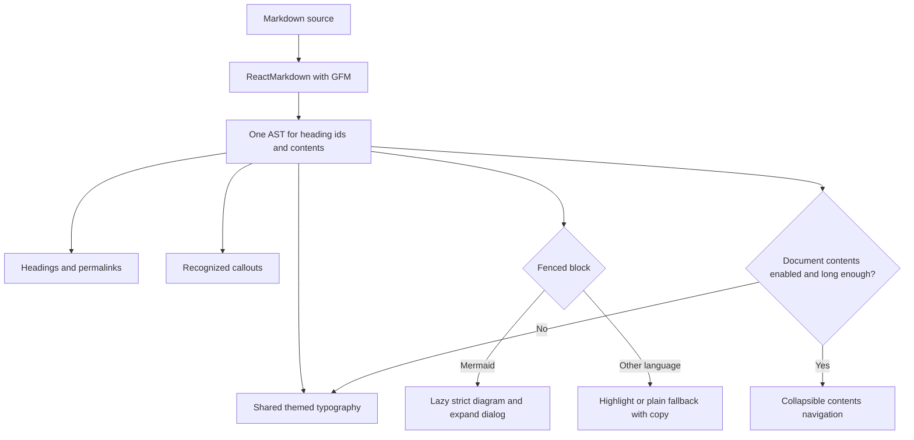

# 47: Rich Markdown rendering

Status: Ready

## Scope

The user chose option C and all suggested rendering refinements on 2026-10-15:
colored heading levels, richer section styling, accessible callouts, code syntax
highlighting and copy, heading links, an optional long-document table of contents,
and expandable Mermaid diagrams. Extend the existing shared renderer for MVP §8
Markdown with Mermaid. No editor format migration or document workflow change.

Implement after plan 46. The user must set this plan to Ready before code.

## Done when

- [ ] H1–H6 have distinct size, weight and spacing with level-specific theme colors, readable paragraphs, nested lists and section dividers in light/dark themes; normal text meets 4.5:1 contrast and qualifying large headings meet 3:1.
- [ ] GFM tables stay readable and scroll within their container on narrow screens; task lists, quotes, inline code and long unbroken content preserve layout in ticket descriptions, document pages and live previews.
- [ ] Fenced code has syntax highlighting for supported languages, a language label and a keyboard-accessible copy button with success/failure feedback; unknown languages remain readable plain code and Mermaid remains a diagram.
- [ ] GFM-style NOTE, TIP, IMPORTANT, WARNING and CAUTION blockquotes become labeled callouts using text and icons as well as theme colors; ordinary blockquotes retain their existing meaning and raw HTML is not executed.
- [ ] Headings have stable, unique permalinks with visible keyboard focus; document pages offer a collapsible contents list when at least four H2/H3 headings exist, and contents/permalinks navigate to the correct heading even when text repeats.
- [ ] Mermaid diagrams open in a larger accessible dialog with scrolling and close/focus restoration; malformed diagrams retain a readable fallback, and representative fixtures are checked on mobile/desktop and both themes without widening the initial Mermaid bundle load.

## Design

Presentation choices are proposed in [ADR-0017](../adr/0017-shared-markdown-presentation.md),
building on [ADR-0005](../adr/0005-web-look-and-ui-kit.md). Use existing CSS variables,
shadcn/Base UI parts and Lucide icons. Add semantic theme tokens where necessary;
do not put literal palette colors in components.

| Function / component                | File                                                       | What                                                                                                                | Why                                                                                      |
| ----------------------------------- | ---------------------------------------------------------- | ------------------------------------------------------------------------------------------------------------------- | ---------------------------------------------------------------------------------------- |
| `Markdown`                          | `apps/web/src/components/markdown/markdown.tsx`            | Keep one shared ReactMarkdown pipeline; accept an optional contents flag for document reading.                      | Tickets and live previews get the same typography without an intrusive navigation panel. |
| `remarkMarkdownHeadings`            | `apps/web/src/components/markdown/markdown-headings.ts`    | A remark plugin used by the library assigns deterministic ids and collects H2/H3 entries from the same parsed tree. | Heading links and contents must share ids, including repeated text and Unicode.          |
| `MarkdownHeading`                   | `apps/web/src/components/markdown/markdown-heading.tsx`    | Render the requested semantic heading level with an anchor link and focus treatment.                                | Keep heading semantics while making sections shareable.                                  |
| `MarkdownContents`                  | `apps/web/src/components/markdown/markdown-contents.tsx`   | Render collapsible anchor navigation for long documents with four or more H2/H3 entries.                            | Make long specs easier to scan without using ticket space.                               |
| `MarkdownCodeBlock`                 | `apps/web/src/components/markdown/markdown-code-block.tsx` | Render a labeled highlighted block with a copy control; keep unsupported languages plain.                           | Improve code reading and reuse without making all Markdown interactive.                  |
| `MarkdownCallout`                   | `apps/web/src/components/markdown/markdown-callout.tsx`    | Render recognized GFM alert blockquotes with title, icon, border and color tokens.                                  | Encode intent in ordinary Markdown and keep it legible without color alone.              |
| `Mermaid`                           | `apps/web/src/components/markdown/mermaid.tsx`             | Keep lazy strict rendering, add a labeled expand control and reusable rendered output in a dialog.                  | Read large diagrams without leaving the document or weakening Mermaid safety.            |
| `DocumentView`                      | `apps/web/src/components/documents/document-view.tsx`      | Enable contents for the document body only.                                                                         | Keep the generic renderer's compact use cases simple.                                    |
| `.markdown` styles and theme tokens | `apps/web/src/app/globals.css`                             | Define heading colors, spacing, tables, lists, code and callout appearance in both themes.                          | Apply the same treatment everywhere the shared renderer is used.                         |

Choose a maintained syntax highlighter during implementation against the installed
ReactMarkdown version; use a limited language set (TypeScript/TSX, JavaScript/JSX,
JSON, shell, SQL, CSS, HTML and Markdown) and plain fallback. Do not ship every
grammar. Dependencies and Bun lockfile changes must be explained in Changes.

The remark plugin is a library adapter, not a new application callback wrapper.
Use the existing library traversal facilities and one heading-id algorithm;
do not parse Markdown a second time with regular expressions. Multiple renderer
instances must not produce duplicate DOM ids; a stable instance prefix can be passed
by document pages for shareable fragments and generated for previews/descriptions.

Callouts recognize a marker such as `> [!WARNING]` at the start of a blockquote.
Recognition does not authorize arbitrary HTML. Raw HTML handling remains disabled.
Use text labels, not automatically announced alerts for static document content.

The Mermaid dialog uses the existing rendered SVG, fits the available viewport and
allows scrolling at a readable size. No new pan/zoom engine or animation is needed.
Preserve focus trapping, Escape dismissal and focus return from the standard dialog.

Verification: web lint, typecheck and build. Read the installed Next.js guide before
implementation. Check realistic spec/proposal/debt fixtures with H1–H6, duplicate
and Unicode headings, all callouts, nested lists, task lists, wide tables, supported
and unknown code languages, valid/invalid Mermaid and literal HTML. Exercise copy,
anchor focus and dialog behavior by keyboard, narrow viewport and light/dark themes.
Add focused tests only for meaningful parsing/id behavior if the existing setup
supports them; do not create tests that merely repeat CSS declarations.

No API endpoints, workflow permissions, document revisions, proposal dependency
gate, arbitrary embedded HTML, export format or per-document theme editor is included.

## Changes

Commits: none. Planning only.

Scope confirmed; implementation has not started. Planned vs actual: pending.

Implementation authorized by the user on 2026-10-15: commit/push planning first, then implement on a separate branch and open a PR.
