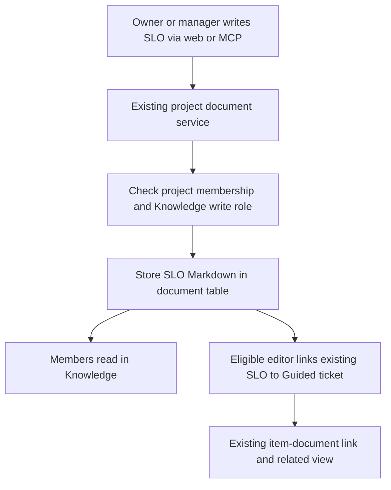

# 48: SLO Knowledge documents

Status: In Review

## Scope

The user confirmed a standalone SLO document kind on 2026-10-15, alongside
Proposal, Spec, ADR and Tech Debt. Extend the existing project Knowledge library
and MCP document tools, not the mistakenly created Unigym reference. This is an
explicit extension to MVP §8's document kinds and §9's Record tools.

An SLO describes a service or user journey, its indicator, target, measurement
window, source, owner and response policy in Markdown. It belongs to the project
and may be linked to multiple Guided tickets. It does not require a proposal.

Implement after confirmed plans 46–47; plan 49 builds on this one. Numbering does
not change the remaining MVP build order. Scope is confirmed; set Ready before code.

## Done when

- [x] A migration adds `SLO` to `DocumentKind`; SLOs remain in the existing document table, have no ticket home, number or workflow status, and existing documents remain readable.
- [x] The API permits Owners/Managers to create, edit and archive SLO Knowledge documents in either project mode, permits all project members to read, and retains forbidden/not-found behavior for unauthorized callers; create-from-ticket cannot make an SLO.
- [x] Knowledge lists, kind filters, new-document forms, editors and detail pages recognize SLO, with a distinct label/icon and a starting template covering journey, SLI, target, window, measurement source, owner, exclusions and response policy.
- [x] Existing Guided ticket link/unlink flows accept project SLOs and return them in related documents; Standard ticket links, foreign-project links and archived links retain their existing restrictions.
- [x] MCP `list_documents`, `get_document` and `save_document` support SLO through the shared services, and plan 46's link tools can link it to a Guided ticket; descriptions explain project scope and do not imply approval or measurement.
- [x] REST/MCP checks and seed cases demonstrate owner/manager writes, member reads/write refusal, project isolation, kind filtering, archival, ticket-home refusal and Guided links; OpenAPI and generated web clients reflect the kind, and relevant lint/typecheck/test/build checks pass.

## Design

Storage, mode and lifecycle choices are proposed in
[ADR-0018](../adr/0018-reliability-document-kinds.md). Extend
[ADR-0014](../adr/0014-ticket-records-are-linked-documents.md) without another store.

| Function / component                                                   | File                                                                             | What                                                                           | Why                                                             |
| ---------------------------------------------------------------------- | -------------------------------------------------------------------------------- | ------------------------------------------------------------------------------ | --------------------------------------------------------------- |
| `DocumentKind`                                                         | `apps/api/prisma/schema.prisma` and a new migration                              | Add `SLO`; regenerate Prisma.                                                  | Reuse the existing typed document model.                        |
| `documentKindsFor`, `creatableDocumentKindsFor`                        | `apps/api/src/modules/items/item.rules.ts`                                       | Include SLO among common Knowledge kinds, but not ticket-owned creation kinds. | The API decides mode availability; the browser uses its result. |
| `createDocument`, `updateDocumentById`, `listDocuments`, `getDocument` | `apps/api/src/modules/documents/document.service.ts`                             | Reuse project-document behavior and existing role checks.                      | SLO writes follow current Knowledge authorization.              |
| `relatedDocumentSchema`                                                | `apps/api/src/modules/items/item.schema.ts`                                      | Accept SLO in related-document responses; keep ticket creation restricted.     | Linked SLOs must survive validation and OpenAPI generation.     |
| `linkDocument`, `unlinkDocument`                                       | `apps/api/src/modules/items/item-document.service.ts`                            | Reuse Knowledge linking and its mode, home, archive and project checks.        | One SLO can guide many tickets without duplicating its body.    |
| `DOCUMENT_KIND`, `DOCUMENT_KINDS`, `DOCUMENT_TEMPLATES`                | `apps/web/src/components/documents/document-meta.ts` and `document-templates.ts` | Add SLO metadata and template.                                                 | Existing picker, filter, form and renderer can serve it.        |
| `buildServer`, document MCP schemas/services                           | `apps/api/src/modules/mcp/`                                                      | Extend shared document enums and section guidance.                             | Agents use the same kinds and permissions as people.            |

The template contains `Service / journey`, `Indicator (SLI)`, `Target and window`,
`Measurement source`, `Owner`, `Exclusions`, `Response policy` and `Related documents`.
Use placeholders; never supply an implied production target or claim monitoring
exists. Distinguish the accountable service owner written in the body from author
metadata. Sections are suggested content, not required structured fields.

Existing endpoints change only by accepting/returning the additional kind:

| Endpoint                                      | Caller and behavior                                   | Main errors                                                  |
| --------------------------------------------- | ----------------------------------------------------- | ------------------------------------------------------------ |
| `GET /api/projects/:projectId`                | Members discover available Knowledge kinds.           | `not_found`                                                  |
| `POST /api/projects/:projectId/documents`     | Owners/Managers create an SLO.                        | `invalid_input`, `forbidden`, `not_found`                    |
| `GET /api/projects/:projectId/documents`      | Members list/filter SLO summaries.                    | `invalid_input`, `not_found`                                 |
| `GET /api/documents/:id`                      | Members read the SLO body.                            | `not_found`                                                  |
| `PATCH /api/documents/:id`                    | Owners/Managers edit/archive using existing behavior. | `invalid_input`, `forbidden`, `not_found`                    |
| `POST /api/items/:id/documents`               | Eligible ticket editors link an SLO in Guided mode.   | `forbidden`, `not_found`, `guided_only`, `document_archived` |
| `DELETE /api/items/:id/documents/:documentId` | Eligible ticket editors remove a Guided ticket link.  | `forbidden`, `not_found`, `guided_only`                      |

All existing session/consent checks also apply. No new endpoint is needed. Existing
status mutation refuses SLO because it has no status. The implementation must check
all hand-maintained kind enums, including related-item responses, not only Prisma.

Frontend routes remain `/p/[projectId]/docs`, `/docs/new`, `/docs/[documentId]` and
`/docs/[documentId]/edit` under the project prefix, plus existing ticket related
documents. Use generated hooks; run `bun run api:spec` and `bun run api:generate`.

Verification: focused document and MCP e2e tests on the documented remote database,
document-kind rule unit tests, API/web lint and typecheck, API tests and relevant
builds. Add seed tickets titled with the action and expected permission result,
including a linked SLO example and a Standard-mode refusal example. Do not start a
local database or apply a production migration as part of planning.

No metrics ingestion, computed compliance, breach alerts, approval/revision
workflow, numbered SLO keys or new proposal/spec dependency is included. Related
documents use ordinary Markdown links initially. Existing
[TD-016](../tech-debt/016-document-outlines-in-two-places.md) also covers the SLO
outline appearing in both web templates and MCP guidance.

## Changes

Commits: `ceace35` (planning, pushed to dev), `2331c50` (implementation on
`feat/mcp-markdown-reliability-documents`).

Added `SLO` to the existing DocumentKind enum with its own additive migration,
Knowledge availability, related-document schema, web label/icon/template and MCP
guidance. Existing document and ticket-link services enforce permissions, mode,
archive and home rules; no new REST endpoints or separate editor. OpenAPI and
browser clients were regenerated. Seed examples cover both modes and owner,
manager and member behavior, with draft placeholders and linked reliability records.

Planned vs actual: followed the planned document-kind approach. SLO fields remain template sections; no numeric target validation or monitoring is implied.
The combined feature commit implements both separately planned kinds, each with
its own migration and kind-specific e2e case. SLA and existing document behavior
remain covered by the focused regression suites.

Validation: 29 document/MCP/ticket-document e2e tests passed, covering new kinds,
roles, project isolation, filtering, archival, ticket-home/status refusal and links.
Root lint/typecheck passed; 115 API unit tests and four Markdown tests passed;
API/web production builds passed. Migrations applied only to the documented
remote development database. Seed code was typechecked; the seed reset was not run.
Existing [TD-016](../tech-debt/016-document-outlines-in-two-places.md) remains open.

Implementation authorized by the user on 2026-10-15. Awaiting human code review;
ADR-0018 remains Proposed. No production deployment.
