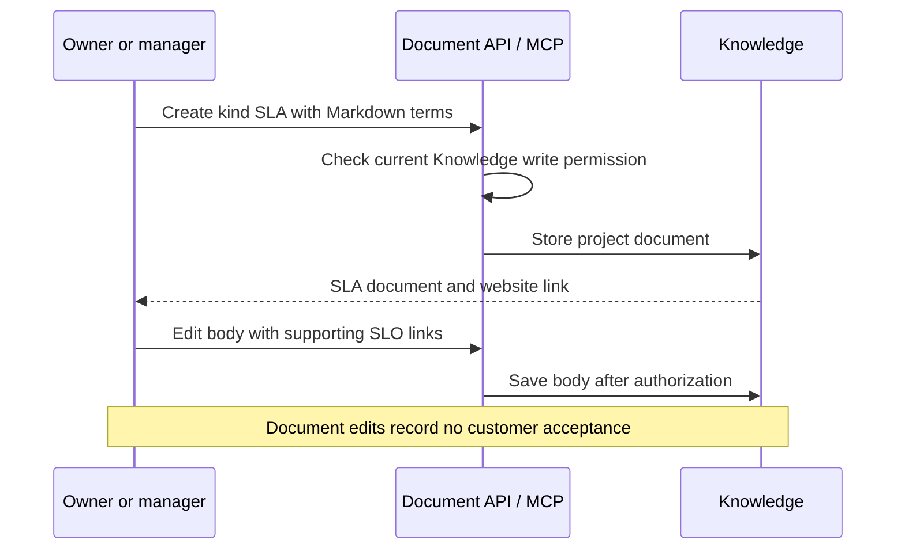

# 49: SLA Knowledge documents

Status: Ready

## Scope

The user confirmed a standalone SLA document kind on 2026-10-15. Follow plan 48's
SLO support with SLA in the same Knowledge library, editor, reader and MCP tools.
This is an explicit extension to MVP §8's document kinds and §9's Record tools.

An SLA records an audience/customer, commitments, measurement terms, exclusions,
remedies and effective dates. It can reference supporting SLO documents through
Markdown links. Creating or editing a document does not execute an agreement or
record customer acceptance. Set this plan to Ready before code.

## Done when

- [ ] A separate migration adds `SLA` to `DocumentKind` in the existing document table; SLA is project Knowledge, available in both modes, with null number/status/home, and SLO plus existing kinds continue to work.
- [ ] Existing REST and MCP document tools permit Owners/Managers to create/edit SLA, members to read, and Owners/Managers to archive; project isolation, immutable kind and create-from-ticket restrictions remain enforced by API services.
- [ ] Knowledge lists, filters, new/edit forms and detail pages recognize SLA with its own label/icon and a template covering audience, commitments, measurement, exclusions, remedies, effective dates, accountable owner, agreement state and supporting SLO links.
- [ ] SLA templates use working ordinary document links for supporting SLOs without requiring one; existing Guided ticket link/unlink and related-document views support SLA, preserving foreign-project, archived-document and Standard-mode restrictions.
- [ ] Seed examples and focused REST/MCP checks cover permissions, filtering, archival, linking and absent workflow status; OpenAPI/generated clients and MCP descriptions include SLA, and relevant lint/typecheck/test/build checks pass.

## Design

Follow [ADR-0018](../adr/0018-reliability-document-kinds.md). Reuse plan 48's
implementation pattern; do not create a second agreement engine or document editor.

| Function / component                                    | File                                                                                                        | What                                                                       | Why                                                           |
| ------------------------------------------------------- | ----------------------------------------------------------------------------------------------------------- | -------------------------------------------------------------------------- | ------------------------------------------------------------- |
| `DocumentKind`                                          | `apps/api/prisma/schema.prisma` and a new migration                                                         | Add `SLA` after SLO exists; regenerate Prisma.                             | Keep the two slices independently reviewable.                 |
| `documentKindsFor`, `creatableDocumentKindsFor`         | `apps/api/src/modules/items/item.rules.ts`                                                                  | Include SLA in common Knowledge kinds.                                     | API remains the owner of mode availability.                   |
| Document CRUD and link services                         | `apps/api/src/modules/documents/document.service.ts`, `apps/api/src/modules/items/item-document.service.ts` | Reuse existing Knowledge authorization, archive behavior and ticket links. | An SLA outlives a feature and may relate to multiple tickets. |
| `relatedDocumentSchema` and document schemas            | `apps/api/src/modules/items/item.schema.ts`, `apps/api/src/modules/documents/document.schema.ts`            | Propagate SLA through responses, filters and OpenAPI.                      | Avoid a kind that can be stored but cannot be returned.       |
| `DOCUMENT_KIND`, `DOCUMENT_KINDS`, `DOCUMENT_TEMPLATES` | `apps/web/src/components/documents/document-meta.ts` and `document-templates.ts`                            | Add SLA presentation and Markdown starting sections.                       | Reuse Knowledge pages and the shared Markdown renderer.       |
| `buildServer`, document MCP schemas/services            | `apps/api/src/modules/mcp/`                                                                                 | Include SLA and its content guidance, with no status mutation.             | Agent writes are document edits, not agreement acceptance.    |

Template sections: `Audience / customer`, `Service commitments`, `Measurement
terms`, `Exclusions`, `Remedies`, `Effective dates`, `Accountable owner`, `Agreement
state` and `Supporting SLOs`. Agreement state is explanatory body text, initially
`Draft; no acceptance recorded by Uniloom`, not a database status or attestation.
Use placeholders for commercial terms and commitments, not invented guarantees.

Supporting SLO references use `/p/{projectId}/docs/{documentId}` Markdown links.
No foreign-key dependency, backlink reporting, SLO picker, required SLO count or
automatic synchronization is introduced. Updating an SLO does not edit an SLA.

Affected endpoints and roles match plan 48: project-kind discovery, document
create/list/get/update and Guided ticket link/unlink. Main errors remain
`invalid_input`, `forbidden`, `not_found`, `guided_only` and `document_archived`
where applicable. Session/consent checks apply. No new endpoint or status transition.

Frontend routes match plan 48: project Knowledge list, new/edit/detail pages and
ticket related documents. Generated hooks remain the only browser API access.

Verification follows plan 48, including regression checks that SLO and other
document kinds remain supported. Seed an SLA linked to a Guided ticket and a
supporting sample SLO, with draft placeholders and titled permission-test tickets.
Run OpenAPI/client generation and relevant API/web lint, typecheck, tests and builds.

Out of scope: signatures, contractual acceptance, structured agreement lifecycle,
immutable agreement revisions, automatic credits, monitoring, breach detection and
computed SLA compliance. Revision/approval work needs a separately confirmed scope
coordinated with plan 18, which currently concerns specifications only. Existing
[TD-016](../tech-debt/016-document-outlines-in-two-places.md) applies to the added
template guidance too.

## Changes

Commits: none. Planning only; scope confirmed, implementation not started.
Planned vs actual: pending. Acceptance criteria remain unchecked.

Implementation authorized by the user on 2026-10-15: commit/push planning first, then implement on a separate branch and open a PR.
