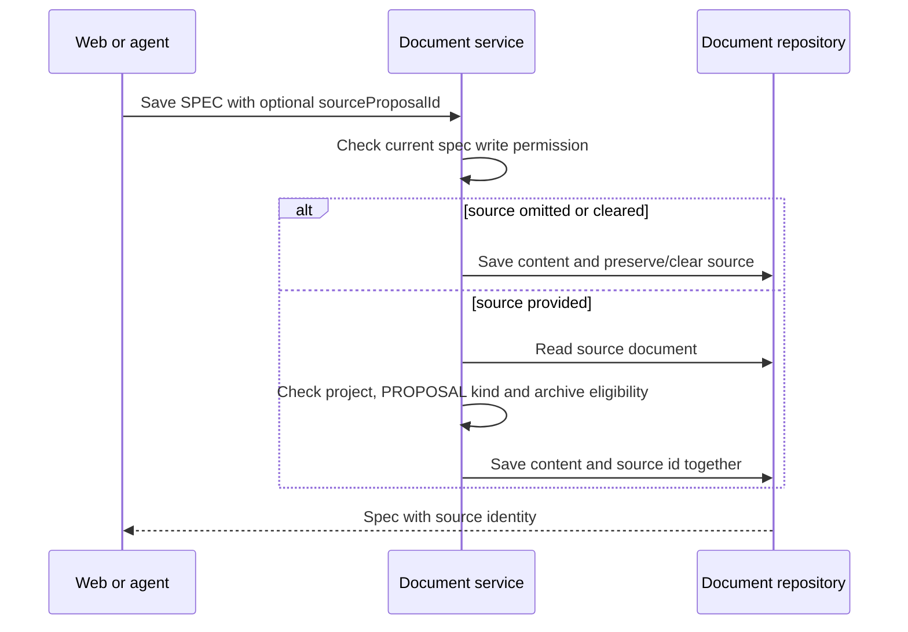
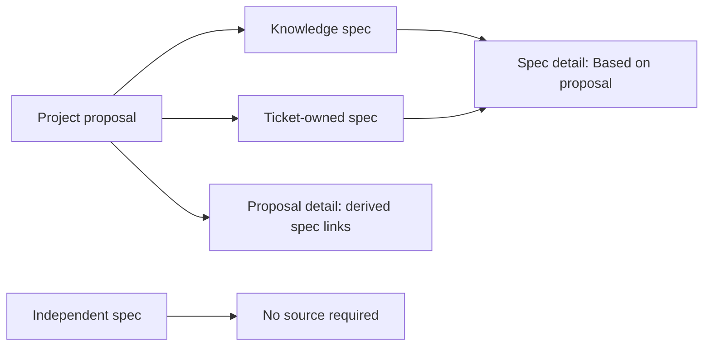

# 50: Optional proposal-to-spec provenance

Status: In Review

## Scope

On 2026-10-15 the user chose to add an optional "Based on proposal" relationship
to Uniloom, following the production SLO/SLA and MCP linking checks. One project
proposal may support many specs; each spec may name one proposal or none. This
extends the existing document model in MVP §8 and document tools in §9.

Support Knowledge specs in both modes and ticket-owned specs in Guided mode,
through the web and MCP. Existing spec edit permissions apply. A relationship is
provenance, not an approval or execution dependency: independent specs remain valid.

The user authorized implementation with “start” on 2026-10-15, setting this
confirmed design Ready. Implementation is now in progress.

## Done when

- [x] A migration adds indexed nullable `sourceProposalId` to Document, with a self-relation and inverse derived specs; no unique constraint limits the number of specs per proposal, and existing specs remain valid with null source.
- [x] Shared API services allow only a SPEC to reference a same-project Knowledge PROPOSAL; reject missing/foreign sources with `not_found`, wrong kinds with `invalid_source_proposal`, and new archived sources with `document_archived`. Omitted input preserves the source, null clears it, and retaining the same archived source remains valid.
- [x] Existing project-document and ticket-document create/edit paths and MCP `save_document` accept the optional source; detail reads expose source summary and proposal-derived spec summaries, hiding specs on deleted tickets. Compact save confirmations include the source id, and membership/edit rules remain shared with existing services.
- [x] Web spec create/edit forms and New spec on a Guided ticket offer an optional same-project proposal picker; spec detail shows a linked "Based on proposal", and proposal detail shows linked derived specs. Existing archived sources remain readable and removable without appearing among new choices.
- [x] No source is required to create a spec, no proposal approval is implied, and association changes neither ticket state nor unrelated item-document links. Seed cases name what to try and expect for independent specs, multiple derived specs, clear/replace, archives, roles, wrong kinds and cross-project sources.
- [x] Focused REST/MCP tests cover the full association lifecycle, both Knowledge modes and ticket-owned permissions; OpenAPI/client generation, relevant lint/typecheck/tests/build and browser checks pass, with a production smoke-test report distinguishing deployed behavior from the new feature.

## Design

See [ADR-0019](../adr/0019-optional-spec-source-proposal.md), Proposed. Extend
[ADR-0014](../adr/0014-ticket-records-are-linked-documents.md) instead of introducing
a generic document graph or another content table.

| Function / component                                                | File                                                                                                    | What                                                                                                                                      | Why                                                                                                          |
| ------------------------------------------------------------------- | ------------------------------------------------------------------------------------------------------- | ----------------------------------------------------------------------------------------------------------------------------------------- | ------------------------------------------------------------------------------------------------------------ |
| `Document`                                                          | `apps/api/prisma/schema.prisma` and a new migration                                                     | Add nullable `sourceProposalId`, named `SpecSourceProposal` relation, inverse `derivedSpecs`, index, and `onDelete: SetNull`.             | One spec has at most one source; a proposal can support many specs; existing rows need no content migration. |
| `sourceProposalError`                                               | `apps/api/src/modules/documents/document.rules.ts`                                                      | Check spec kind and eligibility of the resolved source, accounting for an unchanged existing archived source.                             | Express the rule once for REST, ticket creation and MCP.                                                     |
| `createDocument`, `addTicketDocument`, `updateDocumentById`         | `apps/api/src/modules/documents/document.service.ts`                                                    | Authorize the spec write first, resolve/validate a provided source, then persist it with the content write.                               | Linking requires permission to edit the spec, not permission to edit the proposal.                           |
| `createTicketDocument`                                              | `apps/api/src/modules/items/item-document.service.ts`                                                   | Pass source data only for SPEC; refuse the field on other kinds using the document service rule.                                          | Preserve existing ticket edit and Guided-only checks without copying them into MCP/web.                      |
| `insertDocument`, `updateDocument`, `findDocument`, `findDocuments` | `apps/api/src/modules/documents/document.repository.ts`                                                 | Persist the nullable id, select source summaries, and load inverse derived-spec summaries on detail reads with deleted-home filtering.    | Keep Prisma access in repositories and avoid loading full spec bodies for backlinks.                         |
| `toDocument`, `toDocumentSummary`                                   | `apps/api/src/modules/documents/document.utils.ts`                                                      | Return source id/summary and detail-only derived-spec summaries.                                                                          | Web and MCP consume the same authorized shape.                                                               |
| `saveDocument`, `toDocumentConfirmation`, document schemas          | `apps/api/src/modules/mcp/` and API document/item schemas                                               | Accept nullable source id on creates/updates and return it in compact confirmations.                                                      | Make provenance writable by agents without changing human-only status operations.                            |
| `SourceProposalPicker`                                              | `apps/web/src/components/documents/source-proposal-picker.tsx`                                          | Search active same-project proposals through generated hooks; preserve a selected archived source as existing context and allow clearing. | Use an optional input rather than an approval gate or body-copy action.                                      |
| `DocumentForm`, `NewTicketDocumentDialog`, `DocumentView`           | `apps/web/src/components/documents/` and `apps/web/src/components/items/new-ticket-document-dialog.tsx` | Wire the picker into spec flows and render forward/back links on detail pages.                                                            | Make the relationship visible and navigable in existing routes.                                              |

Only SPEC accepts `sourceProposalId`, even if null is supplied to a different kind.
For SPEC, `undefined` means preserve on update and no source on create; null means
clear/no source. Resolve the actual stored kind on edit, since document kinds are
immutable and input must not redefine them. Check source project before exposing
kind/archive errors so foreign documents remain indistinguishable from missing ones.

An archived proposal remains readable through an existing relationship. Archiving
does not erase provenance or invalidate body-only spec edits. Assigning the same
existing source is idempotent. A new or replacement source must be active. Proposal
content is not copied into the spec, and source edits do not rewrite derived specs.

Detail shape additions: `sourceProposalId`, nullable `sourceProposal` with id/title
and archive state, and `derivedSpecs` with id/title/home-ticket summary. The reverse
list contains same-project specs only and excludes those whose home ticket is
soft-deleted. List responses include source identity without inverse collections;
MCP maps document summaries to website URLs using the existing origin helper.

Existing routes are extended, not duplicated:

- `POST /api/projects/:projectId/documents`: Owners/Managers create a Knowledge spec.
- `POST /api/items/:id/documents/new`: eligible Guided ticket editors create a spec.
- `PATCH /api/documents/:id`: current authorized editors attach, replace or clear source.
- `GET /api/documents/:id` and project document lists: members read provenance.
- `POST /mcp`: existing `save_document`, `get_document` and `list_documents` use the same services; no approval or source-dependent workflow tool is added.

Main new rule errors are those in the checklist; existing `forbidden`, `guided_only`
and session/consent errors remain. No new REST endpoint is required. Run OpenAPI
and browser client generation after schema changes.

Frontend routes remain `/p/[projectId]/docs/new`, `/docs/[documentId]/edit`,
`/docs/[documentId]` under the project prefix, and the existing ticket New spec dialog.
All browser API access uses generated hooks. The picker never supplies a field for
non-SPEC kinds; this is presentation, with the authoritative validation in the API.

Verification includes creation with/without source, absent/null semantics, replacing
and repeating a source, multiple derived specs, project isolation, non-SPEC inputs,
wrong source kinds, archives, soft-deleted home tickets, and Owner/Manager versus
assigned/unassigned Member writes. Seed all introduced rule cases with titled
instructions. Use the documented remote development database; do not start a local
database or change production schema before the feature is reviewed and released.

Out of scope: required proposals, proposal acceptance states, approval inheritance,
spec revision snapshots (plan 18), automatic content generation, arbitrary document
dependencies, and monitoring/SLA enforcement. Existing edit/reassignment concurrency
debt remains [TD-015](../tech-debt/015-edit-check-reassign-race.md); this slice does
not redesign all document write authorization.

## Changes

Implementation branch: `feat/proposal-spec-provenance`; implementation commit and PR
will be recorded below after publication.

Planned vs actual: all six done-when items are met. The optional FK, shared pure rule
and service validation, existing REST/MCP contract extensions, proposal picker and
forward/back links match the design. No status dependency, automatic content copy or
item-document linking was introduced. MVP §8 now records the confirmed behavior.
The touched Edit/Cancel link buttons also set Base UI's `nativeButton={false}` after
browser warnings identified their existing semantics mismatch. Next regenerated its
managed heading in `apps/web/AGENTS.md`; the project guide retains that change.

Architecture decisions: the user chose optional provenance and the single-source,
many-derived cardinality; I implemented it with an indexed nullable self FK and
shared service checks. I retained archived provenance while rejecting new archived
sources. ADR-0019 stays Proposed for the user's decision. Independent specs work in
both modes, ticket-owned specs retain Guided permissions, and source content is never
copied. This trades away multiple sources per spec and revision snapshots. Existing
edit/reassignment concurrency remains TD-015; no new shortcut was taken.

Built by priority:

- P0: additive migration, shared source validation and persistence; without these the
  relationship cannot be saved safely. Existing authorized POST project documents,
  POST ticket documents/new and PATCH documents now accept the optional source.
- P1: GET detail/list source summaries, detail-only derived specs and MCP URLs;
  web spec create/edit picker, ticket New spec picker and linked detail sidebar.
  These make the relationship discoverable and navigable through existing routes.
- P2: regression cases, seed examples, generated OpenAPI/browser clients and archived
  selection handling; these protect the lifecycle and permission edge cases.

Validation:

- `bun run db:generate`, `bun run api:spec`, `bun run api:generate`: passed.
- Development migration `20261015160000_spec_source_proposal`: applied successfully
  to the documented remote development database; production was not migrated.
- `bun run lint`, `bun run typecheck`, `bun run test`, `bun run build`: passed;
  unit coverage totals 120 API tests plus 4 Markdown tests.
- Focused integration: 65 tests passed across six files (`spec-provenance`, `mcp`,
  `documents`, `mcp-documents`, `mcp-write`, `item-documents`). The new suite covers
  both modes, independent/multiple specs, preserve/replace/clear, malformed/missing/
  foreign/wrong-kind sources, role checks, archives, physical source deletion,
  soft-deleted ticket backlinks and unchanged ticket state/unrelated links.
  MCP cases cover compact save, source and reverse URLs, list identity, lifecycle
  mutations and stable rule errors. Existing MCP suites retain current-role coverage.
- Local Chrome checks with mocked generated-hook API responses: create, clear,
  independent creation, archived-source preservation, empty search, ticket creation,
  source/backlink and ticket URLs all passed. Desktop 1280px and mobile 390px in light
  and dark themes had no page overflow or JavaScript errors. Temporary test route was
  removed before build. These browser checks exercise presentation and request
  payloads; the integration suite verifies real persistence and authorization.
- Seed cases were added and typechecked; the seed was not run because it replaces
  existing seed projects. No independent code review was run, per repository rules.

Deployment distinction: the live report below covers released SLO/SLA and existing MCP
linking only. The new source field is tested on this branch/development database and
will require merge, release and a production migration before a live provenance smoke
test. Next build on these shared authorized contracts after review; no further feature
implementation is required for this plan.

Production fixtures on Testing TS-4 demonstrate SLO/SLA create/read/update/filter,
Knowledge linking and idempotent unlink. Proposal and spec have a manual Markdown
reference only until this feature is implemented. Final smoke-test results will
be recorded separately so existing deployed behavior is not confused with provenance.

Live verification report: [Testing TS-4 report](https://loom.psstee.me/p/01a10b79-d9ff-769a-8f7a-51d1d6fff239/docs/01a1405f-37bf-76fb-99a5-60b4461b1052).
