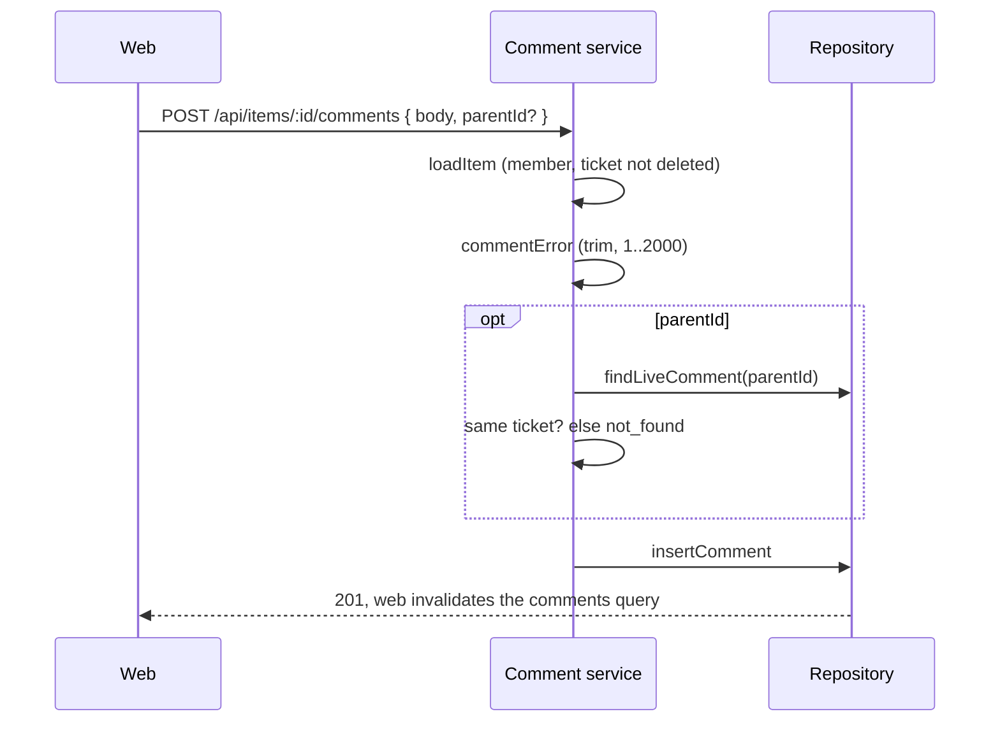
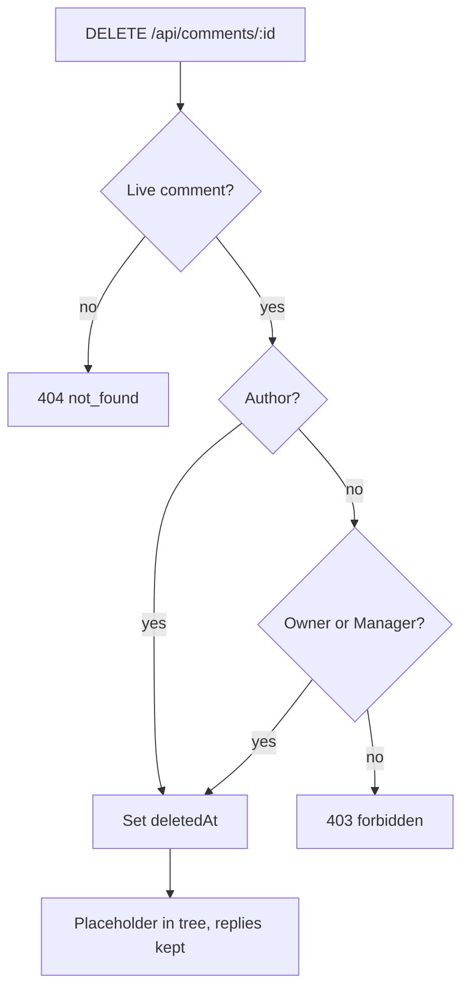

# 52: Comments on tickets

Status: In Review

## Scope

MVP §4 promises "Thread per item, by people and agents" (L116), and Members "read and
comment on any ticket" (L96). On 2026-10-16 the user asked to port Unishare's comment
system: same behaviour, Uniloom's primary colour, nested replies. Comments go on tickets
(this plan) and documents ([plan 53](53-document-comments.md)).

This slice delivers the Comment model, the comment API for tickets, the shared web
thread components and the thread on the item page.

User choices on 2026-10-16:

- web only; MCP `list_comments` / `save_comment` are a later plan;
- no notifications yet;
- a comment can be deleted by its author or by an Owner or Manager.

Behaviour copied from Unishare (`unishare/apps/api/src/modules/posts/comments/` and
`unishare/apps/web/components/post-detail/`):

- the whole tree, oldest first, no pagination; 1 to 2000 characters; plain text with
  URLs turned into links;
- only the author edits, with no edit window; delete is soft and leaves "This comment was
  deleted." from "Deleted user", so replies keep their place;
- composer: 3-row textarea, "Write a comment...", Shift+Enter submits (with the hint),
  "Post" / "Posting...";
- one inline editor for edit and reply, only one of each open at a time, Cancel and
  Save / Reply;
- nesting: indents `ml-4 sm:ml-7 lg:ml-10 xl:ml-12` capped at 8 levels, a coloured left
  bar per depth that collapses the thread, "Hide replies" / "Show replies (n)";
- author badge, relative time, "(edited)"; skeleton, empty text and an error line; no
  optimistic updates.

Unishare bugs not copied: "edited" uses its own `editedAt` (not `updatedAt`); Reply, Edit
and Delete are hidden on deleted comments and refused by the API; the header counts every
live comment; whitespace-only bodies are refused on the server; Delete shows only from the
API's `canDelete`.

Left out: MCP tools, notifications, Markdown, mentions, reactions, pagination, comments in
the activity timeline, a purge job.

## Done when

- [x] A migration adds `Comment` (one target via the `comment_one_target` CHECK, `parentId` for nesting, `editedAt`, `deletedAt`) as in ADR-0021.
- [x] `GET` and `POST /api/items/:id/comments` let any member list the tree and add a comment or reply; the body is trimmed and refused as `empty_comment` or `comment_too_long` (over 2000), and a missing, deleted or other-ticket parent is `not_found`.
- [x] `PATCH /api/comments/:id` is author-only (`forbidden`) and sets `editedAt`; `DELETE /api/comments/:id` is allowed for the author, Owner or Manager and leaves a placeholder that keeps its replies; a deleted comment can't be edited, replied to or deleted again (`not_found`).
- [x] The item page shows the Unishare-style thread below the activity: composer with Shift+Enter, nested replies with depth bars and collapse, Author badge, relative time and "(edited)", in Uniloom's primary colour, with buttons shown only from `canEdit` / `canDelete`.
- [x] The seed adds a ticket with a nested thread, an edited comment and a deleted comment with a live reply, titled with what to try and what should happen; rules, tree and API tests cover the cases above.

## Design

See [ADR-0021](../adr/0021-one-comment-table.md), Proposed.

| Function / component                                                   | File                                                            | What                                                                                                                                                                                                                                                                           | Why                                                                        |
| ---------------------------------------------------------------------- | --------------------------------------------------------------- | ------------------------------------------------------------------------------------------------------------------------------------------------------------------------------------------------------------------------------------------------------------------------------ | -------------------------------------------------------------------------- |
| `Comment`                                                              | `apps/api/prisma/schema.prisma`, new migration                  | Fields from ADR-0021; indexes `[itemId, createdAt]`, `[documentId, createdAt]`; CHECK `comment_one_target` in the SQL.                                                                                                                                                         | One table serves tickets and documents.                                    |
| `commentError`                                                         | `apps/api/src/modules/comments/comment.rules.ts`                | Trims the body; returns `empty_comment`, `comment_too_long` or null. Unit-tested.                                                                                                                                                                                              | One pure rule, shared by create and edit.                                  |
| `toCommentTree`                                                        | `apps/api/src/modules/comments/comment.utils.ts`                | Builds the nested tree from flat rows in one pass; blanks deleted nodes; adds `canEdit`, `canDelete`, `isTargetAuthor` (ticket creator); counts live comments.                                                                                                                 | The web shows buttons only from these flags, never its own role check.     |
| `listItemComments`                                                     | `comment.service.ts`                                            | `loadItem(id, userId)` (membership, hides deleted tickets), then reads rows and returns the tree.                                                                                                                                                                              | Reuses the ticket's own access check.                                      |
| `createItemComment`                                                    | `comment.service.ts`                                            | `loadItem`, `commentError`, then checks the parent is live and on the same ticket; inserts.                                                                                                                                                                                    | Any member may comment (MVP L96).                                          |
| `updateComment`                                                        | `comment.service.ts`                                            | Loads the live comment, `requireRole(projectId, userId, ROLES)`, author only; `commentError`; sets `body` and `editedAt`.                                                                                                                                                      | Author-only edit, as in Unishare.                                          |
| `deleteComment`                                                        | `comment.service.ts`                                            | Loads the live comment; allowed for the author, else `requireRole(..., CREATORS)`; sets `deletedAt`.                                                                                                                                                                           | Owner and Manager stand in for Unishare's admin.                           |
| `findComments`, `findLiveComment`, `insertComment`, `updateCommentRow` | `comment.repository.ts`                                         | Prisma access, with author name and image.                                                                                                                                                                                                                                     | Prisma stays in repositories (ADR-0004).                                   |
| Routes and handlers                                                    | `comment.routes.ts`, `comment.handlers.ts`, `comment.schema.ts` | `GET`/`POST /api/items/:id/comments`, `PATCH`/`DELETE /api/comments/:id`, each with `describe()`. Mounted in `apps/api/src/routes/index.ts`.                                                                                                                                   | Plain Hono routes; OpenAPI drives the orval hooks.                         |
| `CommentSection`                                                       | `apps/web/src/components/comments/comment-section.tsx`          | Takes `target: { kind: 'item' \| 'document', id }`, picks the generated hook, shows the count, composer, thread, skeleton, empty text and error.                                                                                                                               | Plan 53 reuses it unchanged.                                               |
| `CommentComposer`                                                      | `comment-composer.tsx`                                          | Textarea, Shift+Enter, Post button.                                                                                                                                                                                                                                            | One component per file.                                                    |
| `CommentEditor`                                                        | `comment-editor.tsx`                                            | Inline editor for edit and reply.                                                                                                                                                                                                                                              | Same as Unishare.                                                          |
| `CommentThread`                                                        | `comment-thread.tsx`                                            | Recursive node: `Avatar` (`components/user/avatar.tsx`), name, Author badge `bg-primary/10 text-primary`, `timeAgo` (`lib/time.ts`), "(edited)", actions, depth bar cycling `bg-primary` → `bg-chart-2` → `bg-chart-3` → `bg-muted-foreground`, collapse, indents capped at 8. | Uniloom's primary replaces Unishare's amber; only theme tokens (ADR-0005). |
| `CommentListSkeleton`                                                  | `comment-list-skeleton.tsx`                                     | Three rows from `ui/skeleton`.                                                                                                                                                                                                                                                 | Loading state.                                                             |
| `linkifyText`                                                          | `apps/web/src/components/comments/linkify-text.ts`              | Splits text on URLs and returns links with `text-primary`.                                                                                                                                                                                                                     | Plain text with links, as in Unishare.                                     |
| `ItemDetail`                                                           | `apps/web/src/components/items/item-detail.tsx`                 | Renders `CommentSection` after `ItemActivity`.                                                                                                                                                                                                                                 | The thread sits under the ticket's history.                                |

Main errors: `not_found` (404), `forbidden` (403), `empty_comment` and
`comment_too_long` (400). Once plan 51 lands, comments on a deleted project are hidden by
its `findMember` gate.

Use the remote dev database over Tailscale; seed with
`SEED_OWNER_EMAIL=test@email.com,psst@gmail.com`. Run `api:spec` and `api:generate`
after the routes exist.

## Changes

Commit `91c65dd` (feat(comments): threaded comments on tickets and documents) on `feat/comments`, together with plan 53.

API:

- `prisma/schema.prisma` and migration `20261016120000_comments`: `Comment` with the
  `comment_one_target` CHECK (`num_nonnulls("itemId", "documentId") = 1`), indexes as planned, plus
  `parentId` index. Applied with `migrate deploy`; `migrate diff` against the schema shows no drift.
- `apps/api/src/modules/comments/`: types, rules (`commentError`), utils (`toCommentTree`),
  repository, service, schema, handlers, routes; mounted in `routes/index.ts`.
  `GET`/`POST /api/items/:id/comments`, `PATCH`/`DELETE /api/comments/:id`.
- Tests: `comment.rules.spec.ts`, `comment.utils.spec.ts`, `test/comments.e2e-spec.ts` (9 cases,
  including the CHECK constraint).
- Seed: `seedComments` adds a TG ticket with a 4-level thread, an edited comment, and a deleted
  comment with a live reply.
- `apps/web/openapi.json` regenerated. The recursive `Comment` schema needs `.meta({ id: 'Comment' })`,
  or Orval rejects the spec.

Web: `components/comments/` (`CommentSection`, `CommentComposer`, `CommentEditor`, `CommentThread`,
`CommentListSkeleton`, `linkify-text.tsx`), and `ItemDetail` renders the section after `ItemActivity`.

Planned vs actual:

- `linkify-text` is `.tsx`, not `.ts`, because it returns JSX.
- `CommentSection` takes `target: { kind: 'item'; id }` only for now. Plan 53 widens it when the
  document hooks exist (hooks can't be picked conditionally).
- Draft text lives inside the composer and editor, not in the section; the section keeps only the
  open edit id and reply id, so one of each is open at a time.
- Responses for create and edit return the single comment node, with the same flags.
- Not checked in a browser; checked by typecheck, lint and build only.

Review fixes (code-reviewer, no critical findings): the edit response now sets `isTargetAuthor`
from the ticket's creator; a top-level post no longer disables an open reply editor; the seed's
invite doc comment is back on `seedInvites`. Left as
[TD-024](../tech-debt/024-comment-update-not-guarded-by-deleted.md): edit/delete racing a delete.

Update on 2026-10-16: brought up to date with `dev` (after plan 51), renumbered the
tech-debt note to TD-024 (TD-023 is plan 51's), and after a second review: a failed thread
load shows an error line instead of "No comments yet", posting a top-level comment keeps
an open reply editor, and `app.e2e-spec.ts` lists the six comment operations.

After review, at the user's request (2026-10-16): the comment section can be hidden like
Activity, Subtasks and Blocked by. Those three repeated the same `
` markup, so it
became `CollapsibleSection` (`apps/web/src/components/collapsible-section.tsx`), used by all
four; the ticket and document threads both get it through `CommentSection`.
