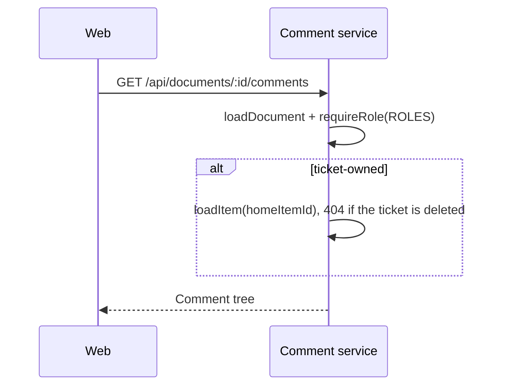

# 53: Comments on documents

Status: In Review

## Scope

The second half of the comment work the user asked for on 2026-10-16. It puts
[plan 52](52-ticket-comments.md)'s thread on every document page: all kinds (brief,
proposal, spec, ADR, tech debt, SLO, SLA, reference), Knowledge and ticket-owned. It
reuses plan 52's table, rules, edit and delete endpoints and web components; no
migration.

Same user choices as plan 52: web only, no notifications, delete by the author or an
Owner or Manager. Plan 52 must be done first.

Left out: everything plan 52 leaves out, and comments on archived or superseded
documents behave like any other (still readable and commentable).

## Done when

- [x] `GET` and `POST /api/documents/:id/comments` list and add comments and replies through plan 52's rules; any project member may comment, and a reply's parent must be on the same document.
- [x] `DocumentView` shows `CommentSection` at the end of the article for every document kind, Knowledge and ticket-owned, with the Author badge on the document author's comments.
- [x] A document whose home ticket is deleted answers `not_found` for its comments, as its page already does.
- [x] The seed adds a Knowledge document and a ticket-owned spec with threads, titled with what to try and what should happen; API tests cover listing, replying across documents (refused) and the deleted home ticket.

## Design

See [ADR-0021](../adr/0021-one-comment-table.md), Proposed.

| Function / component    | File                                                  | What                                                                                                                                                        | Why                                                                                             |
| ----------------------- | ----------------------------------------------------- | ----------------------------------------------------------------------------------------------------------------------------------------------------------- | ----------------------------------------------------------------------------------------------- |
| `listDocumentComments`  | `apps/api/src/modules/comments/comment.service.ts`    | Loads the document with `loadDocument`, `requireRole(projectId, userId, ROLES)`; for a ticket-owned one also `loadItem(homeItemId)`; then returns the tree. | Same access as `getDocument` in `document.service.ts`, so a deleted home ticket hides comments. |
| `createDocumentComment` | `comment.service.ts`                                  | Same load, `commentError`, parent on the same document, insert with `documentId`.                                                                           | Reuses plan 52's rule.                                                                          |
| `toCommentTree`         | `comment.utils.ts`                                    | `isTargetAuthor` is the document's `authorId`.                                                                                                              | Badge follows the target.                                                                       |
| Routes                  | `comment.routes.ts`                                   | `GET`/`POST /api/documents/:id/comments` with `describe()`.                                                                                                 | Edit and delete stay on `/api/comments/:id` from plan 52.                                       |
| `DocumentView`          | `apps/web/src/components/documents/document-view.tsx` | Renders `<CommentSection target={{ kind: 'document', id }} />` after `CreatedBy`.                                                                           | `CommentSection` already supports documents.                                                    |

## Changes

Commit `91c65dd` (feat(comments): threaded comments on tickets and documents) on `feat/comments`, together with plan 52.

API (`apps/api/src/modules/comments/`):

- `GET`/`POST /api/documents/:id/comments` with `listDocumentComments` / `createDocumentComment`. Access
  goes through `loadDocument` + `requireRole(ROLES)`, plus `loadItem(homeItemId)` for a ticket-owned
  document, as `getDocument` does. A reply's parent must have `documentId` equal to the document, else
  `not_found`. `isTargetAuthor` is the document's `authorId`.
- `findComments` takes `{ itemId } | { documentId }`; `insertComment` takes either target;
  `findLiveComment` also returns the document's `authorId` and its home ticket's `deletedAt`.
- `loadComment` (edit and delete) now also answers `not_found` when the document's home ticket is
  deleted, and the edit response's `isTargetAuthor` uses the document author.
- No migration: the table and CHECK come from plan 52.
- Tests in `test/comments.e2e-spec.ts` (3 added): document thread and shared edit/delete, a reply across
  documents or from a ticket comment refused, and a deleted home ticket hiding list, add, edit and delete.
- Seed: `seedDocumentComments` adds a Knowledge reference and a ticket-owned spec, each with a thread.

Web: `CommentSection` takes `target: { kind: 'item' | 'document'; id }`. It calls both list hooks with
`enabled` set so only the matching one fetches, and picks the create mutation by kind.
`DocumentView` renders it after `CreatedBy`.

Planned vs actual: no deviations. Not checked in a browser.
