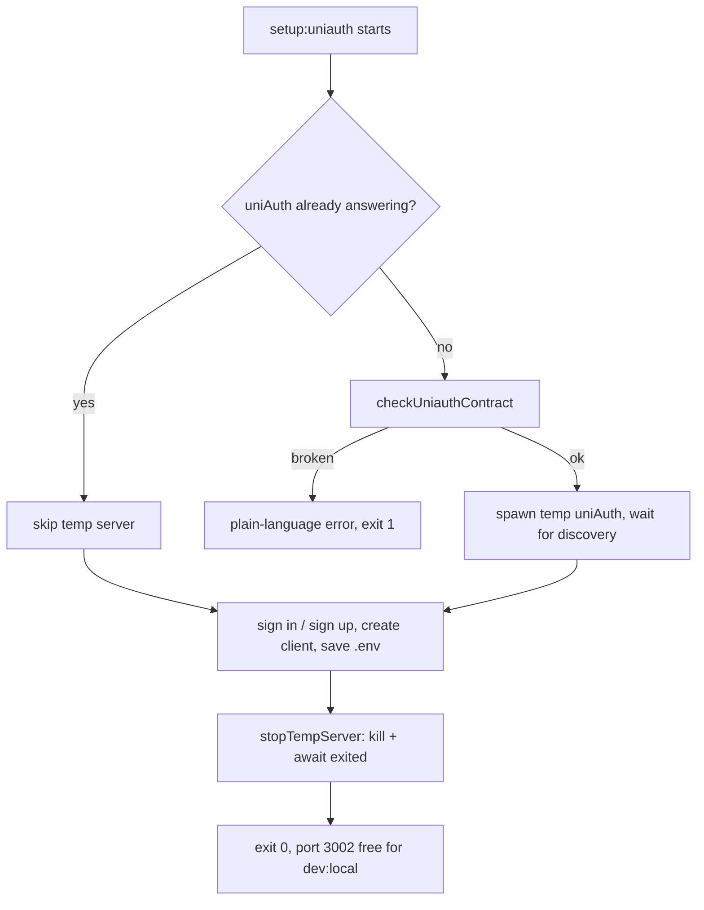

# 55: Setup review fixes

Status: In Review

## Phases

- **Phase 1 — Docs and decisions** (no logic changes): SETUP heading,
  anchor regression test, AGENTS.md wording, ADR-0021, delete snippet dumps.
- **Phase 2 — Script logic, TDD**: `setup:uniauth` temp-server wait +
  preflight, `wait-for-ready` exit code, kept tests, `test:scripts` wiring.
- **Phase 3 — DX polish and ship**: `kill-port` devDependency, SETUP
  additions, full checks, PR checklist, push/review.

## Scope

Fixes the 6 findings from the PR #60 review (`docs/local-setup`), test-first
(TDD): a failing regression test is written before each code fix. Covers the
README's broken anchor, the orphaned temp uniAuth server, the AGENTS.md
database contradiction, friendly errors for the uniAuth coupling, the
wait-for-ready exit code, and the small DX gaps. Refreshing the branch to
`origin/dev` is done; deleting the two untracked snippet dumps is included
(they are referenced nowhere and describe the Pages router; the project uses
the App Router).

Out of scope: changing `bun run dev`, team `.env.example` values, or the
uniAuth repo itself.

## Done when

- [x] Every `SETUP.md#anchor` link in README resolves to a real SETUP.md
      heading, guarded by a kept test
- [x] `bun run setup:uniauth` never leaves a temp uniAuth running, and a
      broken uniAuth coupling fails with a plain-language error; both guarded
      by kept tests
- [x] `wait-for-ready.mjs` exits non-zero when the web app never answers,
      guarded by a kept test
- [x] Root `AGENTS.md` says team day-to-day uses Oracle while fresh setup
      follows `SETUP.md`
- [x] `bun run stop` works from a clean install, and SETUP states which
      processes keep running plus how to find non-Docker port conflicts
- [x] ADR-0021 (Proposed) records the loopback/port/local-first decisions;
      `bun run lint`, `typecheck`, `test`, `build` pass; PR checklist ticked

## Design

| Function                            | File                                                         | What                                                                                                                                         | Why                                                                                                                                                           |
| ----------------------------------- | ------------------------------------------------------------ | -------------------------------------------------------------------------------------------------------------------------------------------- | ------------------------------------------------------------------------------------------------------------------------------------------------------------- |
| (none — docs edit)                  | `README.md:66`                                               | keep link target                                                                                                                             | link must resolve; adding the heading fulfills the "explains each one" promise better than retargeting                                                        |
| `## Why some URLs say 127.0.0.1`    | `SETUP.md`                                                   | new heading over the existing address paragraph                                                                                              | gives the README link a target; no prose rewrite needed                                                                                                       |
| `anchorsResolve()`                  | `scripts/docs-anchors.test.mjs` (new)                        | parse `#slugs` from README/SETUP links, compare against GitHub-slugged headings                                                              | fails now (missing slug), passes after the heading; permanent regression guard                                                                                |
| `stopTempServer(proc)`              | `scripts/setup-uniauth.mjs`                                  | `proc.kill()` then `await proc.exited`                                                                                                       | today's `kill()` + immediate `process.exit()` orphans the server (reproduced: `trap '' TERM; sleep` survives); awaiting frees port 3002 before step 7         |
| `checkUniauthContract(dir)`         | `scripts/setup-uniauth.mjs`                                  | assert `../uniAuth` layout: `apps/server/src/index.ts`, `scripts/create-client.ts`, `db:migrate` + `dev` scripts in its `package.json` files | all exist today (verified against the real repo) so this is purely defensive: a rename surfaces as one plain sentence instead of a cryptic `cd`/spawn failure |
| `main()` + `import.meta.main` guard | `scripts/setup-uniauth.mjs`                                  | wrap existing top-level flow so helpers are importable                                                                                       | tests must import without side effects; `bun scripts/setup-uniauth.mjs` behavior unchanged                                                                    |
| `waitForReady(fetch, budget)`       | `scripts/wait-for-ready.mjs`                                 | return exit code; `process.exit(code)` only under `import.meta.main`; timeout path returns 1                                                 | `concurrently --kill-others-on-fail` only reacts to non-zero exits, so today's silent `0` leaves a broken session idling                                      |
| (none — docs edit)                  | `AGENTS.md`                                                  | qualify the database bullet: team day-to-day = Oracle over Tailscale; fresh setup = `SETUP.md` local DB                                      | ends the contradiction with the PR for human and agent readers                                                                                                |
| `kill-port` devDependency           | `package.json`                                               | add `kill-port`, `stop` becomes `bunx --bun kill-port …` or plain `kill-port`                                                                | `stop` must work on a clean offline install, not download on first use                                                                                        |
| (none — docs edits)                 | `SETUP.md`                                                   | "stop leaves the databases running" line; `lsof`/`ss` port-conflict row; restart-`dev:local` note in step 6's success path                   | each answers a question the current text leaves open at the exact moment it arises                                                                            |
| ADR-0021                            | `docs/adr/0021-local-setup-loopback.md` (new)                | Context/Options/Decision/Consequences for 127.0.0.1-vs-localhost, the port map, local-first setup                                            | choice outlives the slice; repo rules ask for a Proposed ADR                                                                                                  |
| (none — deletions)                  | `docs/javascript-snippets.md`, `docs/typescript-snippets.md` | delete                                                                                                                                       | untracked, referenced nowhere, Pages-router era                                                                                                               |

TDD order per fix: write the `*.test.mjs`, run `bun test scripts/` to see it
fail, implement, re-run to green. `test:scripts` script + chaining into root
`test` wires the guards into CI's unit-tests job (no new dependencies;
`bun:test` is built in).

## Changes

Phase 3 checks, all local, 2026-10-16: `bun run lint` pass; `typecheck` pass
after `db:generate` + `api:generate` — the merged dev tip had left generated
artifacts stale, no code bug; `bun run test` pass including the 8 new script
tests; `bun run build` pass.

Planned vs actual: as planned, in three phases. One test assertion corrected
mid-TDD (`exitCode` stays null on signal kills in Bun; assert on the pid being
gone instead). `drizzle-kit migrate` verified non-interactive, so the
preflight is defensive-only.
