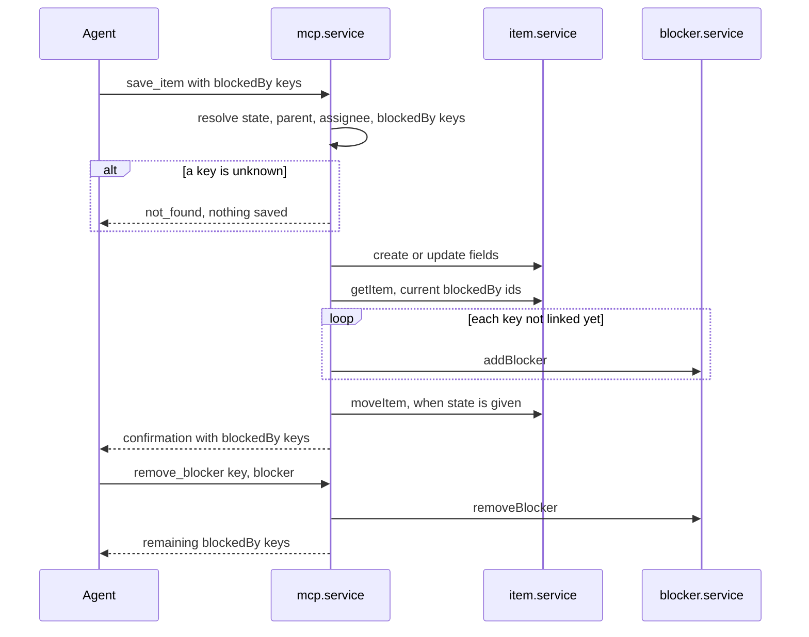

# 56: Blocked-by over MCP

Status: In Review

## Scope

Agents can add the items an item waits on through the existing `save_item` tool, remove
one with a new `remove_blocker` tool, and read them as keys in `get_item`. Today the
website and REST API can add and remove blockers, but MCP only shows them, as ids.

- `save_item` takes an optional `blockedBy`: a list of item keys (`["CC-3", "CC-4"]`).
  - Left out → the item's blockers are not touched.
  - Given → each key is added as a blocker. Existing blockers stay. A key that is
    already a blocker is skipped, so repeating a call is harmless.
  - Works on create and on update.
- New tool `remove_blocker { key, blocker }`: `key` stops waiting on `blocker`. Removing a
  link that doesn't exist is harmless. It answers the item's remaining `blockedBy`.
- Both go through the existing `addBlocker` / `removeBlocker` services, so MCP follows the
  website's rules: `self_block`, `invalid_blocker` (other project), `blocking_cycle`, and
  `forbidden` for a Member on a ticket that isn't theirs.
- `get_item`, the `save_item` confirmation and `remove_blocker` show `blockedBy` as keys.
- The `uniloom` skill (`skill/SKILL.md`, `skill/FEATURES.md`) tells agents to set
  `blockedBy` when they create slices that wait on each other, and lists
  `remove_blocker`.

Out of scope:

- Blockers still do not gate moves (In Progress, In Review and Done ignore them).
- No `add_blocker` tool: `save_item` with `blockedBy` does it.
- No activity-log entry for blocker changes: the website doesn't record them either.

## Done when

- [x] `save_item` with `blockedBy` on create or update adds those keys as blockers and
      keeps existing ones; keys already linked are skipped; without `blockedBy` nothing
      changes
- [x] `remove_blocker` removes one link and answers the remaining `blockedBy`; a link
      that doesn't exist is not an error
- [x] An unknown item or blocker key answers `not_found` and saves nothing
- [x] A blocker the website would refuse (`self_block`, `invalid_blocker`,
      `blocking_cycle`, Member's `forbidden`) answers the same code; after a create or
      an edit, the message says what was already saved
- [x] `get_item`, the `save_item` confirmation and `remove_blocker` list `blockedBy` as
      keys, not ids
- [x] The tool descriptions and the `uniloom` skill explain that `blockedBy` adds and
      `remove_blocker` removes

## Design

| Function                                  | File                                            | What                                                                                                             | Why                                                                                                  |
| ----------------------------------------- | ----------------------------------------------- | ---------------------------------------------------------------------------------------------------------------- | ---------------------------------------------------------------------------------------------------- |
| `saveItemSchema.blockedBy`                | `apps/api/src/modules/mcp/mcp.schema.ts`        | Optional array of item keys; its description says it adds and never removes                                      | The field agents send; optional so existing calls don't change                                       |
| `removeBlockerSchema`                     | `apps/api/src/modules/mcp/mcp.schema.ts`        | `{ key, blocker }`, both item keys                                                                               | Input of the new tool                                                                                |
| `saveItem(agent, input)`                  | `apps/api/src/modules/mcp/mcp.service.ts`       | Resolves the `blockedBy` keys before saving anything; after the fields, adds each key not linked yet; then moves | Unknown keys fail before any write; blockers saved before the move so a failed move still keeps them |
| `removeBlocker(agent, key, blocker)`      | `apps/api/src/modules/mcp/mcp.service.ts`       | Resolves both keys, calls the blocker service's `removeBlocker`, answers the remaining `blockedBy` as keys       | Lets an agent undo one link without reading and resending a list                                     |
| `findItemKeys(ids)`                       | `apps/api/src/modules/mcp/mcp.repository.ts`    | Keys (`CC-3`) for a list of item ids, in one query                                                               | Every answer must show keys, never ids (MCP instructions: "use keys in every tool")                  |
| `getItem(userId, key)`                    | `apps/api/src/modules/mcp/mcp.service.ts`       | Replaces the `blockedBy` ids with keys from `findItemKeys`                                                       | Agents can read back what they set                                                                   |
| `save_item`, `remove_blocker` tools       | `apps/api/src/modules/mcp/mcp.server.ts`        | One sentence on `blockedBy` in `save_item`'s description; registers `remove_blocker`                             | The description is what the agent reads before calling                                               |
| `addBlocker`, `removeBlocker` (unchanged) | `apps/api/src/modules/items/blocker.service.ts` | Existing rules, locks and cycle check                                                                            | One place for blocker rules, shared by the website and MCP                                           |

Notes:

- A refused blocker after a create or an edit answers like a failed move does today:
  `CC-5 was created, but CC-3 was not added as a blocker: <reason>`. The agent then
  doesn't create the item twice.
- Keys already linked are skipped before calling `addBlocker`, so a repeated `save_item`
  doesn't answer `already_blocked`.
- Tests: extend `test/mcp-write.e2e-spec.ts` with a `blockedBy` block, one test per
  done-when item.

## Changes

Commits:

- `cb629c4` feat(api): add and remove blockers over MCP
- `f05c030` docs(skill): add the uniloom agent skill

Built as planned:

- `mcp.schema.ts`: `saveItemSchema.blockedBy` and `removeBlockerSchema`.
- `mcp.repository.ts`: `findItemKeys(ids)`, one query.
- `mcp.service.ts`: `saveItem` resolves every `blockedBy` key before any write (unknown key:
  `not_found`, nothing saved), adds the keys not linked yet after the create or edit and
  before the move; a refused blocker answers its own code with
  `<saved>, but <KEY> was not added as a blocker: <reason>`. New `removeBlocker`. `getItem`, the `save_item`
  confirmation and `remove_blocker` answer `blockedBy` as keys. Two private helpers:
  `findKeys` (ids to keys) and `readRefusal` (reads a refused call's code and message; the
  failed-move handling now uses it too).
- `mcp.server.ts`: `blockedBy` sentence in `save_item`, `remove_blocker` registered.
- `skill/SKILL.md`, `skill/FEATURES.md`: tools table, step 3 and ordering mention `blockedBy`
  and `remove_blocker`.
- Tests: `blockedBy` block in `test/mcp-write.e2e-spec.ts` (one per done-when item);
  `remove_blocker` added to the tool list in `test/mcp.e2e-spec.ts`.

Deviations: none from the design.

Fixes after the independent review (all minor):

- Two spellings of one key (`CC-3`, `CC-03`) are now one blocker: duplicates are removed
  by item id, not by text, so the second no longer answers `already_blocked`.
- Each added blocker is now part of the "what was saved" message, so a refused later
  blocker or a refused move says which blockers were already added, even when no other
  field was saved.
- `remove_blocker` added to the website's agent guide (`guide-agent-step.tsx`), and one
  sentence on `blockedBy` / `remove_blocker` added to the MCP server instructions.
- New tests: two spellings of one key, blockers kept when the move after them is refused,
  and a Member's `forbidden` on `remove_blocker`.
