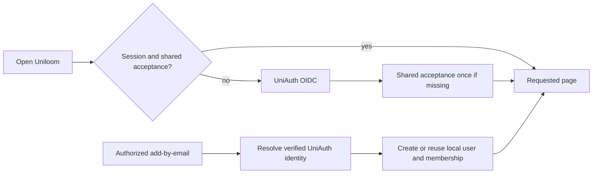

# 57: Shared Unicorp acceptance

Status: In Review

## Scope

The user authorized implementation of the shared-account plan on 2026-10-21.
Consume UniAuth's recorded acceptance and reuse OIDC for first visits and old
sessions. Keep add-by-email independent of an invitee's first visit or terms.
See Proposed ADR-0024 and UniAuth's `docs/plans/unicorp-account-experience.md`.

## Done when

- [x] Validated OIDC profiles persist the shared policy version and original acceptance timestamp; request input cannot supply them.
- [x] The API requires current shared acceptance, preserving app-only consent history without treating it as shared evidence.
- [x] Missing shared evidence takes a user through UniAuth; current acceptance opens the requested page without another terms prompt.
- [x] A verified UniAuth user can be added before first sign-in, and concurrent sign-in/provisioning retain one local identity.
- [x] Tests, generated API contracts and seed scenarios cover shared acceptance and the invite-before-first-visit journey.

## Design

| Function                        | File                                | What and why                                                                                       |
| ------------------------------- | ----------------------------------- | -------------------------------------------------------------------------------------------------- |
| `sharedTerms`                   | `apps/api/src/auth/shared-terms.ts` | Parse UniAuth's current namespaced claim; missing or malformed evidence stays unaccepted.          |
| `auth`                          | `apps/api/src/auth/auth.ts`         | Map verified claims into server-controlled local fields on sign-in.                                |
| `requireConsent`                | `apps/api/src/auth/middleware.ts`   | Enforce current shared evidence rather than app-only acceptance.                                   |
| `giveConsent`                   | Users service                       | Retain the endpoint as a read of existing shared acceptance; never manufacture acceptance locally. |
| `AuthBootstrap` / `Consent`     | Web auth components                 | Reuse OIDC for missing acceptance; keep safe return URLs and prevent redirect loops.               |
| `addMember` / `ensureLocalUser` | Existing membership/UniAuth modules | Keep directory resolution and provisioning independent of invitee consent.                         |

## Changes

Implementation is ready for user review; publication was subsequently authorized by the user on 2026-10-21. Proposed
ADR-0024 remains proposed. No dependencies or environment variables were added.
The additive migration preserves historical consent and adds two nullable fields.

Planned vs actual: Better Auth filters read-only profile fields, so trusted evidence
is explicitly persisted after linked identity resolution. The old compatibility
endpoint confirms existing evidence without creating acceptance. Sidebar queries
and MCP authorization now use the same current shared record as REST. Replaced a
fragile wall-clock race assertion with a unit assertion proving one insert and one
winner read, retaining database race coverage. Existing seeds include named cases.

Proof for the five done-when items, in order:

1. Profile parser and forged update tests; trusted sign-in integration tests.
2. Old app-only consent and missing shared evidence integration tests; MCP checks.
3. API/web typecheck and lint; UniAuth browser continuation and repeat silent flow.
4. Directory provisioning, first-visit and concurrent linking integration tests.
5. 147 unit tests and 55 targeted app/directory/identity integration cases passed
   across relevant runs; generated OpenAPI/types and seed scenarios updated.
   Eight additional focused MCP integration checks passed, covering discovery,
   authentication, missing-acceptance denial, tool listing and project listing.

The full live Unishare-to-Uniloom browser journey awaits staging rollout; individual
central browser flows and consumer API behavior were exercised separately.
No independent reviewer was run. No real account or membership was changed.
