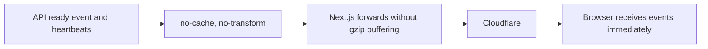

# 58: Notification stream compression

Status: In Review

## Scope

The user authorized the diagnosed notification-stream fix on 2026-10-28.
Keep the existing authentication, events, and heartbeat interval. Prevent proxy
compression from buffering the SSE response. Check Unishare for the same issue.

## Done when

- [x] Loom's notification stream disallows response transformations so Next.js forwards events immediately.
- [x] The stream integration test covers the no-transform response contract and still receives the initial ready event.
- [x] Relevant checks pass and the deployed Unishare route's compression protection is inspected.

## Design

`getNotificationStream` in `apps/api/src/modules/notifications/notification.handlers.ts`
will send `Cache-Control: no-cache, no-transform`. Next.js's existing compression
middleware respects that directive, preserving the streaming response without
disabling compression for ordinary pages. Extend `openStream` in the existing
notification integration test to check the response contract.

## Changes

The header is set on the response returned by `streamSSE`. Planned vs actual:
the integration test demonstrated that Hono replaces a header configured before
the helper runs, so the directive must be set afterward. No new dependencies,
routes, migrations, or authentication changes.

The user authorized committing and opening PRs on 2026-10-28. The implementation
and regression check are grouped in the notification-stream compression fix;
deployment remains pending review and the normal release flow.

Checks: API typecheck, lint, build, three notification unit tests, and the two
targeted notification integration tests passed. The worker-claim and connection
count integration tests were intentionally not run; this patch changes response
headers only. The regression assertion first failed against the preliminary
header placement and passed after setting the returned response's header.

Deployed Unishare already sets no-transform on its web stream response. A separate
runtime API_URL issue was reproduced there and is prepared in the infrastructure
repository. No source changes were made to Unishare.
