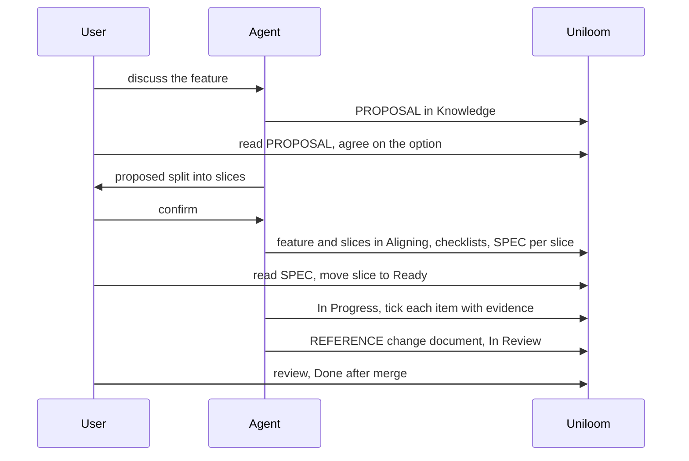

# Uniloom

Uniloom is a tracker where work is planned before it is built. Its tools are
`mcp__uniloom__*`; if they are deferred, load the ones you need with ToolSearch in one
call. If they are missing, stop and tell the user. Never fall back to plan or doc files in
the repository.

The server's own instructions hold the rules (states, checklist limits, `people_only`,
document kinds) and always apply. This skill is the workflow. The project's `AGENTS.md`
names the project's key prefix and any personal rules; those win over this skill.

## Before anything

1. `list_projects`: find the project by the key prefix in `AGENTS.md`. Note its mode and its
   `checklistMin` / `checklistMax`.
2. `list_items` (filter by state or parent) and `get_item` for the work at hand.
3. `list_documents` with `kind: "ADR"`, then `get_document` for any that touch the work.
   New work follows accepted ADRs instead of re-arguing them.

Use keys everywhere (`TG-12`), never ids. Documents are the exception: they are named by
id. People are `"me"`, `"none"` or a member's email.

## Tools

| Need                 | Tool                                                            |
| -------------------- | --------------------------------------------------------------- |
| Projects             | `list_projects`                                                 |
| Find and read items  | `list_items`, `get_item` (its `related` lists ticket documents) |
| Create, update, move | `save_item` (no key = create; `state` = a state name)           |
| Blocked by           | `save_item` with `blockedBy` (adds), `remove_blocker`           |
| Delete               | `delete_item` (owners and managers; not with children)          |
| Done-when checklist  | `set_criteria`, `get_criteria`, `check_criterion`               |
| States and labels    | `list_states`, `list_labels`                                    |
| Documents            | `save_document`, `get_document`, `list_documents`               |
| Knowledge links      | `link_document`, `unlink_document`                              |

There is no tool to approve a design, accept an ADR, or move to Ready or Done. People do
that on the website. There are no comment or commit-link tools yet: record commits as
checklist evidence and in the change document. Pull requests link through the GitHub App,
by the ticket key (see [Branches and pull requests](#branches-and-pull-requests)).

## Branches and pull requests

When the project's repository is connected to Uniloom's GitHub App, a pull request links
to a ticket by its key (`TG-12`, any letter case). Without the key, nothing links.

- **Branch**: `<type>/<KEY>-<short-desc>` with the **slice** key, such as
  `feat/TG-12-send-message`. Also put the key in the PR title when the repo's title rules
  allow it.
- **Title or branch** with a key: the PR **closes** that ticket.
- **Description**: `Closes TG-13`, `Fixes TG-13` or `Resolves TG-13` closes a ticket. A
  bare `TG-13` only links it, to show the PR on that ticket. GitHub's `Closes #12` does
  nothing in Uniloom.
- **One PR, several slices**: name the branch after one of them, or after none, and write
  `Closes <KEY>` once per slice in the description.
- **Never close the feature from a PR.** Keep its key out of the branch and title (they
  close it) and name it bare, as `Part of TG-10`. A feature finishes with its slices.
- **Dependencies** are `blockedBy` in Uniloom, not PR keys. Don't write `Closes` for a
  ticket this PR doesn't finish.
- **Merge into `dev` or `main`.** Other base branches don't count as finished.

A PR for slices TG-12 and TG-13 of feature TG-10, on branch `feat/TG-12-send-message`:

```markdown
Closes TG-12
Closes TG-13

Part of TG-10
```

When the project has "Move to Done when merged" on, the merge moves a closing ticket to
Done only when the ticket is **already In Review**, its checks pass, its checklist is
complete, nothing blocks it and its other closing PRs are merged or closed. So move the
slice to In Review (step 9) before the PR is merged. If a merge does not move it, the
project's activity shows why.

## Guided workflow



Each level has its own document:

| Level     | Document                          | It answers                                       |
| --------- | --------------------------------- | ------------------------------------------------ |
| Feature   | one `PROPOSAL`, in Knowledge      | What to do, which option and why                 |
| Slice     | one `SPEC`, created from it       | How this piece is built                          |
| Functions | rows in the SPEC's function table | What each does and which done-when item needs it |

A function never gets its own document.

1. **Discuss** the feature with the user until the scope is clear. Read the code it
   touches first.
2. **Write the proposal first.** Before any SPEC, write a `PROPOSAL` document in Knowledge
   (`save_document` without `ticket`): Summary, Motivation, Options, Recommendation, Open
   questions. It is where the options are weighed, so the SPEC only describes how the
   chosen one is built. Give the user its URL and wait until they agree on the option.
   Only Owners and Managers write Knowledge documents: on `forbidden`, tell the user. A
   one-slice change with a single obvious option may skip it if the user says so.
3. **Propose the feature** (see [FEATURES.md](FEATURES.md)): its title, whether and how
   it splits into small slices (one behaviour and at most one new piece of
   infrastructure each), each slice's title, its 3 to 6 done-when items (one behaviour
   each), and which slices
   wait on which. Confirm with the user before creating anything.
4. **Create** the feature, then each slice with `parent` set to the feature, all in
   `Aligning`, `assignee: "me"`. Give each slice its checklist with `set_criteria`. When a
   slice waits on another, create the other first and set `blockedBy` to its key.
   `blockedBy` only adds; `remove_blocker` removes one. Blockers do not gate moves.
5. **Design** each slice as a `SPEC` document created from it (`save_document` with
   `ticket`), with `sourceProposalId` set to the proposal's id. Follow
   [DESIGN.md](DESIGN.md). A choice that outlives the slice gets an
   `ADR` (also with `ticket`); it starts Proposed and the user accepts it.
6. **Wait.** Tell the user the slices and SPECs are ready to read, with their URLs. Do not
   write code until the user moves the slice to Ready. Re-read it with `get_item` before
   starting. If a SPEC changes after Ready, tell the user: they review it again.
7. **Build**: `save_item` with `state: "In Progress"`, on a branch named with the key
   (see [Branches and pull requests](#branches-and-pull-requests)). Tick each item with
   `check_criterion` **the moment it is met**, with evidence: the test that proves it and
   the commit SHA. A dropped session then leaves real progress recorded. There is no
   un-tick tool, and `set_criteria` resets every tick: if a ticked item stops being true,
   tell the user instead of rewriting the checklist.

   **Keep Uniloom in step with the code.** Whenever the code moves away from the SPEC
   during the build (the user asks for a change, a review fix, a refactor, a rename or a
   moved file), update Uniloom in the same turn, before reporting back:
   1. the SPEC (`save_document` with its id): function tables, file names, edge cases,
      acceptance and diagrams, so it describes the code as it is now;
   2. the ticket's Changes section (`save_item` description): one line per change,
      planned vs actual;
   3. if a ticked done-when item is no longer true, tell the user (there is no un-tick).

   The slice was already Ready, so tell the user the SPEC changed and give its URL, so
   they review it again.

8. **Blocked**: if you cannot finish without the user, `save_item` with
   `state: "Blocked"` and add the reason at the end of the description. Then tell them.
9. **Finish**:
   1. `get_criteria`: every item ticked. If not, the slice does not move.
   2. `save_document` with `ticket`, kind `REFERENCE`: what changed and how. Sections:
      Overview, Details (planned vs actual: functions from the SPEC that were built,
      changed or dropped, and anything extra), Links (commits, branch, PR). Add a Mermaid
      diagram for backend flows.
   3. `save_item` with `state: "In Review"`. Stop there. Done is for people, after merge,
      or for the GitHub App when the PR merges.
10. **Tech debt**: a shortcut taken or a problem not fixed now becomes a `TECH_DEBT`
    document created from the ticket where it was found (What, Why it matters, Suggested
    fix). Mention it in your summary.

## SLO and SLA

Both are project Knowledge documents, in Guided and Standard mode. Only Owners and
Managers write them, they never belong to a ticket and they have no workflow status.

- **SLO** (`kind: "SLO"`): write one when a feature adds or changes a service or user
  journey that should keep a measurable target, such as 99.5% of message sends succeed
  within 1 s over 30 days. One SLO per service or journey.
- **SLA** (`kind: "SLA"`): write one when the team promises something to someone outside
  it (a customer, another team), with remedies if the promise is missed. Link its
  supporting SLOs by their website URLs under Supporting SLOs; an SLA does not need one.
- **Only when asked.** Suggest one in the feature proposal when it fits, but write it only
  when the user agrees. Targets, owners and remedies are the user's to set: leave a
  placeholder rather than invent a number.
- Use the sections `save_document` lists for the kind. Saving an SLA records no
  acceptance; Agreement state stays draft until people agree on it.
- To relate one to a Guided ticket, `link_document` it; a SPEC can link an SLO it must
  meet.

## Standard mode

Tasks contain Subtasks, states come from `list_states`, and a checklist is optional and
any length. There are no ticket documents, ADRs or tech debt (`guided_only`). Use the
same order — confirm, create, build, tick — without the SPEC and the wait for Ready.

## Writing

- Item titles: plain words, what it does (`Send a message to a room`), not how.
- Descriptions are short: the goal in one or two sentences, then bullets. The SPEC holds
  the detail; don't repeat it in the description.
- Every Mermaid block follows [MERMAID.md](MERMAID.md).
- Bodies are Markdown, with the section headings the tool lists for that kind.

## Rule errors

Errors come back as `code: message`, such as `criteria_incomplete`,
`checklist_max_exceeded`, `people_only`, `forbidden`, `guided_only` or `not_found`.
Report them to the user. Do not retry the same call, and do not change the data (drop
checklist items, reassign, delete) to get past a rule.

## Project setup block

A project that uses this skill keeps a short block in its `AGENTS.md`. Replace
`<KEY_PREFIX>` with the project's key prefix from `list_projects`, and the mode if it
is Standard:

```markdown
## Tracking: Uniloom

Use the `uniloom` skill to track all work in the Uniloom project with key prefix
`<KEY_PREFIX>` (Guided). Do not write plans, specs, ADRs, tech debt or change notes as files in
this repository.

- Confirm the scope and the split before creating anything.
- Do not start code until I move the slice to Ready.
- Stop at In Review.
```
